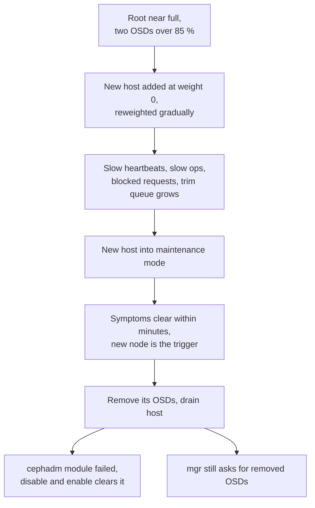
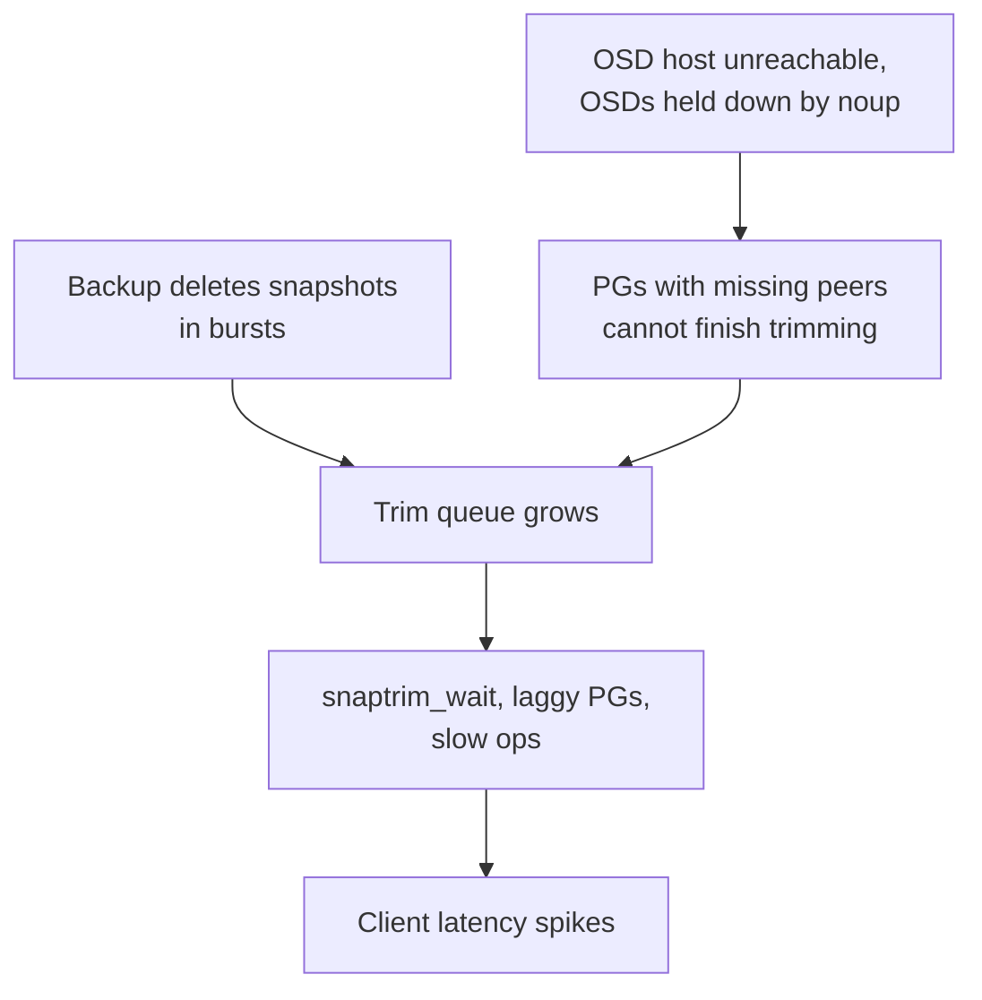
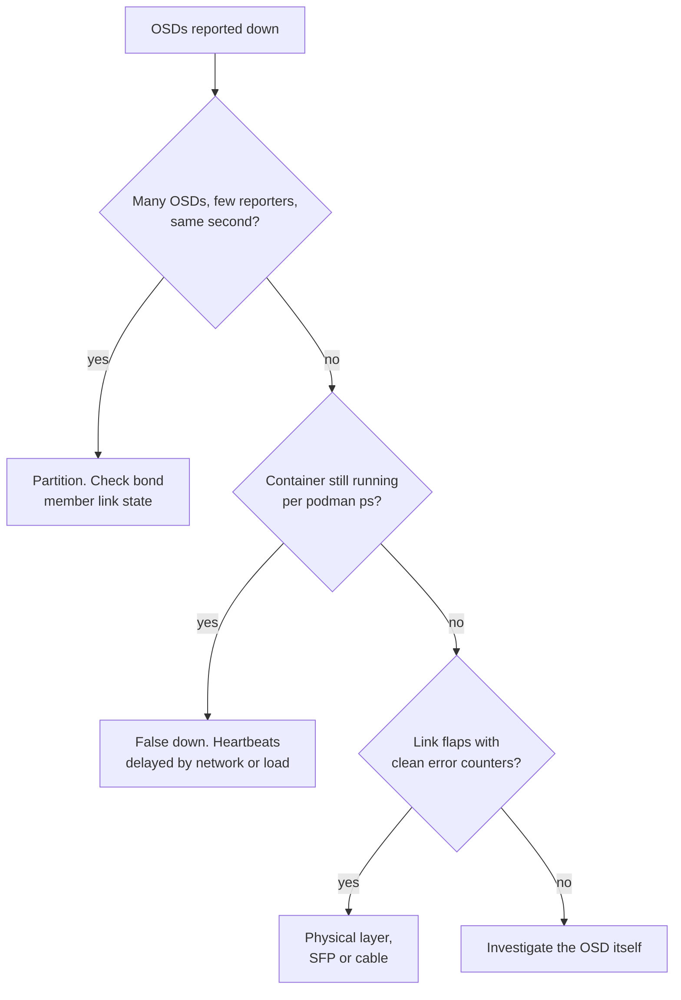
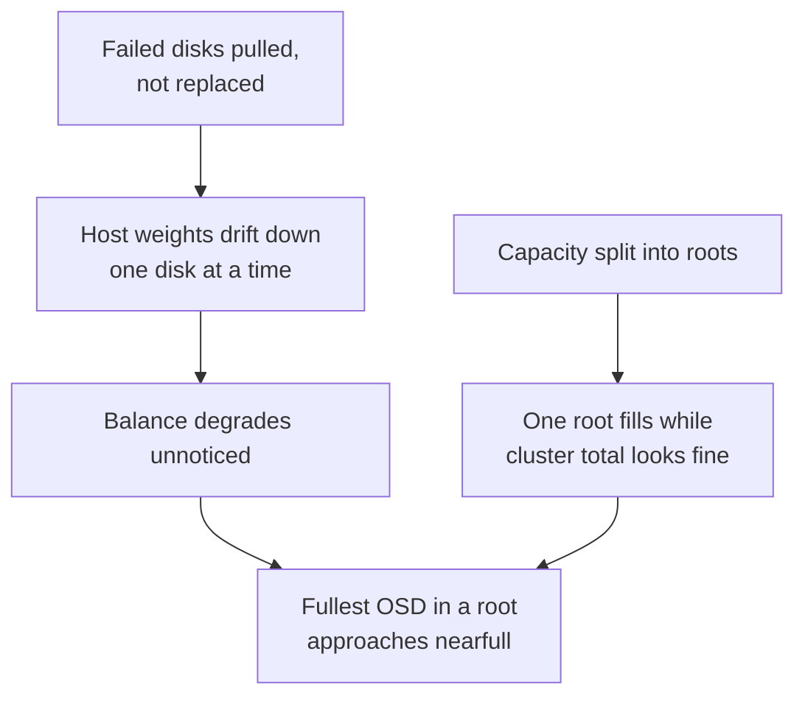

# Ceph: Hard Problems and Lessons

The problems that cost us the most time on our production Ceph fleet, and what each one taught us. Each section follows the same shape: context, problem, what we tried, what worked, and the lesson I took away.

> [!TIP]
> **Key takeaways**
> - Weight-0 staging plus gradual reweight is what made a failed expansion survivable. Qualify hardware before it joins a root, and expand long before nearfull.
> - Most "OSD failures" were the network, and most latency spikes had a cause outside Ceph's tuning knobs. Read the whole health output.
> - Usable capacity is set by the fullest OSD in each root, not by the cluster average.
> - Memory budgets must be per host and include recovery, the mgr and every agent.
> - The cluster tends to be more consistent than the people, configs and documents around it.

| # | Problem | Lesson in one line |
|---|---|---|
| 1 | Expanding a cluster that was already too full | Weight 0 made the rollback survivable. Don't let expansion become an emergency |
| 2 | Snapshot trimming versus client latency | Correlation, not tuning. The down host was the lead |
| 3 | The network is usually the root cause | Don't restart "failed" OSDs before checking the network |
| 4 | PG counts: too many, then too few OSDs | Never mute a check. Do the PG arithmetic before removals |
| 5 | Uneven fill and capacity islands | The fullest OSD in the root sets usable capacity |
| 6 | Disks fail, and the layers above them complicate it | Confirm the OSD-to-bay chain before anything destructive |
| 7 | Memory: OSDs, mgr, and agents | Budget per host, including everything |
| 8 | An orchestrator that depends on the outside world | A blind orchestrator means a change freeze |
| 9 | Drift and the human side | Write it down once, version it, audit on a schedule |

## 1. Expanding a cluster that was already too full

**Context.**

- Our largest SATA-SSD block cluster has close to a thousand OSDs across three CRUSH roots, each backing a 2-replica RBD pool.
- It was running at about 75 % raw used and serving several GiB/s of client I/O with no quiet window.
- One root's pool tripped the `nearfull` flag while the pool as a whole was in the low 70s percent: two individual OSDs had crossed 85 %.

**Problem.** We needed capacity in that specific root, under load, at a fill level where the cluster could not have absorbed a host failure gracefully.

**What we tried.** We added a new host the careful way:

1. Flags went on first (`noout`, `noup`, `norebalance`, `norecover`).
2. We added the host, created its OSDs and pinned all of them to CRUSH weight 0.
3. We moved the host into the target root.
4. We reweighted gradually with the backfill-gated script.

Shortly after the new OSDs started taking data, the cluster reported slow OSD heartbeats, slow ops, blocked requests and a fast-growing snapshot-trim queue.

**What worked.** We rolled back.

- Putting the new host into cephadm maintenance mode cleared the slow ops and trim warnings within minutes. That was strong evidence that the new node, and not the existing pressure, was the trigger.
- We then removed its OSDs completely and drained the host.
- The large orchestrator cleanup left the `cephadm` mgr module in a failed state, which a disable/enable of the module cleared.
- Later, the mgr log showed bursts of `Requested missing service osd.N` for exactly the OSD ID ranges we had removed. The mgr was still asking about OSDs that no longer existed.

**Lessons.**
- Bringing capacity in at weight 0 plus incremental reweight is the only reason the rollback was survivable. If we had added the host at full weight, it would have been a cluster-wide outage.
- Qualify new hardware *before* it joins a production root: firmware, NIC, disk health, and a burn-in. This node had to come straight back out.
- Fix imbalance before buying hardware. Two nearfull OSDs at 72 % pool usage is a balance signal first.
- Don't let a root reach the point where expansion is an emergency. By the time it is, every change carries more risk.
- After any big orchestrator operation, check `ceph health detail` for `Module 'cephadm' has failed` and for stale OSD references before calling the change done.

## 2. Snapshot trimming versus client latency

**Context.** The block clusters back VM volumes. A separate backup service takes daily RBD snapshots and deletes old ones. On the large SSD cluster the pools are snapshot-heavy (`selfmanaged_snaps`).

**Problem.** Clients reported latency spikes at specific times of day. In `ceph -s`:

- thousands of PGs sat in `snaptrim_wait`, some marked `+laggy`;
- `SLOW_OPS` were blocked for over ten minutes;
- `PG_SLOW_SNAP_TRIMMING` was raised for thousands of PGs;
- one capture showed the longest per-PG trim queue in the hundreds of thousands of entries, and it kept growing.

**What we tried.**

- We re-peered individual stuck PGs (`ceph pg repeer`). That is a diagnostic nudge, not a fix: re-peering doesn't add trim throughput.
- Ceph's own hint (lower `osd_snap_trim_sleep`, raise `osd_pg_max_concurrent_snap_trims`) pushes more background I/O onto OSDs that are already producing slow ops.

**What worked.** Correlation, not tuning. Two drivers turned up:

- **Backup bursts.** We matched the latency windows against process telemetry from the backup hosts. Many `rbd snap remove` processes were running at once, often several snapshot dates for the same volume. A *backlog* was being cleared in bursts.
- **A down host, the bigger driver.** The health output showed an OSD host unreachable, with its OSDs held down by `noup`. Trimming for PGs with missing peers can't finish.

The fixes, in order:

1. Restore the host.
2. Stagger snapshot deletion so it stays caught up daily.
3. Only then touch the trim throttles, one knob at a time.

**Lessons.**
- Snapshot deletion is deferred write load. A backup schedule that falls behind and catches up in bursts hurts more than a steady daily cadence.
- Read the *whole* health output. The trim queue was a symptom, and the down host was the lead.
- Watch the `snaptrim_wait` count as a metric, not just the health warning.

## 3. The network is usually the root cause

**Context.** Storage nodes use LACP bonds on 25 GbE. OSD heartbeats travel over both the public and the cluster network.

**Problem.** Three different-looking events turned out to be the network:
- Dozens of OSDs across several hosts went down at once. The monitor log showed a handful of reporters flagging many OSDs failed within the same second.
- One host's OSDs flapped intermittently for days.
- On the large SSD cluster, the monitor marked several OSDs down while they were still running. That produced hundreds of slow ops and one PG stuck `activating`, even though every OSD container had been up for years.

**What we tried.** The instinct is to restart or replace the "failed" OSDs. That would have been wrong every time.

**What worked.** We looked at the hosts' kernel logs.

| Event | What the evidence showed | Action |
|---|---|---|
| Mass OSDs down | Both bond members on a host dropped link (`NIC Link is Down`), taking that host's networks offline | Restore the link |
| One host flapping | One bond member flapped every few hours with *clean* CRC and length counters, pointing at the optics | Replaced the SFP and re-seated the cable under `noout` and host maintenance |
| OSDs marked down while running | "Down" OSDs were alive (`podman ps`), `dmesg` clean, false-downs clustered on four neighbouring hosts during heavy snaptrim load | No OSD action |

**Lessons.**
- `marked down, but it is still running` means failure detection is wrong, not the OSD. Alert on it as its own signal.
- Many OSDs reported failed by a few reporters in one second means a partition, not disk deaths.
- Flapping links with clean error counters are physical-layer faults.
- Bonds hide single-leg failures. Check that bond speed equals the sum of the legs, and alert on member link-down.

## 4. PG counts: too many, and then too few OSDs

**Context.** The large pools have the autoscaler off and fixed `pg_num`.

**Problem.** We hit two separate traps:

| Trap | What happened | What worked |
|---|---|---|
| Too many PGs, hidden | On a small NVMe cluster, `TOO_MANY_PGS` (over 300 PG replicas per OSD against the 250 limit) had been **muted**, so `ceph -s` said `HEALTH_OK`. One pool had been created with a `pg_num` sized for a much bigger cluster | Shrank the oversized pool's `pg_num` by 4×, which brought PGs per OSD to a comfortable level |
| Too few OSDs ahead | On another small cluster we needed to remove more than half the OSDs. At the existing `pg_num`, that would have pushed PGs per OSD well past the limit | Halved `pg_num` *before* draining anything and waited for the merge to finish |

Merges are gradual: `pgp_num` trails `pg_num` for a while.

> [!WARNING]
> Never mute a health check without a ticket and an expiry. A muted check is invisible to any alert that only reads the top-level status.

**Lessons.**
- Do the `pg_num × size ÷ OSDs` arithmetic before every removal, not after.
- PG merges move data across the whole pool and can't be undone cheaply. Size pools for the cluster you have, not for one you might have later.

## 5. Uneven fill and capacity islands

**Context.** Large clusters split capacity into several CRUSH roots, and hardware generations differ in per-host weight.

**Problem.**

- Cluster-wide utilisation looked comfortable while one root approached nearfull.
- In end-of-life clusters we had also adopted a policy of pulling failed disks without replacing them. Host weights drifted downward one disk at a time, and balance degraded without anyone noticing.

**What worked.**

- Monitoring `MAX AVAIL` per pool and `%USE` spread per root instead of the cluster total.
- Treating balance as a capacity tool: every point of skew we remove is capacity we already paid for.

**Lesson.** Usable capacity is set by the fullest OSD in the root, not by the average. Any policy that lets weights drift needs a balance check attached to it.

## 6. Disks fail, and the layers above them complicate it

**Context.** Several thousand devices across several hardware generations. Disk failure is the most common fault we handle. Some days bring vendor hardware alerts for several chassis at once.

**Problem.** The failure surfaces in different places:

- vendor alert mail;
- kernel `critical medium error`;
- a failed logical drive on the RAID controller;
- an NVMe SMART warning;
- a scrub error on a PG.

Each layer adds indirection:
- On RAID-0-per-disk hosts, the OSD sits on LVM, on a device-mapper node, on a logical drive, on a physical bay.
- On split NVMe hosts, one device carries four OSDs.
- One NVMe failure turned out to be a power-loss-protection capacitor fault (`critical_warning: 0x10`), with zero media errors.

**What worked.** A strict mapping discipline. That chain is confirmed before anything destructive is run:

OSD → `block` symlink → LV → kernel device → controller logical drive → bay

The bay is blinked for the datacenter team, and the replacement is requested by chassis serial and bay.

**Lessons.**

- Know your OSD-to-device ratio before draining.
- Track failures per host and per controller slot, not only per disk.
- Always record which logical drive number you are about to delete, because the controller CLI doesn't ask twice.

## 7. Memory: OSDs, mgr, and the agents around them

**Problem.** Three separate memory events:

| Where | What happened |
|---|---|
| Storage node with 22 SSD OSDs and 192 GB of RAM | A `ceph-osd` was OOM-killed. The kill report showed a dozen OSDs at roughly 17–19 GiB resident each, far above the default `osd_memory_target`. The same event watchdog-killed `journald` and corrupted its journal |
| Active mgr on the big object cluster | Pegged its host's memory for several minutes. The dashboard returned 503s and the monitor on that host complained about lease expiry |
| Another node | A hardware LED monitoring daemon was using about 30 % of host memory |

**What worked.**

- **OSDs:** we sized `osd_memory_target × OSDs per host` against real RAM with headroom, and re-checked `vm.min_free_kbytes`, which had been sized for far fewer OSDs than the host actually ran.
- **mgr:** fail over to a standby, enable the mgr TTL cache, limit per-image RBD stats to the pools that need them, and always keep at least two mgr standbys so failover is free.

**Lesson.** Memory budgets have to be per host and include everything: OSDs during recovery (not at idle), the mgr under scrape load, and every monitoring or logging agent we install.

## 8. An orchestrator that depends on the outside world

**Problem.** cephadm needs SSH to every host and a reachable registry, and our nodes have no direct egress. We have seen:

- `ceph orch ps` report `No daemons reported` because a pre-flight image pull failed on DNS, even though the image was already present locally;
- `CEPHADM_REFRESH_FAILED` when SSH to a single host broke.

**What worked.**

- Proxy settings for podman (`containers.conf`) on *every* host, not only the admin host.
- Pre-pulled and pinned images.
- Treating "the orchestrator cannot see the fleet" as a change freeze.

> [!NOTE]
> Daemons keep running when the orchestrator is blind, so confirm that before escalating. But don't start any change until it can see again.

## 9. Drift and the human side

**Problem.** Drift kept appearing in different forms:
- Proxy hosts in front of RGW drifted apart in their nginx configs.
- Host baselines, sshd included, had drifted from host to host.
- Our own change records disagreed about which flags to set when adding OSDs.
- Field notes mixed environment-specific values with commands, so they could not be shared or reused safely.

**What worked.**

- Rebuilding the notes into a single sanitised runbook set organised as Discovery, Operation, Monitoring and Troubleshooting, with every gap labelled as a gap.
- Rolling out an Ansible-managed sshd baseline host by host.
- Merging the proxy configs by diffing both hosts against their common commit.
- Flagging every credential that had ever appeared in a note as exposed and due for rotation.

**Lesson.** The cluster tends to be more consistent than the people and documents around it. Write procedures down once, keep them versioned, and audit configs on a schedule rather than after an incident.
