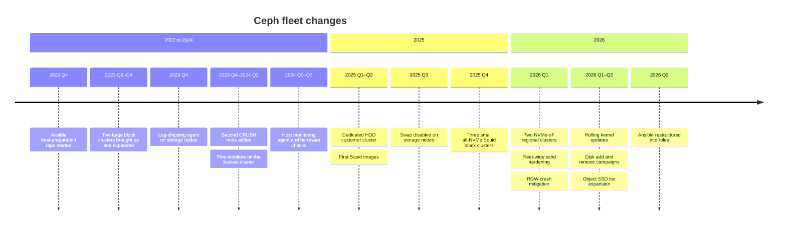
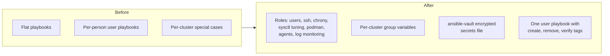

# Ceph Fleet Changes Over Time

A timeline of the notable changes to our Ceph fleet: new clusters, version moves, tooling, and configuration that changed how we operate.

> [!NOTE]
> Dates are given only to the quarter. The earlier entries are reconstructed from host-preparation repo history and change records, so they are less detailed than the recent ones.

> [!TIP]
> **Key takeaways**
> - Host preparation moved into Ansible early, and was restructured into roles with vault-encrypted secrets in 2026 Q2.
> - The fleet grew by adding clusters and new CRUSH roots rather than growing existing pools, which keeps blast radii small but creates capacity islands.
> - Newer clusters run Squid on all-NVMe or NVMe-oF hardware, with pinned monitoring images and separate public and cluster bonds.
> - Host monitoring was made independent of the Ceph metrics pipeline, and swap was turned off on storage nodes.
> - 2026 brought sshd hardening, an RGW crash mitigation, rolling kernel updates and large disk campaigns.

## Summary

| Period | Change |
|---|---|
| 2022 Q4 | Ansible host-preparation repo started for Ceph nodes |
| 2023 Q2–Q4 | Two large block clusters brought up and expanded (NVMe, then SATA SSD) |
| 2023 Q4 | Log-shipping agent rolled out to storage nodes |
| 2023 Q4–2024 Q2 | Second CRUSH roots added to existing clusters; monitor count raised to five on the busiest cluster |
| 2024 Q2–Q3 | Host-level monitoring agent and hardware checks added to the Ansible baseline |
| 2025 Q1–Q2 | Dedicated HDD customer cluster added to the managed fleet; first Squid images |
| 2025 Q3 | Swap disabled and masked on storage nodes |
| 2025 Q4 | Three new small all-NVMe Squid block clusters |
| 2026 Q1 | Two NVMe-oF-backed regional clusters on AlmaLinux and Squid; fleet-wide sshd hardening; RGW crash mitigation |
| 2026 Q1–Q2 | Rolling kernel updates; large disk add/remove campaigns; SSD tier expansion on the object cluster |
| 2026 Q2 | Ansible repo restructured into roles with vault-encrypted secrets |

## 2022 Q4: Ansible for host preparation

**What changed.** We started an Ansible repo that prepares a host for Ceph without touching Ceph itself. It covers operator users and keys, `sshd_config`, chrony, `/etc/hosts`, podman and later OS tuning.

**Why.** Hosts were being prepared by hand, and differences between nodes in time sync, users and tuning were showing up as hard-to-attribute problems later.

**Impact.** Adding a node became "inventory entry plus playbook" before `ceph orch host add`. The rule was to run it from the cluster's admin node with a personal key, after a `--check --diff` dry run.

**Gotchas.** The repo grew organically as a flat set of playbooks, one inventory per cluster and per-person user playbooks. That served us for years but eventually needed restructuring (see 2026 Q2).

## 2023 Q2–Q4: Large block clusters come online

**What changed.**

- Two large RBD clusters were brought up and grown through the year:
  - one on local NVMe;
  - one on SATA SSDs behind hardware RAID controllers (single-drive RAID-0 per disk). It runs Quincy and pulls images from a local registry mirror.
- An OS tuning role (scheduler latency, dirty-page ratios, network buffers, swappiness) was added to the Ansible baseline in the same period.

**Impact.** These became the backbone of the block storage service, and the source of most of the operational lessons in [challenges.md](challenges.md).

**Gotchas.** Both ended up with `size 2, min_size 1` pools and fixed `pg_num`. Those were defensible cost choices at the time, but they shaped every maintenance procedure afterwards.

## 2023 Q4: Log shipping from storage nodes

**What changed.** We rolled out a log-collection agent (an OpenTelemetry collector role) to the storage clusters.

**Why.** Kernel and Ceph logs were only on the hosts. Correlating `NIC Link is Down` or medium errors with a Ceph health event meant SSHing around after the fact.

**Gotchas.** Agents are not free. Later, a host-side agent's memory use became one of the things we had to rule out when investigating memory pressure on storage nodes.

## 2023 Q4–2024 Q2: Second roots and more monitors

**What changed.**

- Existing clusters were expanded with *new CRUSH roots* instead of being grown inside the existing ones, on newer hardware:
  - a second SSD root on the SATA cluster;
  - a second NVMe root on the NVMe cluster, which splits each 15 TB-class device into four OSDs.
- The SATA SSD cluster went from three to five monitors.

**Why.**

- New hardware generations have different per-host weights and performance. Keeping them in their own root (with one pool per root) avoids mixing generations in one pool.
- Five monitors means the cluster survives two monitor losses, which matters on a cluster that is never quiet enough for a risky monitor change.

**Gotchas.** Each root is its own capacity island, and the four-OSDs-per-device layout means one disk failure takes out four OSDs.

## 2024 Q2–Q3: Host monitoring independent of Ceph

**What changed.** We added a host monitoring agent role, hardware checks and log forwarding to the Ansible baseline. Host-level alerting now reports to a separate monitoring server from the Ceph metrics pipeline.

**Why.** When the mgr fails over or the metrics pipeline is down, we still need to know that a disk or PSU died.

## 2025 Q1–Q2: Dedicated customer cluster, first Squid images

**What changed.** We brought a dedicated customer cluster into the managed fleet and its Ansible inventory. It is a small set of HDD-dense 2U servers (24 × 10 TB-class drives each), split across two racks for HA. This is also roughly when Squid (19.2.x) container images first appear in our tooling.

**Why.** One customer needed isolated capacity. A separate cluster gave them their own blast radius and their own maintenance calendar.

**Gotchas.**

- HDD recovery, backfill and scrub run an order of magnitude slower than on the flash clusters, so the throttle values we use elsewhere don't carry over.
- The planned network was a single dual-port 10 GbE adapter per node, which is thin for 24 HDDs' worth of backfill.

## 2025 Q3: Swap off on storage nodes

**What changed.** We disabled swap and masked the swap target on storage nodes through Ansible.

**Why.** An OSD with part of its cache swapped out is slower than one that gets restarted. We would rather have the OOM killer act decisively, with memory sized properly, than have daemons limp along.

## 2025 Q4: Three small all-NVMe Squid clusters

**What changed.** We built three small block clusters on Ubuntu 22.04 with Squid:

| Aspect | Choice |
|---|---|
| Shape | 3 MON/MGR hosts plus 2–4 storage nodes each |
| Disks | 14 TB-class NVMe |
| Network | Separate public and cluster bonds |
| CRUSH | `chassis`-level failure domain mapped to racks |
| Monitoring | Per-cluster Prometheus with `remote_write` to central storage, monitoring images pinned explicitly |
| Host | BIOS HPC profile with SMT disabled, NIC driver stack from the vendor's networking bundle |

**Why.** New zones needed block storage quickly, and small clusters keep each blast radius small.

**Gotchas.**

- Two of them share racks and switches, so their failure domains are not independent.
- Each cluster's daily backup stack is a single Compose deployment with no failover.

## 2026 Q1: NVMe-oF regional clusters, sshd hardening, RGW fix

**What changed.**
- Two regional block clusters whose OSDs sit on LUNs from external NVMe disk shelves, reached over dual 100 GbE paths through a vendor multipath driver. They were our first clusters on **AlmaLinux 8.10** instead of Ubuntu, built on Squid, and they came with a lossless RoCEv2 storage fabric (PFC, ECN, DCQCN). The Ansible repo gained AlmaLinux playbooks, including offline package installs from DVD media for `lldpd` and NIC drivers, and `nmcli` bonds.
- A **fleet-wide sshd baseline** pushed through Ansible: key-only authentication, no root login, an explicit `AllowUsers` list, session logging through `ForceCommand`.
- On the object stack we hit an RGW crash on malformed `CopyObject` requests (upstream advisory). We mitigated it with an nginx rule in front of RGW, and rehearsed the Reef → Squid rolling upgrade in the lab as the durable fix.

**Gotchas.**

| Area | Gotcha |
|---|---|
| NVMe-oF | `ceph-volume` refused to create OSDs until LVM was told to accept the multipath device type and reject the underlying per-path NVMe names. Without that filter, LVM sees the same PV on several paths and reports duplicate PVs |
| NVMe-oF | The 100 GbE NICs needed an out-of-tree driver build |
| sshd | A non-standard SSH port on some proxy and storage hosts had to be preserved |
| RGW | The nginx mitigation only protects traffic that actually passes through nginx |

> [!WARNING]
> The orchestrator's SSH user must never be dropped from `AllowUsers`.

## 2026 Q1–Q2: Kernel updates, disk campaigns, SSD tier growth

**What changed.**
- We rolled Ubuntu 22.04 hosts from an early 5.15 kernel to a recent 5.15 kernel, one host at a time through maintenance mode, after a lab rehearsal.
- We ran large disk changes on live clusters: 16 NVMe OSDs added on each of two clusters, 16 removed from another (with `pg_num` halved first), and two hosts drained out of each of two end-of-life SATA SSD clusters.
- We added four SSD servers to the object cluster's SSD root, and one NVMe host back into the large NVMe cluster.

**Gotchas.**
- `apt upgrade` is a full OS update, not just a kernel.
- One new SSD server deployed OSDs that couldn't start because its cluster-network VLAN address was missing.
- The end-of-life clusters got an explicit policy: no further growth, and failed disks are pulled rather than replaced. That makes host weights drift and needs balance monitoring.

## 2026 Q2: Ansible restructured

**What changed.**

- The host-preparation repo was rebuilt into proper roles (users, ssh, chrony, sysctl tuning, podman, agents, log monitoring) with per-cluster group variables and an `ansible-vault`-encrypted variables file for secrets.
- User management became a single playbook with tags for create, remove and verify.

**Why.** The flat repo had accumulated per-person playbooks and per-cluster special cases, and it was too easy to keep a secret in plain text.

**Alongside it.** We consolidated years of raw field notes into one sanitised runbook library (Discovery, Operation, Monitoring, Troubleshooting) and published a public, anonymised subset of the procedures.
