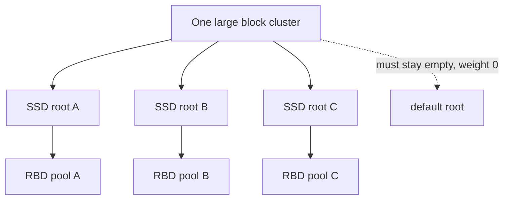
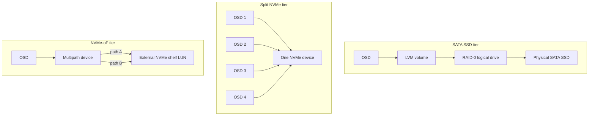
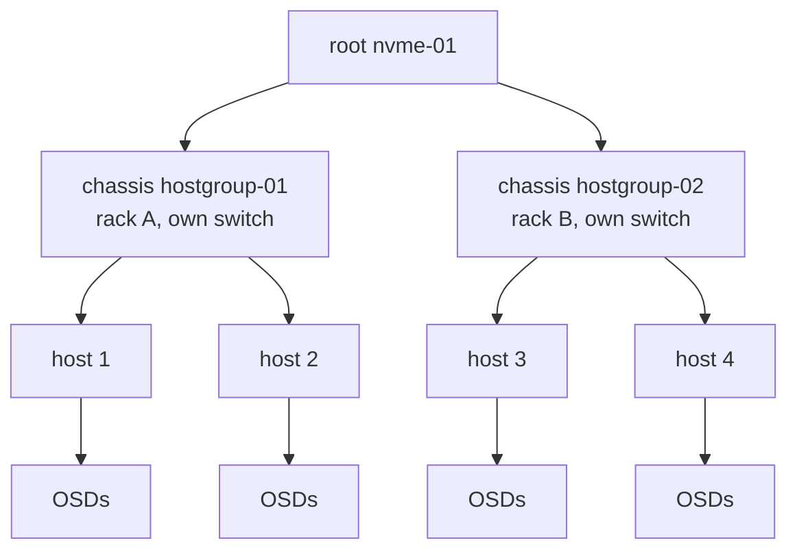
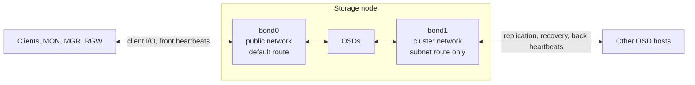
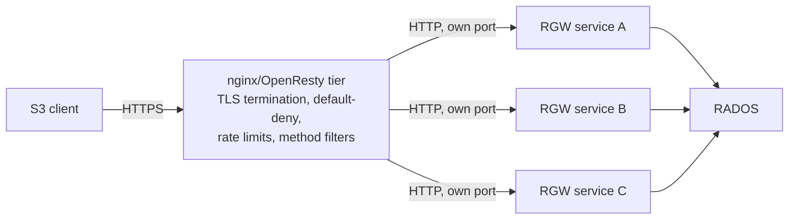

# Ceph Design Notes

How the Ceph clusters I run for a public cloud platform are put together, and the reasoning behind each choice. For the parts I inherited, it is my best reading of the reasoning. The fleet is around ten production clusters plus a lab, a few thousand OSDs and multi-petabyte raw capacity in total, almost all of it flash.

> [!TIP]
> **Key takeaways**
> - Many small blast radii: separate clusters, and separate CRUSH roots inside the big ones. Each root is a capacity island.
> - Three flash hardware generations coexist, and each has a quirk: RAID-0 logical drives, NVMe split into four OSDs, NVMe-oF LUNs behind multipath.
> - Block pools run 2 replicas on flash (a debated cost choice). Object data uses erasure coding. Metadata uses 3 replicas on SSD.
> - Public and cluster networks sit on separate LACP bonds, because they fail differently.
> - S3 traffic always passes an nginx tier, which is also a security control. Ansible prepares the host and cephadm owns Ceph.

## What the fleet is for

Not every cluster does the same job. Most design decisions only make sense once you know which kind of cluster you are looking at.

| Cluster type | Serves | Shape |
|---|---|---|
| Large block clusters | RBD volumes for the platform's VMs (OpenStack Cinder is the client) | Dozens of storage nodes, roughly a thousand OSDs at the top end, SATA SSD or local NVMe |
| Small all-NVMe block clusters | RBD for newer zones and regions | 3 MON/MGR hosts plus 2–4 dense NVMe storage nodes |
| NVMe-oF-backed block clusters | RBD, with OSDs sitting on LUNs from external NVMe disk shelves | 3 MON/MGR hosts plus 4 storage hosts |
| Large mixed object cluster | S3 via RGW, plus CephFS and NFS exports | A few dozen hosts, HDD bulk tiers plus an SSD tier, several RGW services behind an nginx tier |
| Small object clusters | S3 on all-flash | 3–4 nodes |
| Dedicated customer cluster | One customer's workload | A handful of HDD-dense servers |

The older large SATA-SSD clusters were already in place when most of my notes start. The small NVMe clusters and the newest regional clusters were built during the period these notes cover, so for those I can describe the decisions first hand.

## Many clusters rather than one big one

We never tried to run one giant cluster.

- **Each cluster is a blast radius.** A bad upgrade, a monitor store problem or a network event stays inside one cluster.
- **Each cluster can run what suits it**: its own Ceph release and hardware generation.
- **The cost is operational.** N clusters means N sets of monitors, N upgrade campaigns, N monitoring configs, and drift between them. Most of the automation described in [operations.md](operations.md) exists to pay that cost down.

Inside the big clusters we go one step further and split capacity into **separate CRUSH roots**: usually one root per hardware generation or device class, with one pool per root. A large block cluster has three SSD roots, each backing its own RBD pool. The object cluster has two HDD roots (two hardware generations) and an SSD root.

That gives us:

- Predictable performance per pool, because a pool never spans two hardware generations.
- The ability to retire or expand a generation without touching the others.
- A clean way to steer a product or tier to a set of hosts.

The downside is that **each root is a capacity island**. A pool on a 75 % full root cannot borrow space from a 50 % full root next to it, and the cluster-wide `%RAW USED` figure hides that. This bit us more than once (see [challenges.md](challenges.md)).

> [!WARNING]
> The built-in `default` root must stay empty, with weight 0. A new host that was never moved into its named root lands in `default` and silently takes no data. "`default` has weight 0" is a cheap check after every expansion.

## Hardware tiers

Three generations of storage hardware coexist in the fleet, and each has a quirk that shaped the design.

| Tier | Where | Quirk that shaped the design |
|---|---|---|
| SATA SSD behind hardware RAID | Older block clusters | Each disk is a single-drive RAID-0 logical drive |
| Local NVMe | Newer block clusters | On one generation, each device is split into four OSDs |
| NVMe-oF LUNs from external shelves | Two regional clusters | Multipath device handling and a lossless RoCEv2 fabric |
| HDD | Object bulk roots, dedicated customer cluster | Metadata must be steered to SSD |

How an OSD reaches the physical media differs per tier, and that path is what you have to trace before any disk work:

**SATA SSD behind a hardware RAID controller.** The older block clusters use 1.92 TB-class SATA SSDs, about 20 per node, each exposed as a **single-drive RAID-0 logical drive**. That is how these nodes were built, and it was never changed. It works, but it puts an extra layer between Ceph and the disk:

- Replacing a disk also means deleting and recreating a logical drive with the vendor CLI. If you delete the wrong one, you destroy a healthy OSD.
- The kernel sometimes reports these logical volumes as rotational, so Ceph's device-class autodetection can assign `hdd` to an SSD. Rules that filter by class then silently ignore those OSDs.
- A logical drive can show `Failed` while the physical drive under it still reports `OK`, so the controller's view is the one to trust.

**Local NVMe.** The newer block clusters use 14–15 TB-class enterprise NVMe.

- On one generation each NVMe device is split into **four OSDs** (four LVM slices of about 3.5 TB each). The usual reason is that a single OSD process struggles to drive a large modern NVMe device to saturation.
- The trade-off showed up the first time one of those devices failed: one dead disk took out four OSDs at once. If you split devices, the number of OSDs per device becomes a failure-domain fact you need to know before every drain.
- The newest small clusters run one OSD per 14 TB-class device.

**NVMe-oF LUNs from external shelves.** Two regional clusters have no local data disks at all. Their OSDs sit on LUNs served by external NVMe disk shelves over two dedicated 100 GbE paths (A/B), with a vendor multipath driver presenting each LUN as a single device. Two things had to be designed in:

- LVM has to be told to accept the multipath device type and to ignore the underlying per-path NVMe names. Otherwise `ceph-volume` sees the same PV through several paths and refuses to build the OSD (see [incidents.md](incidents.md)).
- The 100 GbE storage paths run a lossless RoCEv2 setup (PFC on the RoCE priority, ECN marking, DCQCN congestion control, DSCP-based classification, jumbo MTU). It is the most complex part of the fabric and needs host and switch to agree exactly.

**HDD.** HDDs only appear in the object cluster's bulk roots and in the dedicated customer cluster (10 TB-class drives, 24 per 2U node). Everything that holds metadata, such as RGW index, log and meta pools and the CephFS metadata pool, is placed on SSD through a dedicated replicated rule.

**DB/WAL placement.** On the flash clusters BlueStore DB and WAL are co-located on the data device. OSDs are created with a plain `ceph orch daemon add osd <host>:<device>` and there are no separate DB devices. On all-flash nodes a separate DB device adds a failure dependency without much latency benefit. My notes don't cover the DB placement for the HDD roots, so I won't guess at it here.

**BIOS and host tuning.** Every storage node gets the same baseline before it holds data:

- a performance/HPC power profile;
- a deliberate NUMA setting;
- SMT disabled on the newest NVMe nodes;
- a sysctl profile with lower scheduler latency, `vm.swappiness=1`, earlier dirty-page writeback and larger network buffers.

Swap was later disabled fleet-wide. We would rather the OOM killer act quickly than have an OSD limp along with its cache swapped out.

## Failure domains and CRUSH

The large clusters use `host` as the failure domain. That is the default, and it fits when there are dozens of hosts per root.

The small four-node clusters use something more deliberate. Their storage hosts are spread over two racks, each rack on its own top-of-rack switch. The CRUSH tree puts an intermediate `chassis` bucket ("hostgroup") between root and host, one per rack, and the replicated rule chooses leaves across `chassis`:

With `size 2` this guarantees one copy per rack:

- Losing a whole rack or switch still leaves a copy.
- Losing one host leaves its rack partner holding that rack's replica.

What we learned to account for:

- **Shared infrastructure breaks independence.** Two of the small clusters were cabled into the *same* two racks and the same pair of switches. As Ceph clusters they are independent, but as failure domains they are not: a switch event hits both.
- **Monitor placement doesn't always follow hostnames.** On the object cluster, two hosts named after their MDS role also carry monitor votes. Draining "just an MDS host" removes a quorum member. We check labels (`ceph orch host ls`), never names.
- **Rules that filter by device class are only as good as the device class.** A wrong class removes OSDs from the rule without any error.

## Replication versus erasure coding

| Data | Protection | Placement |
|---|---|---|
| Block (RBD) pools | 2 replicas, `size 2, min_size 1` | Flash |
| RGW bulk object data | Erasure coding: 6+2 on the large cluster, 2+1 on small three-host clusters | HDD or flash data roots |
| Metadata (RGW pools, bucket index, CephFS metadata) | 3 replicas, `size 3` | SSD-only rule |

**Block pools: 2 replicas.** Most RBD pools on flash run `size 2, min_size 1`. This is the most debated choice in the fleet, and I want to be honest about it.

| For | Against |
|---|---|
| Cost: flash is expensive, and a third replica is 50 % more hardware | During any host maintenance there is exactly one copy of the affected data, and with `min_size 1` I/O keeps flowing on that single copy instead of blocking |
| SSD/NVMe have lower failure rates and much faster recovery than HDD | A scrub error means one known-bad copy and one good copy. There is no majority to arbitrate if both disagree |
| | `osd_pool_default_size` was set to 2 globally on some clusters, so every new pool inherited it unless someone remembered not to |

We live with it by:

- keeping maintenance windows to one failure domain at a time;
- never stacking changes;
- treating every inconsistent PG on these pools as urgent.

If I were designing a new block tier from scratch with a cost case that allowed it, I would choose 3 replicas.

**Object data: erasure coding.** RGW bulk data goes on EC pools.

- The large object cluster uses an 8-shard profile (6+2).
- The small three-host object clusters use 2+1 with `crush-failure-domain=host`, because that is the widest profile three hosts can hold.
- EC data pools also get `allow_ec_overwrites`, `fast_read` and lz4 compression (`aggressive` mode, keep only if the blob compresses to 80 % or less).

> [!WARNING]
> Setting `min_size = k + m` on an EC pool (3 on a 2+1 pool) means a single OSD loss blocks writes, which defeats the point of having a parity shard. `k + 1` is the usual floor.

**Metadata: 3 replicas on SSD.** RGW `.rgw.root`, `log`, `control`, `meta` and the bucket index, plus CephFS metadata, run replicated `size 3` on an SSD-only rule. Pools that bootstrap creates (`.mgr` and the RGW service pools) start on the default rule with default PG counts. The build procedure moves them to the SSD rule and gives them a sensible `pg_num` straight away. We learned to do that the hard way (an index pool with one PG that could not be placed).

**PG sizing.** On the large pools the autoscaler is off and `pg_num` is fixed, typically 16384 PGs per pool on the big clusters.

- The target is roughly 100–200 PG replicas per OSD.
- We do the arithmetic (`pg_num × size ÷ OSDs`) before every removal, because shrinking the OSD count pushes that number up toward the 250 hard limit.

## Network design

Every storage node has two logical Ceph networks, and they fail differently:

| Network | Carries | When it breaks |
|---|---|---|
| **Public** | Client I/O, monitors, mgr, RGW backends, OSD front heartbeats | Clients go down immediately |
| **Cluster** | Replication, recovery, backfill, OSD back heartbeats | Slow recovery, slow heartbeats and OSDs falsely marked down, while clients may look fine for a while |

So we keep them on separate bonds where the hardware allows. On the NVMe nodes `bond0` carries public traffic and the default route, and `bond1` carries the cluster network with only a subnet route and no default route.

**Bond settings.** All bonds are LACP with `miimon=100`, `lacp_rate=fast` and `xmit_hash_policy=layer3+4`.

- The hash policy matters more than it looks. Ceph traffic is a relatively small number of long-lived TCP sessions between the same host pairs, and `layer2` hashing would pin each pair to one leg.
- Most storage nodes run 2×25 GbE, and some MON-only nodes run 2×10 GbE.

Two lessons from the lab and from production:

- **One `back_addr` per OSD.** `cephadm bootstrap` accepts several cluster-network CIDRs, but each OSD binds to exactly one of them. We tried to give an OSD two cluster addresses, and both syntaxes were rejected. If you want one OSD to use two fabrics, bond them at L2 and present one L3 address.
- **The cluster network must exist on the host before OSDs are created.** A node added without its cluster-network VLAN address deploys OSDs that fail with `Failed to pick cluster address`.

Other host-side settings:

- `net.ipv4.tcp_mtu_probing=1` is on everywhere. That softens an MTU mismatch into a throughput dip instead of a black hole. It also means a mismatch won't show itself, so we check MTU end to end explicitly.
- `lldpd` runs on every node, so cabling can be verified from the host side without a trip to the datacenter.

## RGW front end and HA

On the large object cluster, S3 clients never talk to RGW directly:

- **Several independent RGW services** rather than one shared pool of daemons. Each S3 endpoint or product gets its own RGW service, its own port and its own placement label (`count-per-host:1;label:<service>`). We scale one endpoint by labelling another host, and restart one endpoint without touching the others.
- **nginx terminates TLS** and enforces a catch-all default-deny vhost, per-site rate limits and method filters. RGW is told to trust the proxy (`rgw_remote_addr_param: HTTP_X_REAL_IP`, `rgw_trust_forwarded_https: true`). That is only safe because RGW ports are not reachable except through the proxy tier, and we treat that as a hard requirement.
- **The proxy hosts are peers, not a cluster.** Config is kept in git on each host and synced by hand. That is simple, but it lets two proxies drift and serve different behaviour for the same hostname. Merging drifted configs is the riskiest routine task on that tier.
- **The proxy layer is also a security control.** When an RGW parsing bug let a single malformed request crash every gateway, a one-line nginx rule was the mitigation until the daemons could be upgraded.

> [!NOTE]
> For SSE-S3 we validated RGW against a Vault transit engine in the lab. The design caveat is that encrypted objects become unreadable if Vault is sealed or lost, so Vault becomes a tier-0 dependency of the object service.

## Deployment tooling

- **cephadm + podman** on every cluster. Releases in the fleet span Quincy, Reef and Squid.
- **Host labels drive placement**: `_admin`, `mon`, `mgr`, `rgw.<service>`, `mds`, `osd`, `monitor`.
  - On the object cluster OSDs come from `osd.hdd` / `osd.ssd` service specs.
  - On the block clusters we add OSDs one device at a time with `ceph orch daemon add osd`, which gives finer control when bringing capacity in at weight 0.
- **Ansible prepares the host; cephadm owns Ceph.** An Ansible repo handles everything below Ceph: operator users and keys, sshd baseline, chrony, sysctl tuning, podman, `/etc/hosts`, log and metrics agents, and a node checklist. Keeping the boundary at "the host is ready" means the Ceph layer itself follows plain upstream cephadm, and the playbooks stay small enough to dry-run (`--check --diff`) before every production run.
- **No direct internet egress.** Nodes reach package repos and registries through an HTTP proxy, or pull from a local registry mirror. That means:
  - pre-pulling images before any bootstrap, add or upgrade;
  - configuring the proxy for podman as well as for the shell;
  - setting `mgr/cephadm/use_repo_digest false` when using a re-tagged mirror;
  - **pinning every monitoring image** (`container_image_prometheus`, `_grafana`, `_alertmanager`, `_node_exporter`) so a later redeploy can't silently jump a major version.

Monitoring follows the same idea of independence:

- **Ceph metrics** go from the mgr module and per-host exporters, through a per-cluster Prometheus using cephadm service discovery, into a central long-term store.
- **Host health** is reported by a separate agent to a separate server.

So a mgr failover or a metrics-pipeline outage never blinds host alerting.
