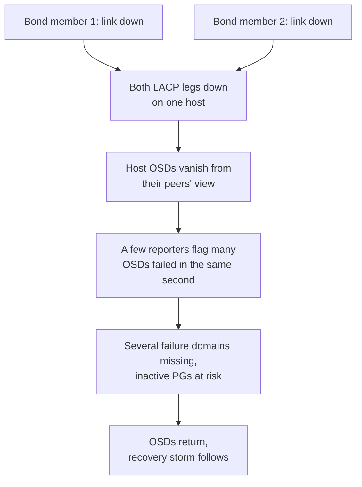
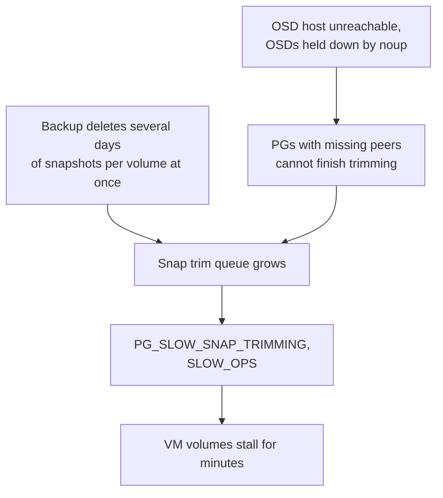
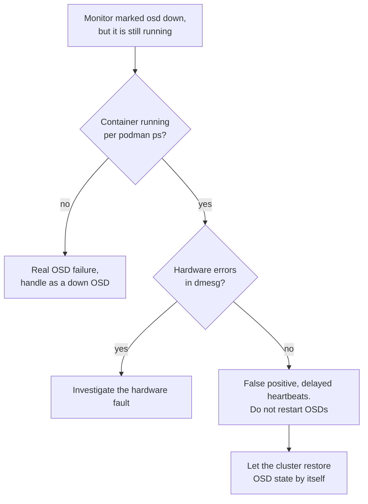
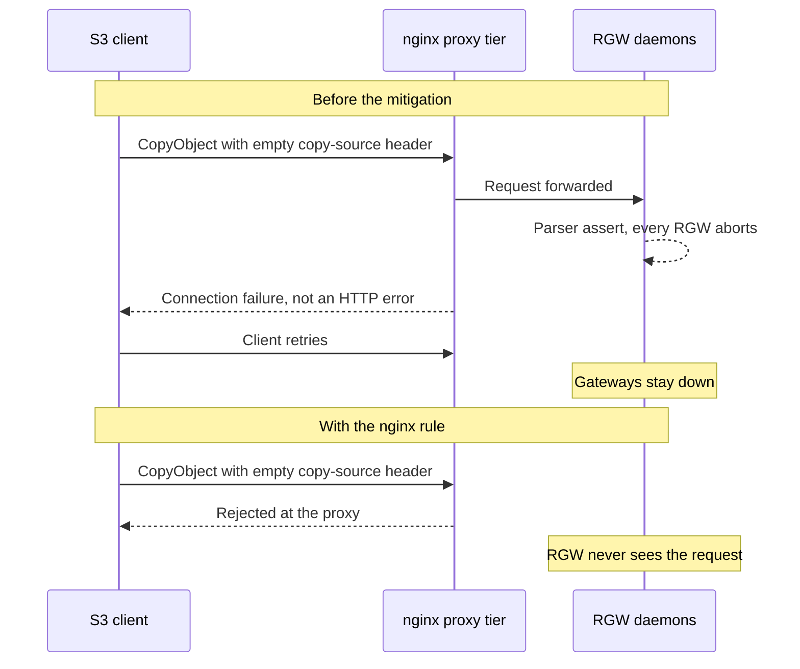
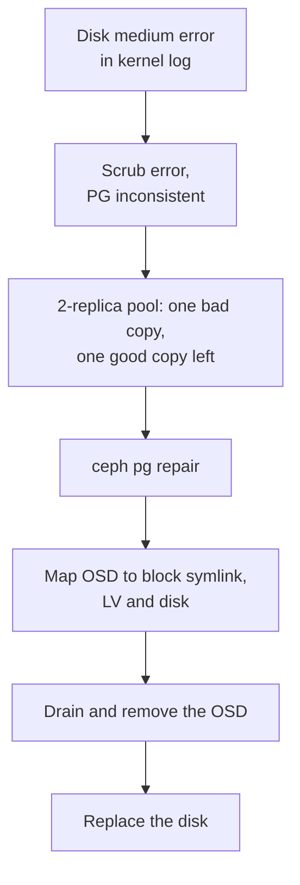

# Ceph Incident Write-ups

Postmortem-style notes on incidents we actually hit across our Ceph fleet: what we saw, what it turned out to be, and what changed afterwards. Identifiers have been replaced with placeholders like `<host>`, `<osd-id>` and `<pool>`, and impact is described qualitatively.

> [!TIP]
> **Key takeaways**
> - The health string tells you where to look, not what is wrong. Most of these took less time to fix than to stop misreading.
> - "OSDs down" was usually the network or delayed heartbeats. Check bond links and `podman ps` before touching OSDs.
> - Weight-0 staging made a bad capacity addition cheap to roll back.
> - A single malformed S3 request could crash every RGW. The proxy tier in front was the mitigation.
> - On 2-replica pools, every scrub error is urgent.

| # | Incident | Root cause in short |
|---|---|---|
| 1 | Dozens of OSDs down at once (2025 Q4) | Both bond members on a host dropped link |
| 2 | One host flapping for days (2026 Q1) | Optics: SFP or cable |
| 3 | Capacity addition rolled back (2026 Q1) | The new node was the trigger |
| 4 | Snapshot-trim backlog and slow ops (2026 Q1) | Bursty snapshot deletion plus a down host |
| 5 | OSDs marked down while running (2026 Q2) | Delayed heartbeats, a failure-detection false positive |
| 6 | All RGW daemons crashing (2026 Q1) | Upstream `CopyObject` parser bug |
| 7 | Crash-looping OSD (2026 Q2) | BlueStore assert on the snapshot-trim path |
| 8 | ceph-osd OOM-killed (2026 Q2) | OSD memory footprint larger than host RAM |
| 9 | Inconsistent PGs (2026 Q1) | Failing media |
| 10 | Smaller ones | See the table at the end |

## 1. Dozens of OSDs down at once: bond members dropping link (2025 Q4)

**Symptoms.** Whole hosts' worth of OSDs went `down` together on the large NVMe block cluster. The monitor log showed a few OSDs reporting many peers failed within the same second:

```text
cluster [DBG] osd.<a> reported failed by osd.<x>
cluster [DBG] osd.<b> reported failed by osd.<x>
cluster [DBG] osd.<c> reported failed by osd.<y>
[WRN] OSD_SLOW_PING_TIME_BACK: Slow OSD heartbeats on back (longest ~1400ms)
[WRN] CEPHADM_REFRESH_FAILED: ... Unable to reach remote host <host>. SSH connection closed
```

**Impact.** Several failure domains were missing at the same time, which put inactive PGs at risk. When the OSDs came back, a recovery storm followed.

**Root cause.** The network, not the disks. On an affected host both members of the LACP bond dropped link:

```text
ice ...: <ethN>: NIC Link is Down
bond0: (slave <ethN>): link status definitely down, disabling slave
```

With both legs down, that host's OSDs disappeared from their peers' view all at once.



**Fix.**

```bash
ceph osd set noout                  # stop the mass "out" + rebalance
# restore the link, then start the OSDs host by host
ceph orch daemon start osd.<id>
watch -n2 ceph -s
ceph osd unset noout                # only after PGs are clean
```

**Prevention.** Alert on bond member link-down and on bond speed below nominal. Treat "many OSDs reported by a few reporters in one second" as a partition signature.

## 2. One host flapping for days: optics (2026 Q1)

**Symptoms.** A single bond member went down and came back every few hours for three days, recovering after about 30–40 s each time. Ceph showed intermittent slow-ping warnings for that host's OSDs.

**Root cause.** NIC error counters were clean (`rx_crc_errors: 0`, no length errors). Repeated link loss with clean counters points at the physical layer: an SFP module or the cable.

**Fix.** We replaced the SFP and re-seated the cable inside a maintenance window (`noout`, then `ceph orch host maintenance enter <host>`).

**Prevention.** A link that recovers by itself still has to be treated as a fault. Each flap halves the host's bandwidth while it lasts, and a flap on the second leg turns it into incident 1.

## 3. Capacity addition that had to be rolled back (2026 Q1)

**Symptoms.** A pool on the large SATA-SSD cluster raised the nearfull flag:

```text
nearfull_ratio 0.85
pool <n> '<pool>' replicated size 2 min_size 1 ... flags hashpspool,nearfull,selfmanaged_snaps
```

We added a new host at weight 0 and started reweighting it in. Soon after, the cluster reported slow heartbeats, slow ops, blocked requests and `PG_SLOW_SNAP_TRIMMING`.

**Impact.** Client latency degraded on a cluster serving several GiB/s with no quiet window.

**Root cause.** The new node was the trigger. Putting it into maintenance mode cleared every symptom within minutes. My notes don't establish the exact fault on the node (firmware, NIC or disk). We pulled it rather than debug it in production.

**Fix.**

```bash
ceph orch host maintenance enter <host>      # symptoms gone within minutes
# then per OSD: crush remove -> osd rm -> auth del -> orch daemon rm --force
ceph orch host drain <host>
ceph mgr module disable cephadm && ceph mgr module enable cephadm   # cleared "Module 'cephadm' has failed"
```

Afterwards the mgr log showed `get_metadata_python Requested missing service osd.<id>` for exactly the removed OSD ID range.

**Prevention.** Burn in new hardware before it joins a production root. Add capacity well before nearfull. Keep weight-0 staging mandatory, because it is what made the rollback cheap.

## 4. Snapshot-trim backlog and slow ops (2026 Q1)

**Symptoms.**

```text
[WRN] PG_SLOW_SNAP_TRIMMING: snap trim queue for <thousands> pg(s) >= 32768 (mon_osd_snap_trim_queue_warn_on)
    longest queue on pg <pgid> at <hundreds of thousands>
[WRN] SLOW_OPS: <hundreds> slow ops, oldest one blocked for 756 sec
pgs: ... active+clean+snaptrim_wait / active+clean+snaptrim+laggy
```

**Impact.** VM volumes stalled for minutes at a time during the worst periods.

**Root cause.** Two things combined:

- **Bursty deletion.** The backup service was deleting RBD snapshots in bursts, often several days' worth per volume at once.
- **A missing host.** The same `ceph health detail` showed an OSD host unreachable over SSH, with its OSDs down and held there by `noup`. PGs with missing peers can't finish trimming, so the queue kept growing for as long as the host was gone.



**Diagnosis commands.**

```bash
ceph health detail
ceph log last 10000 | grep -i snap
ceph pg <pgid> query | grep last_epoch_started
ps -ef | grep 'rbd.*snap remove'      # on the backup hosts
```

**Fix.**

1. We restored the missing host first.
2. `ceph pg repeer` helped individual stuck PGs but didn't drain the backlog.
3. Then we spread snapshot deletion out so it stays caught up daily.

**Prevention.** Track `snaptrim_wait` as a metric. Only change trim throttles one knob at a time while watching client latency. Treat a down host as the first suspect for any backlog.

## 5. OSDs marked down while still running (2026 Q2)

**Symptoms.**

```text
health: HEALTH_WARN
        Reduced data availability: 1 pg inactive
        ~300 slow ops, oldest one blocked for 467 sec
osd: N osds: N up (since 2m), N in
pgs: ... active+clean+laggy ... 1 activating
cluster [WRN] Monitor daemon marked osd.<id> down, but it is still running
```

**Root cause.** A false positive in failure detection.

- Every OSD that had been "marked down" was in fact running: its container had been up for years according to `podman ps`.
- `dmesg` showed no hardware errors on any of the four hosts involved.
- The false-downs clustered on neighbouring hosts in one SSD root, during heavy snaptrim load.

Delayed heartbeats are the most consistent explanation. I can't say with certainty whether the delay came from the network or from load on the hosts.



**Fix.** No OSD restarts. The cluster restored its OSD state by itself, and the one `activating` PG finished peering.

**Prevention.**

- Always confirm with `podman ps` before acting on a "down" OSD.
- Alert on the `marked down, but it is still running` string as its own signal.
- Review heartbeat grace against the load profile.
- Stagger trim-heavy work.

## 6. All RGW daemons crashing on one request (2026 Q1)

**Symptoms.** Every RGW instance in the zone exited at almost the same moment, and RGW's own logs showed no errors. Clients got connection failures instead of HTTP errors. `ceph health detail` showed `RECENT_CRASH`, repeated for one RGW entity:

```text
Assertion '__pos < this->_M_len' failed.
*** Caught signal (Aborted) **
 ceph version 18.2.x (...) reef (stable)
 (RGWCopyObj::parse_copy_location(...))
```

**Impact.** Every gateway in the zone goes down from a single request, and a client that retries keeps it down. In effect, anyone who can reach the S3 endpoint can take the object service offline. Much of the evidence I kept comes from our lab reproduction rather than from production captures.

**Root cause.** A known upstream bug. A `CopyObject` request with an empty `x-amz-copy-source` header crashed the parser (published as an upstream security advisory). We reproduced it in the lab with a crafted request against a lab endpoint.



**Fix.**

- **Immediate mitigation:** an nginx rule in front of RGW that rejects requests with an empty copy-source header before they reach radosgw.
- **Durable fix:** an RGW release that contains the upstream fix. Rehearse that rolling upgrade in a lab first (`ceph orch upgrade start`, which upgrades MON, MGR, OSD and then RGW).

**Prevention.**

- Make sure RGW ports are reachable *only* through the proxy tier, so the proxy can act as a control point.
- Find crashes with `podman logs` on the RGW container, not the request log.
- Subscribe to upstream security advisories.

## 7. Crash-looping OSD on a BlueStore assert (2026 Q2)

**Symptoms.** One OSD on a small NVMe cluster crashed six times in ten minutes:

```text
FAILED ceph_assert(diff <= bytes_per_au[pos])
assert_func: bluestore_blob_use_tracker_t::put(...)
backtrace: ... BlueStore::_do_remove ... PrimaryLogPG::snap_trimmer ... PGSnapTrim::run
ceph_version: 19.2.x
```

**Root cause.** BlueStore metadata accounting disagreed with itself on the snapshot-trim path.

- It was not a media error.
- The `stack_sig` was identical across all crashes, which meant one bug and not six.
- The OSD would keep crashing as long as it had trim work to do.

**Fix.** Remove the OSD → wait for recovery → zap the device → recreate the OSD at weight 0 → reweight it back in. It took about two days end to end, most of that recovery and observation.

**Prevention.** Compare `stack_sig` across crash reports, and check `dmesg` to rule out a second, hardware fault.

## 8. ceph-osd OOM-killed on a dense SSD node (2026 Q2)

**Symptoms.**

```text
oom-kill: ... task=ceph-osd ...
Out of memory: Killed process <pid> (ceph-osd) total-vm:~20GB, anon-rss:~19GB
systemd-journald.service: Failed with result 'watchdog'
```

**Root cause.** The total OSD footprint was larger than the host's RAM.

- The host ran 22 OSDs on 192 GB of memory.
- A dozen of them were at around 17–19 GiB resident each, far above the default `osd_memory_target`.
- `vm.min_free_kbytes` had also been sized for far fewer OSDs than the host was running.

**Fix.** The killed OSD restarted by itself, and we throttled recovery to keep from adding more pressure. The durable fix is setting `osd_memory_target` so that `target × OSDs + headroom` fits in RAM.

**Prevention.** Plan memory per host, including recovery-time growth. Watch per-OSD RSS, not just the configured target.

## 9. Inconsistent PGs from failing media (2026 Q1)

**Symptoms.**

```text
HEALTH_ERR 1 scrub errors; Possible data damage: 1 pg inconsistent
    pg <pgid> is active+clean+inconsistent, acting [<osd-a>,<osd-b>]
```

The OSD host's kernel log showed a medium error seconds before the alert fired:

```text
Sense Key : Medium Error [current]
blk_update_request: critical medium error, dev <sdX>, sector <n> op 0x0:(READ)
```

**Impact.** On a 2-replica pool, one known-bad copy meant the affected objects had a single good copy left.



**Fix.**

```bash
ceph pg repair <pgid>
ceph osd metadata <osd-id> | grep -E 'devices|hostname'
ls -l /var/lib/ceph/<cluster-id>/osd.<osd-id>/block    # follow to LV, then lsblk to the disk
```

Then we drained and removed the OSD and replaced the disk. On RAID-0-per-disk hosts that includes deleting and recreating the logical drive.

**Prevention.**

> [!WARNING]
> Treat every scrub error on a 2-replica pool as urgent, and track repeat failures per host. One host lost two disks in two months.

## 10. Smaller ones worth remembering

| When | Symptom | Cause | Fix |
|---|---|---|---|
| 2025 Q4 | mgr host at 100 % memory, dashboard returning 503, monitor lease warnings | mgr under heavy load from metrics scrapes and modules | `ceph mgr fail`, mgr TTL cache, limit per-image RBD stats |
| 2025 Q4 (lab) | `ceph orch ps` → `No daemons reported` | Image pre-pull failed on DNS because podman had no proxy, even though the image was present locally | Proxy in `/etc/containers/containers.conf` on every host, restart podman |
| 2026 | `MON_DISK_BIG` on all five monitors, returning after the threshold was raised | Monitor store growing while the cluster never settled (constant snaptrim and reweights) | Compact one monitor at a time, prune old crash reports; raising the threshold only hides it |
| Lab | `pg <id> is stuck inactive ... current state unknown, last acting []`, buckets could not be created | Freshly built object cluster's index pool on the default rule with one PG, unplaceable | Moved it to the SSD metadata rule and raised `pg_num` |
| Lab | Half the objects degraded while every OSD was up | Two SSD OSDs autodetected as `hdd`, so the class-filtered rule couldn't place replicas | Corrected the device class (and the spec that set it) |
| 2026 Q1 | `ceph-volume lvm batch` failed: `Cannot update volume group ... with duplicate PV devices` | Multipath NVMe-oF LUN visible under several device names | LVM `types`/`global_filter` accepting only the multipath device |
| 2026 Q2 | New OSDs failed: `Failed to pick cluster address` | Cluster-network VLAN address missing on the new host | Configured the address, redeployed the OSDs |
| 2026 Q2 | `LARGE_OMAP_OBJECTS` in the RGW log and index pools | Usage log never trimmed; a versioned bucket full of delete markers outgrew its index shards | `radosgw-admin usage trim`; reshard the bucket; deep-scrub the PG to clear the warning |

The lesson that keeps repeating across this list: **the health string tells you where to look, not what is wrong.** Most of these took less time to fix than to stop misreading.
