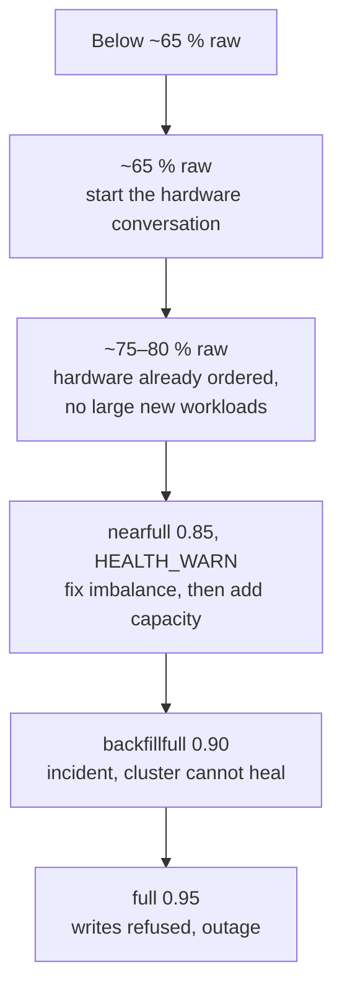
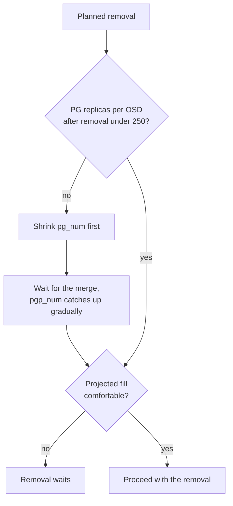
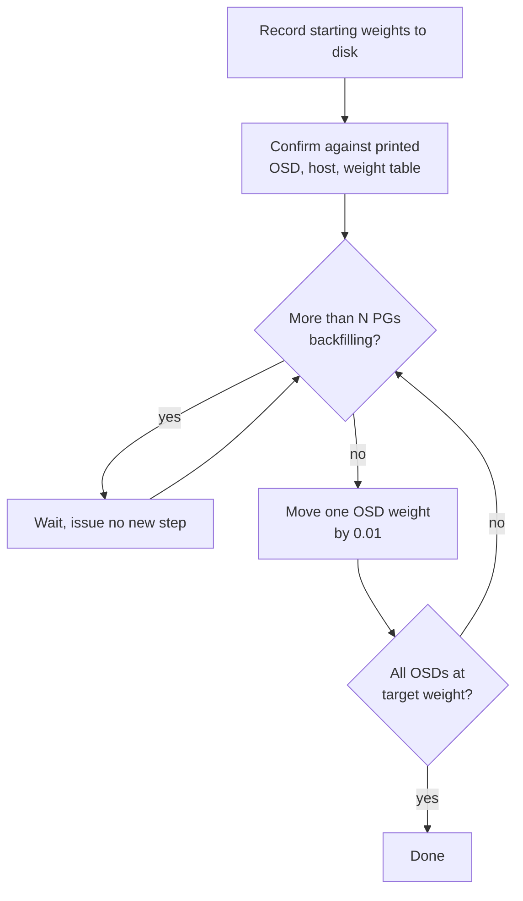
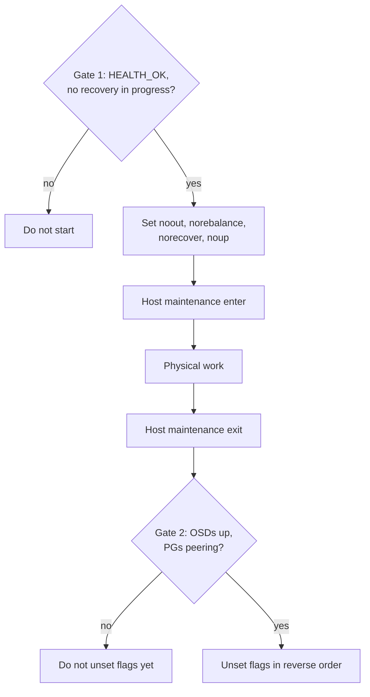

# Operating Ceph Day to Day

The practices that keep our Ceph fleet boring, and the reasons behind each one. These are opinions formed by running block and object clusters at production scale. They are not a runbook. The step-by-step procedures live elsewhere, and this page is about the judgement around them.

> [!TIP]
> **Key takeaways**
> - Nothing moves unless I decide it moves: freeze movement, add or remove at weight 0, reweight in small gated steps, one failure domain at a time.
> - Judge fullness per OSD and per CRUSH root, never by the cluster total. Start the hardware conversation at ~65 %.
> - Before shrinking, do the PG arithmetic and shrink `pg_num` first if needed.
> - Read back every throttle you inject. mClock may be ignoring it.
> - Watch the signals that predict trouble (muted checks, false downs, half-speed bonds, `snaptrim_wait`), not just `HEALTH_OK`.

## The core principle: nothing moves unless I decide it moves

Almost every bad day we have had with Ceph started with data movement that was larger, faster or earlier than intended. So most of the practices below come down to a few rules:

- Freeze data movement before touching topology.
- Bring capacity in or out at weight 0.
- Move weight in small steps, gated on how busy the cluster already is.
- Change one failure domain at a time.

## Capacity planning and fill thresholds

Ceph judges fullness **per OSD**, not per cluster. A cluster showing 54 % raw used can still block writes if one OSD in one root has drifted to 95 %. In our multi-root clusters every threshold below is evaluated **per CRUSH root**, because a pool cannot borrow space from another root.

| Level (per root) | What Ceph does | What I do |
|---|---|---|
| ~65 % raw | Nothing | Start the hardware conversation. Lead times are measured in months. |
| ~75–80 % raw | Nothing | Hardware should already be ordered. Above this a single host failure can push survivors into nearfull during re-replication. Stop placing large new workloads on this root. |
| `nearfull_ratio` 0.85 | `HEALTH_WARN` | Act now: fix imbalance first (it is free), then add capacity. Don't raise the ratio. |
| `backfillfull_ratio` 0.90 | Backfill *into* those OSDs stops | Incident. The cluster can no longer heal itself. |
| `full_ratio` 0.95 | Writes refused | Outage handling only. |



Signals I watch rather than the headline percentage:

- **`MAX AVAIL` per pool in `ceph df`.** It is derived from the fullest OSD the pool can land on. If it is far below what raw free space suggests, the cluster is imbalanced, not full.
- **`ceph osd df tree`.** I look for `%USE` spread inside a root and `VAR` far from 1.00. Hosts should be equally full in *percentage*, not in bytes, because CRUSH weights differ by hardware generation.
- **PGs per OSD.** Too few PGs and the balancer can't even out data. Too many and peering and memory suffer.

One more rule, learned the hard way: **don't plan an expansion for the moment you need it.** Adding a node to a root at 75 % used while the cluster is serving several GiB/s means the new hardware has to be perfect the first time. If it isn't, you are rolling back under pressure.

## Shrinking is capacity planning too

We have shrunk clusters as often as we have grown them: hosts retired from end-of-life clusters, disks removed from small NVMe clusters. Before every removal I write down the arithmetic:

```text
PG replicas per OSD = pg_num × size ÷ remaining OSDs

2048 × 2 ÷ 28 OSDs  ≈ 146   (today)
2048 × 2 ÷ 12 OSDs  ≈ 341   (after removing 16)  -> over the 250 limit
1024 × 2 ÷ 12 OSDs  ≈ 170   (shrink pg_num first) -> fine
```

And the fill projection: removing two hosts from a nine-host pool took it from mid-40s to high-50s percent used.



- If the projected number is uncomfortable, the removal waits.
- If `pg_num` has to come down, it comes down first, and the merge has to finish before any OSD is drained.

## Backfill and recovery tuning

Every add, remove, drain and reweight triggers backfill. These knobs decide whether that is background noise or a client-visible outage.

Practices that have held up:

- **Read, test on one OSD, then apply to the subtree.** An `injectargs` that silently doesn't take is easy to miss.

  ```bash
  # read current values across the subtree you are about to change
  for id in $(ceph osd ls-tree <root>); do
    ceph config show osd.${id} | egrep "osd_recovery_max_active|osd_max_backfills"
  done

  # test on one OSD and read it back
  ceph tell osd.<id> injectargs --osd_recovery_max_active_ssd=1 --osd_max_backfills=1
  ceph config show osd.<id> | egrep "osd_recovery_max_active|osd_max_backfills"
  ```

- **Use the per-class keys.** `osd_recovery_max_active_ssd` / `_hdd` take precedence over the generic key on recent releases, so setting the generic one and assuming it applied is a classic mistake.
- **`injectargs` for a change window, `ceph config set` for policy.**

  | Method | Lifetime | Use for |
  |---|---|---|
  | `ceph tell ... injectargs` | Disappears on OSD restart | One-off change windows |
  | `ceph config set` | Stored centrally, persists | Policy. Has to be unwound afterwards |

- **Pin to 1 during busy hours.** On the large clusters the convention is `max_active=1, max_backfills=1` across the affected root for any host or disk work. It is slower, but nobody files a ticket.

> [!WARNING]
> **Know whether mClock is ignoring you.** On mClock-scheduled releases, manual backfill counters are ignored unless `osd_mclock_override_recovery_settings=true`. If you inject a limit, read it back, and the recovery rate doesn't change, this is why. Either set the override or work through `osd_mclock_profile`.

## Gradual reweighting

We never jump an OSD from 0 to full weight. Two small scripts, one for weight up and one for weight down, move each OSD's CRUSH weight in 0.01 steps and **stop issuing new steps while more than N PGs are already backfilling** (N is typically 3–4). Each script records the starting weights to disk first and asks for confirmation against a printed OSD → host → weight table.



That turns "add sixteen 14 TB NVMe OSDs" into a slow migration that clients don't notice. It takes many hours to more than a day, which is fine. Things I learned running them:

- **The guard can deadlock at start.** If the cluster is already backfilling past the threshold when the script starts, it never issues its first step. Nudging one OSD by hand gets it moving.
- **Check the script's own validation range.** One copy rejected targets above a small-SSD weight, which is wrong for 14 TB devices.
- **Recovery flags must be unset**, or the script happily issues reweights that move nothing.
- Run it under `nohup` or tmux. A run that outlives your SSH session is normal.

## Host and OSD lifecycle principles


**Adding capacity (disk or host):**

1. Healthy start: `HEALTH_OK`, no recovery in flight.
2. Set the flags (`nobackfill`, `norebalance`, `norecover`, and `noin` / `noup` for new OSDs). Our records were not consistent about which flags to use, and the conservative answer is the union.
3. Create the OSDs, then pin every new OSD to CRUSH weight 0.
4. For a new host, move it into the intended root explicitly (`ceph osd crush move <host> root=<root>`), and check that `default` is still empty.
5. Unset the flags and run the weight-up script.

**Removing an OSD** depends on whether there is anything left to drain:

| Healthy disk | Crash-looping or dead |
|---|---|
| throttle → `crush reweight` to 0 → wait for recovery → `out` → stop → `crush remove` → `osd rm` → `auth del` → `orch daemon rm` | Nothing left to drain: go straight to `out`, wait for recovery, then complete the removal |

- We found older notes that stopped the daemon *before* marking it out, which drops a copy abruptly instead of draining it. On 2-replica pools that difference matters.
- After removing a dead OSD, confirm it is fully purged. Half-removed OSDs leave stale references that later show up as mgr metadata errors.

**Failed disks** are routine. Hardware alerts arrive for several chassis on a bad day. The workflow:

- Map the kernel device to the OSD through the LVM `block` symlink, never by assumption (`dm-21` tells you nothing by itself).
- Check the controller's view of the logical drive.
- Drain, remove, replace, then redeploy at weight 0.

On RAID-0-per-disk hardware, write the logical-drive number down before deleting anything. We also track failures per host and per controller slot: some hosts lost two disks within weeks, and that is a pattern worth chasing.

**Monitor hosts:** a monitor's store is disposable while quorum holds. The clean way to rebuild or swap a monitor:

1. Remove its `mon` label.
2. Do the work.
3. Wait for the monmap change to reach all OSDs.
4. Add the label back and let cephadm deploy a fresh monitor that syncs from the survivors.

Never do this with a monitor already out of quorum. On a 3-MON cluster you have no spare.

## Maintenance windows

Our maintenance template has two gates around the physical work:



```bash
# Gate 1: only start from HEALTH_OK with no recovery in progress
ceph osd set noout
ceph osd set norebalance
ceph osd set norecover
ceph osd set noup          # when OSDs must not rejoin early
ceph orch host maintenance enter <host>

# ... physical work: reboot, BIOS profile, RAM, NIC, RAID battery, PSU ...

ceph orch host maintenance exit <host>
# Gate 2: verify OSDs are up and PGs are peering before unsetting flags
ceph osd unset noup
ceph osd unset norecover
ceph osd unset norebalance
ceph osd unset noout
```

Rules that go with it:

- One host, one failure domain, at a time. On a 2-replica pool, a second fault during a window is data loss.
- Before the window, `HEALTH_WARN` should show *only* the flags you set.
- Rolling kernel upgrades use the same window per host. Rehearse the target kernel on a lab VM of the same OS release first, and remember that `apt upgrade` is a full OS update with a kernel in it, not a kernel-only change.

## Upgrades

- **Lab first.** The version paths we care about, including Reef → Squid, were rehearsed end to end on lab clusters before they went near production.
- **Two layers.** Upgrading the `cephadm` / `ceph-common` packages on admin hosts changes only your tooling. `ceph orch upgrade` changes the cluster. A stale `cephadm` binary in `/usr/local/bin` shadowing the packaged one is a classic trap, so check `which cephadm`.
- **Preconditions:** `HEALTH_OK`, all PGs `active+clean`, at least three monitors in quorum, the target image pre-pulled on every host (because of the proxy), and one major release at a time.
- **During:** freeze data movement and scrubbing (`noout`, `norebalance`, `noscrub`, `nodeep-scrub`) and keep `ceph orch upgrade pause` ready. Expect quorum to dip briefly as each monitor restarts. Don't start with a monitor already down.
- **Pin the monitoring images** before upgrading, so the Ceph upgrade doesn't also become a Grafana major-version upgrade.

## Monitoring signals that matter

Beyond `HEALTH_OK`, these are the signals that actually predicted trouble for us:

| Signal | Why it matters |
|---|---|
| `(muted: ...)` in `ceph -s` | A muted check makes `HEALTH_OK` lie. We found `TOO_MANY_PGS` muted on one cluster. |
| `Monitor daemon marked osd.N down, but it is still running` | Failure detection is wrong, not the OSD. Usually network or load. |
| `OSD_SLOW_PING_TIME_BACK/FRONT` | Cluster or public network trouble, often before OSDs flap. |
| `NIC Link is Down` on a bond member | Bonds hide single-leg failures until the second leg goes. |
| Bond speed half of nominal | One LACP leg is down. Silent and common. |
| `snaptrim_wait` PG count | The backlog of deleted-snapshot work. It predicts slow ops on snapshot-heavy RBD pools. |
| `MON_DISK_BIG` | Leading indicator. The monitor store grows while the cluster never settles. |
| mgr `since` resetting in `ceph -s` | The mgr is failing over under load, and metrics gaps follow. |
| `get_metadata_python Requested missing service` | Stale OSD references after an incomplete removal. Per-OSD metrics go blind. |
| `RECENT_CRASH` with the same entity repeating | Crash loop. Compare `stack_sig` across crashes. |
| Per-pool `MAX AVAIL` trend | Capacity islands filling. |

On the mgr side, two settings helped the large clusters: `mgr_ttl_cache_expire_seconds` set below the scrape interval (10 s against a 15 s scrape), and enabling `mgr/prometheus/rbd_stats_pools` only for the pools where per-image stats are worth the CPU.

## Automation and hygiene

- **Ansible for everything under Ceph**: users, keys, sshd baseline, chrony, sysctl, agents, a node checklist. Always `--check --diff` first, then run it on one host before the fleet.
- **Secrets never go into notes.** It is tempting to paste keyrings, dashboard passwords or S3 keys next to the command that used them. Treat anything that was ever written down as exposed and rotate it, and keep credentials in a vault-encrypted variables file and a secrets manager.
- **Keep the scripts in version control** alongside the OSD ID lists they were run with. The record of what was actually run is as valuable as the runbook.

> [!WARNING]
> **sshd changes are the one change that can lock you out permanently.**
> - Keep the old session open and back up the old config.
> - Validate with `sshd -t`.
> - Open a *second* session on the new config before closing the first.
> - Never drop the orchestrator's SSH user from `AllowUsers`.

## Start-of-shift checklist

```bash
ceph -s                  # health, quorum age, mgr standby, OSD up/in agree, recovery moving
ceph health detail       # read every line, including muted ones
ceph df                  # MAX AVAIL per pool
ceph osd df tree         # %USE spread per root, PGs per OSD
ceph crash ls            # new crashes since last shift
ceph orch ps | grep -v running   # daemons in error
```

And per node, after any rebuild or reboot:

- `chronyc sources`
- hostname and `/etc/hosts`
- `ip a` and routes
- `ethtool bond0`: speed equals the sum of the legs
- live config matching the config files on disk
