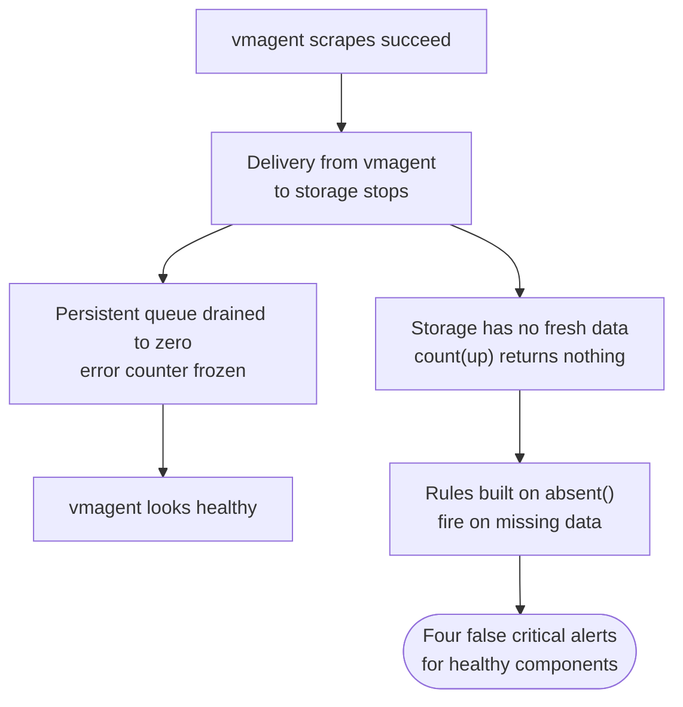
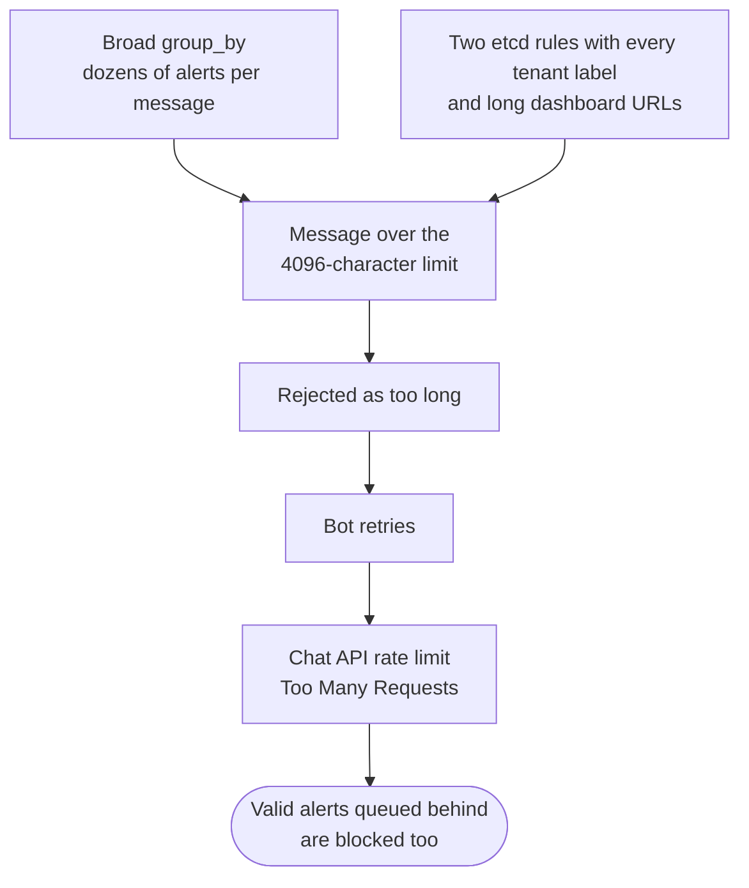
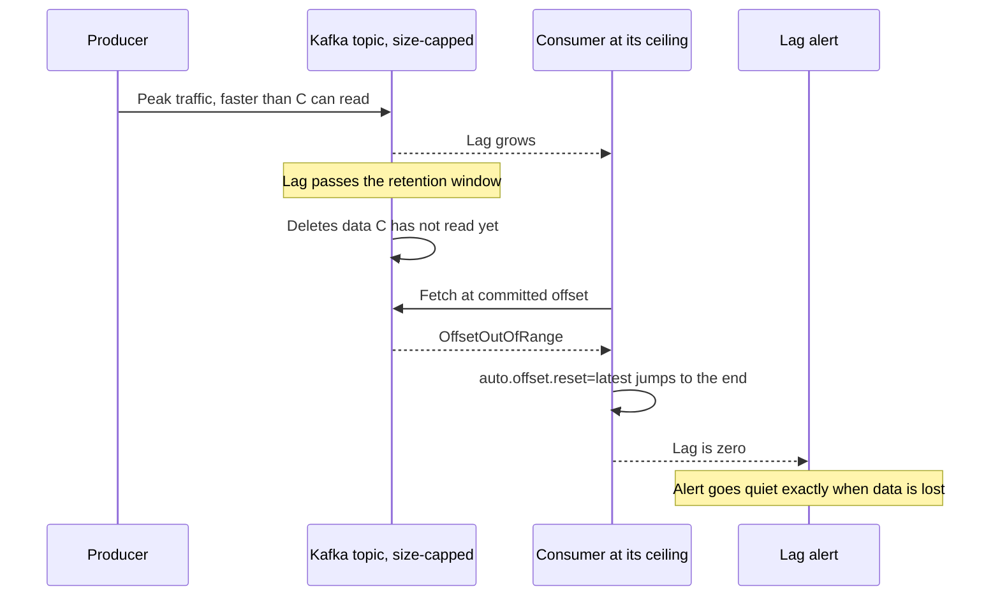
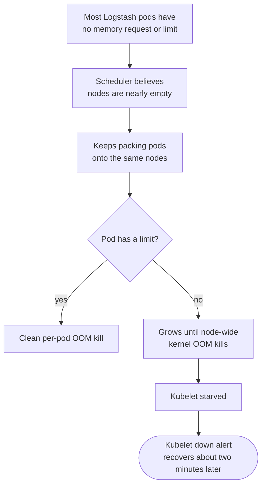
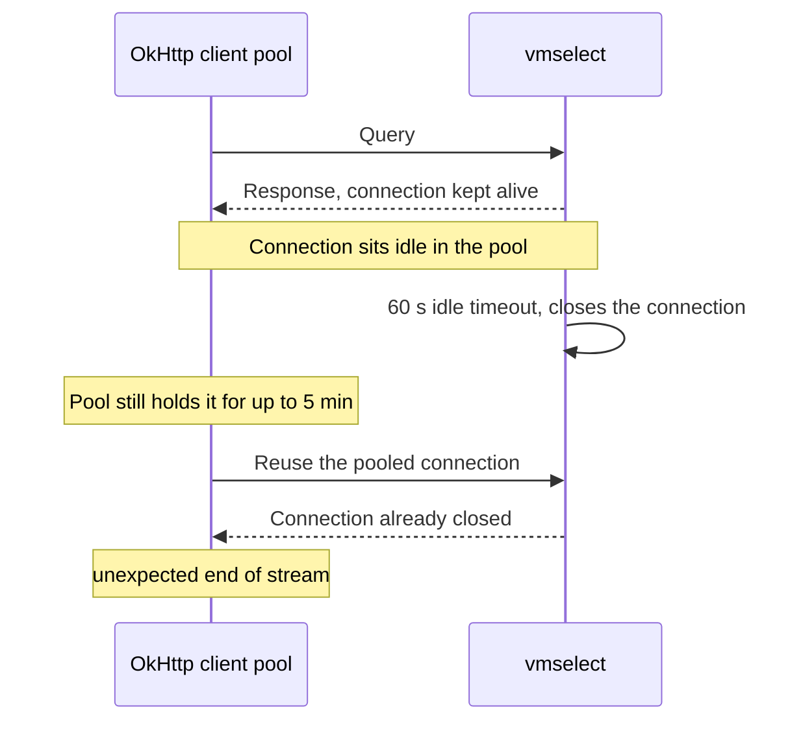

# Hard Problems Running a Monitoring Platform

These are the problems on the monitoring platform that took the longest to understand, each told as context, problem, what we tried, what worked, and the lesson.

> [!TIP]
> **Key takeaways**
> - The hardest problems were the monitoring system misreporting its own health: blind, undelivered, or green but empty.
> - Measure the right thing: the store, not the scraper; headroom, not lag; content, not status; placement, not replica counts.
> - Measure the component you're about to blame. "Slow" and "connection reset" often come from the client side.
> - Dishonest resource requests blind the scheduler, and adding hardware doesn't help.
> - Splitting storage by history costs you in every audit. Labels are cheaper than instances.

| # | Problem | Lesson in one line |
|---|---|---|
| 1 | The monitoring system went blind and blamed everything else | Probe the store, not the scraper |
| 2 | Alerts sent but never delivered | Message size is a design constraint |
| 3 | Silent data loss hidden by Kafka's own recovery | On size-capped topics, watch headroom, not lag |
| 4 | The scheduler thought the log nodes were empty | Honest requests, or the scheduler is blind |
| 5 | "vmselect is slow" was really two different bugs | Measure before you blame |
| 6 | Two TSDBs, four alert paths, wrong conclusions | Labels are cheaper than instances |
| 7 | Green but empty | Check content, not status |
| 8 | HA on paper versus HA in placement | Audit where things actually run |

## 1. The monitoring system went blind and blamed everything else

**Context.** Alerts about the production cluster are evaluated on a self-monitoring stack. vmagent in the cluster scrapes targets and remote-writes them to a separate TSDB.

**Problem.** One day four critical alerts fired together: kubelet down, API server down, kube-state-metrics down, Redis missing its master. **All four were false.** The cluster was healthy. The delivery path from vmagent to storage had stopped, and the rules built on `absent()` fired on their own missing data.

**What we tried.**

- Checking each component the alerts named. That wasted time, because each one was fine.
- Looking at vmagent: scrapes were succeeding, and the persistent queue had even drained to zero. That looked healthy too.

**What worked.** Checking **storage**, not the scraper.

- `count(up)` on the self-monitoring tenant returned nothing.
- `vmagent_remotewrite_errors_total` was **frozen**, not rising: writes had stopped, rather than failing.
- We turned the observation into a rule for on-call: three or more "X is down" alerts at once, while X is visibly running, means the monitoring path is broken.

> [!WARNING]
> A frozen error counter is easy to misread as "no errors". It can mean writes have stopped altogether.

The underlying delivery problem for that tenant stayed open for weeks, which says something about how hard it is to prioritise fixing your own eyes.

**Lesson.** A successful scrape doesn't mean the data arrived. Probe the store. Write rules that tell "no data" apart from "bad data", and have one query (`count(up)`) that decides whether any other alert can be trusted.

## 2. Alerts that were sent but never delivered

**Context.** Self-monitoring alerts go from Alertmanager through small bot containers to Telegram, with separate critical and warning channels.

**Problem.** The warning channel had almost stopped delivering, and the critical channel was erratic for a while. Nobody noticed, because the critical channel *looked* fine.

**What we tried.** An early report claimed 0% delivery, but it was counting a `200 OK` string the log never printed. We corrected that before acting on it. The real numbers came from counting successes and failures per hour.

**What worked (diagnosis).** The root cause was a chain of small things:

1. `group_by: [job, alertname]` was so broad that one message carried dozens of alerts.
2. Two etcd rules carried every tenant label of the managed clusters plus long dashboard URLs.
3. Messages went over Telegram's 4096-character limit, came back with `Bad Request: message is too long`, and got retried.
4. The retries hit rate limits (`Too Many Requests`), which also blocked the valid alerts queued behind them.

**The fix order we settled on:**

1. truncate the template,
2. fix or silence the two noisy rules,
3. rate-limit the channel.

In a separate alert stack I built, the template is capped at a handful of alerts per message and a fixed line length. A test sends fifty alerts and checks that exactly one truncated message arrives.

**Lesson.** A healthy critical channel tells you nothing about the warning channel. Before you report a zero, prove your measurement can show something other than zero. Treat message size as a design constraint of every notification channel.

## 3. Silent data loss hidden by Kafka's own recovery

**Context.** Product metric feeds pass through Kafka topics whose retention is capped by **bytes**. That works out to somewhere between ten minutes and an hour or two of data per partition, depending on throughput.

**Problem.** Two consumers ran right at their ceiling. A metadata forwarder could process fewer messages per second than its producer sent at peak.

- When lag grew past the retention window, Kafka deleted data the consumer hadn't read, and the consumer hit `OffsetOutOfRange`.
- `auto.offset.reset=latest` then jumped the offset to the end of the topic.
- A scan of committed offsets found this had happened more than a dozen times over two months, each time skipping roughly a partition's worth of messages.
- The SDN metrics forwarder had the same mechanism, with resets hundreds of times a day before it was fixed.

> [!WARNING]
> **Lag dropped to zero, so the lag alert went quiet at the exact moment data was lost.**

**What we tried.**

- Watching lag as a percentage of the window. That was misleading: after each reset the percentage started again from zero.
- Chasing OOM restarts on the forwarder. They were real, but a separate problem.

**What worked.**

- For the SDN path: give the job CPU headroom (TaskManager CPU doubled). Resets stopped, and the volume of SDN data stored went up noticeably, because we had been losing a large share of it without knowing.
- For detection: track **headroom = committed offset − oldest retained offset** per partition, and alert on that rather than on lag. A sudden jump in committed offset far beyond the normal consume rate is the fingerprint of a reset.

**Lesson.** On size-capped topics, lag isn't a safety metric. Headroom is. A consumer with no spare capacity will lose data the first time anything upstream hiccups. In a later incident, a short cluster-wide produce stall in Kafka was enough to push the SDN job back into resets.

## 4. The scheduler thought the log nodes were empty

**Context.** The log tier runs a few hundred Logstash deployments, one JVM per tenant feed, generated from a template.

**Problem.** One log node fired "kubelet down" every day and recovered about two minutes later. Others sat at 94–98% RAM and refused new pods with `MemoryPressure`.

**What we tried.**

- The kubelet and networking were fine by the time anyone looked.
- Name resolution for the node failed, which was a red herring.
- Adding nodes didn't help, because the new nodes looked empty to the scheduler too.
- Lowering JVM `-Xms` didn't change resident memory.

**What worked (diagnosis).** `dmesg` showed waves of kernel OOM kills, including `kubelet invoked oom-killer ... oom_score_adj=-999`, which means the whole node was out of memory.

- Most Logstash pods had **no memory request and no limit**, so the scheduler kept packing them onto nodes that it believed were nearly empty.
- Pods with a proper limit got clean per-pod OOM kills.
- Pods without one grew until the kernel killed things node-wide, and starved the kubelet in the process.

- In the short term, rebalancing pods across nodes relieved the pressure.
- The real fix is to set requests and limits in the provisioning template.

**Lesson.** If requests aren't honest, the scheduler is blind, and adding hardware doesn't help. Treat "no limits" as a fleet-wide defect, not a problem with one bad node.

## 5. "vmselect is slow" was really two different bugs

**Context.** Customer dashboards query VictoriaMetrics through a Java metric API.

**Problem.** Users saw intermittent `unexpected end of stream` errors and some slow queries. The assumption was that vmselect was overloaded.

**What we tried / what worked.** We measured instead of assuming. vmselect p50 was a few milliseconds, p99 about a hundred, almost no queries in flight, and no restarts in years. The symptoms came from three separate things:

1. **Keep-alive mismatch.** vmselect closes idle connections after 60 seconds (`-http.idleConnTimeout` default). The OkHttp client pools them for 5 minutes. Any pooled connection idle in that gap fails on reuse. The invariant to hold is *client keep-alive < server idle timeout*. Fix one side, not both.
2. **`limitk()` after aggregation** on a tenant with more than ten million series, so the limit removed no work.
3. **CPU throttling plus a strict liveness probe** on the API pods. The probe timed out under throttling, and the kubelet killed the containers every half hour or so. That turned out to be the bigger user-facing cause (see the incidents write-up).

**Lesson.** Measure the component you're about to blame. "Slow" and "connection reset" often come from the client side.

## 6. Two TSDBs, four alert paths, and wrong conclusions

**Context.** For historical reasons, self-monitoring data is split across several single-node VictoriaMetrics instances. Customer alarms are evaluated by two engines, and ops alerts travel on four independent paths.

**Problem.**

- An audit concluded that Elasticsearch wasn't monitored, because the new instance had zero ES series. They were all in the other instance.
- The same split meant a rule could be placed in the vmalert that reads the wrong TSDB and stay silent forever.
- Because the paths share no silences, one incident produced several unrelated alert streams.

**What we tried / what worked.**

- Short term: a rule that you **always query both instances** before saying "not monitored", plus a mapping table of "metric source → TSDB → rule file".
- In the staging design: one TSDB with `cluster` and `plane` labels instead of separate instances.

**Lesson.** Splitting storage by history rather than by design costs you in every audit and every rule review. Labels are cheaper than instances.

## 7. Green but empty

**Context.** Dashboards and job statuses are what most people look at.

**Problem.** Several things looked healthy and weren't:

| Looked like | Actually |
|---|---|
| A database backup CronJob exited 0 every night for weeks | One "successful" run lasted three seconds. The script never returned non-zero, reported success even when the upload failed, and dumped everything uncompressed to node disk until the kubelet evicted it. One notification log table had grown to almost the entire database. |
| A hypervisor scrape job was green | It returned only the exporter's own Go runtime metrics. |
| The JMX exporters on the log Kafka brokers showed `Up` | Every scrape timed out. A catch-all `pattern: .*` rule made responses too large for the scrape timeout. The "Kafka down" alert watched the host exporter, not the brokers, so it never fired. Broker metrics were missing for weeks. |

**What worked.**

- Rewriting the backup script: per-database dumps, `--single-transaction`, fast compression, a bounded `emptyDir`, and real exit codes.
- Explicit JMX patterns instead of the catch-all, rolled out to one broker first.
- Alert rules for "backup never succeeded", "backup older than N hours" and "exporter partially down".

**Lesson.** Check content, not status. An exit code of 0 isn't a verified backup, and a backup you've never restored isn't a backup yet.

## 8. HA on paper versus HA in placement

**Context.** Most services have two or more replicas and dedicated node pools.

**Problem.** A read-only HA review found:

- Replicas of the same service on one node.
- Every per-tenant vmalert and Alertmanager running as a single replica, nearly all on one storage node, with node-pinned local PVs so they couldn't move.
- Only two PodDisruptionBudgets in the entire cluster.
- In-cluster MinIO (which holds Flink HA state and checkpoints) spread over just two nodes, so losing either one lost write quorum.
- A large share of log-Kafka partitions at RF=1.

**What worked.** Writing it down as a prioritised list. Replica counts alone hide all of these, so the review checked actual pod placement and actual replication factors with queries, not manifests.

**Lesson.** HA is a property of placement and failure domains, not of the `replicas:` field. Audit where things actually run.
