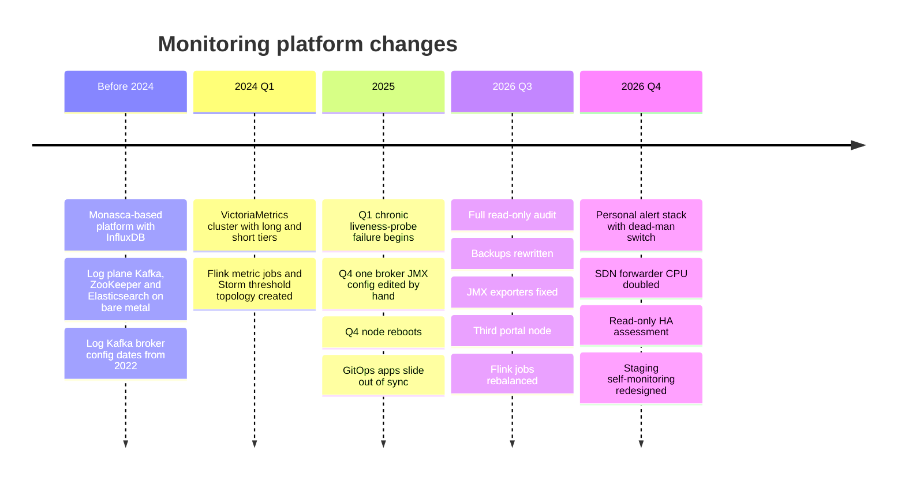
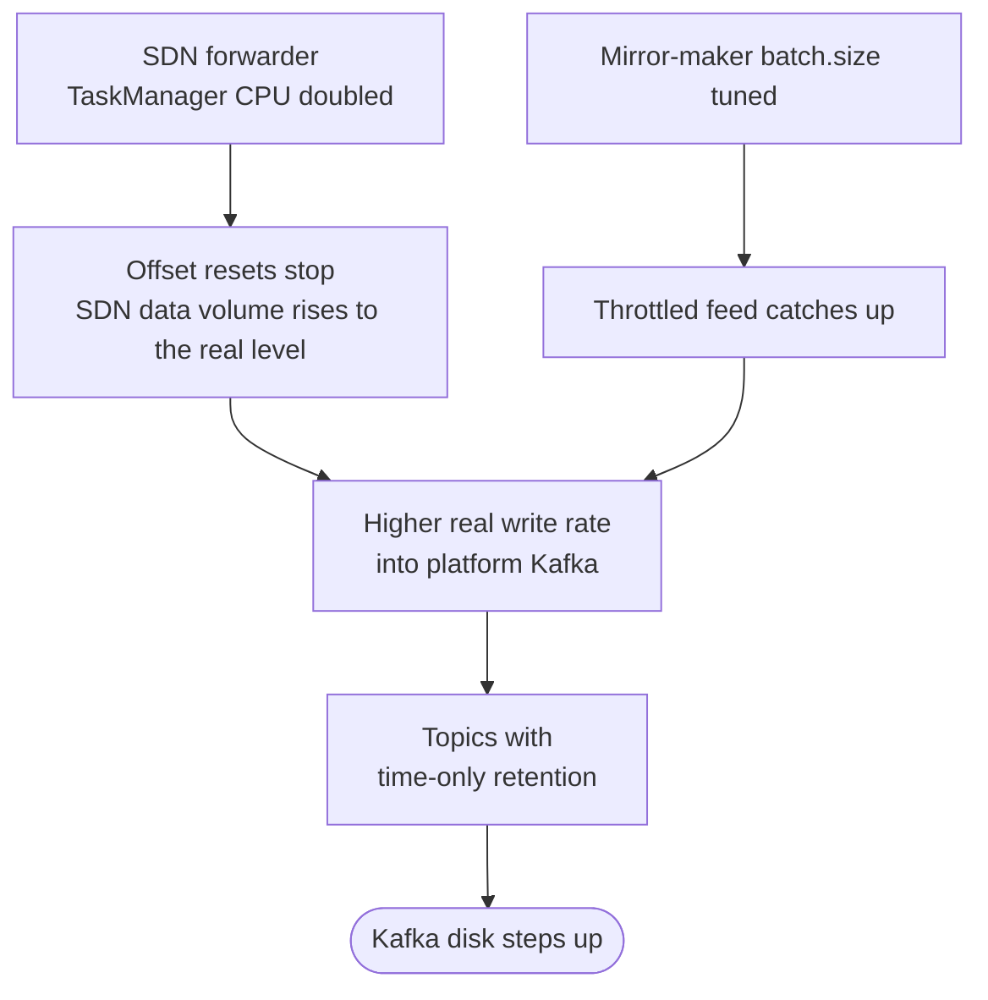

# Monitoring Platform: Notable Changes Over Time

This timeline covers notable changes to the monitoring platform, by quarter. Before mid-2026 the record is thin, because those dates come from system artefacts (uptimes, creation timestamps) rather than change logs. From 2026 Q3 on, I was keeping change records myself.

> [!TIP]
> **Key takeaways**
> - The real architecture changes, VictoriaMetrics and Flink, happened early and held up well.
> - 2025 was quiet drift: hand edits, chronic probe failures, apps sliding out of sync. Nobody alerted on any of it.
> - Most later work paid down operational debt (limits, backups, exporters, alert delivery, placement) and needed little new technology.
> - Fixes that restore real throughput move load downstream. Both Kafka disk steps came from correct upstream fixes.

## Before 2024: the foundations

**What existed.**

- The platform grew out of OpenStack Monasca: the API, persister, notification service and a Storm threshold topology, with InfluxDB as the original store.
- The log plane ran its own Kafka, ZooKeeper and Elasticsearch on bare metal.
- Most of the log Kafka broker configuration dates from **2022** and was hardly touched afterwards.

**Why it matters now.** Many current oddities are inherited from this era:

- the Monasca JSON envelope,
- `INFLUX_*` variable names pointing at VictoriaMetrics,
- two alarm engines,
- an old InfluxDB that still gets backed up even though it is no longer the main writer.

## 2024 Q1: VictoriaMetrics cluster and Flink become the core

**What changed.**

- The VictoriaMetrics cluster storage (long and short retention tiers) went into service around this time. Storage pods later showed uptimes of well over two years, and query logs reach back to this quarter.
- The current Flink metric jobs were created in the same period, and so was the Storm threshold topology.

**Why.** To move from InfluxDB to a horizontally scalable TSDB with native multi-tenancy, and to handle product feeds as stream jobs.

**Impact.** Query latency has been excellent ever since. The storage tier went years without a restart.

> [!WARNING]
> **Gotchas.** `-replicationFactor` was set on vminsert only, and both tiers ended up on the same filesystem per node. Nobody noticed either problem until an audit two years later.

## 2025: drift accumulates quietly

**What changed.** Nothing big, and that is the point:

| When | Drift |
|---|---|
| 2025 Q1 | A chronic liveness-probe failure began on a log-shipping DaemonSet. Over the following months it fired thousands of times. |
| 2025 Q4 | One log Kafka broker's JMX exporter configuration was edited by hand. The other brokers were not, and that drift went unnoticed for about ten months. |
| 2025 Q4 | Several nodes were rebooted, and a firewall-persistence service on one worker stayed in `failed` state from then on. |
| End of 2025 | The last recorded GitOps sync for several apps, after which they slid into `OutOfSync`. |

**Lesson.** Undocumented, unalerted drift is what turned up in the 2026 audits.

## 2026 Q3: audit, incidents, and fixes that stuck

This is the quarter in which we ran a full read-only audit and started keeping evidence-labelled change records.

| Change | Why | Impact | Gotchas |
|---|---|---|---|
| Full read-only audit of production, plus a VictoriaMetrics deep-dive | Users reported "slow" queries and connection errors | Found the keep-alive mismatch, `limitk` misuse, missing vmselect RF, shared filesystem, silently dropped samples. Corrected the "six months of runway" claim | Every finding came with a recommendation; none were applied as part of the audit |
| Staging: Vault → External Secrets autosync for dozens of apps, plus a certificate-rotation test | A renamed Vault mount broke secret paths, and because ExternalSecrets ran as Helm pre-install hooks, one Vault error failed the whole app sync | One secret source that re-syncs on its own | Staging only; production still lacks the same pieces |
| Added a third portal worker node | Only two nodes hosted customer APIs, so the pool could not lose a node | A failure domain to spare for the portal pool | The planned follow-up fix for the restarting metric API was not applied, and it kept restarting |
| NTP/chrony tuning across hosts | Clock-sync alerts on log hosts | Re-check showed zero hosts out of sync | "Time since last sync" alerts are not the same as real clock skew |
| node_exporter on the log tier, added to the self-monitoring scrape | Log hosts were barely visible | Host metrics for the log plane | Two runbooks for the same job; only one was ever executed |
| New Logstash nodes joined, one drained | Log nodes at 94–98% RAM | Load spread out | The drain plan missed a pod because `kubectl -o wide` output was parsed by column |
| Database backup rewritten | Backups had silently failed for weeks | First good backup in about two months, and much smaller compressed | The CronJob stayed suspended for weeks afterwards; no restore test yet |
| JMX exporter fixed on log Kafka brokers (explicit patterns, one-broker canary) | Exporters timed out for weeks | Broker metrics back on all brokers | The old alert watched the wrong job |
| Extra hardware and VM rebalancing | Memory-bound pools | Headroom on saturated pools | Less RAM per host was delivered than had been proposed |
| Flink jobs rebalanced onto two idle nodes | Flink out of slots while two nodes sat idle | Lag on one SDN job went to zero | The result tables in the runsheet were never filled in |

## 2026 Q4: alert path, data loss, and capacity

| Change | Why | Impact | Gotchas |
|---|---|---|---|
| Personal read-only alert stack (vmalert → own Alertmanager → Telegram) with dead-man's switch, backup status, certificate expiry, daily report | An independent check on the alert path itself, plus backup and certificate visibility in one place | Daily seventeen-item report each morning; backup and certificate digests; a mirror of the production rules running with `-notifier.blackhole` for comparison | See the list below the table |
| Removed a long-suspended Flink job | Dead weight | Cleaner job list | Nobody had noticed it was suspended |
| SDN forwarder TaskManager CPU doubled | The job was resetting offsets hundreds of times a day and losing a large share of SDN data | Resets stopped; SDN data volume rose to the real level | Platform Kafka disk usage stepped up as a result |
| Mirror-maker `batch.size` tuned for one region's SDN feed | Throttled replication | Feed caught up | Another Kafka disk step, because the topics had time-only retention |
| Read-only HA assessment | Needed a prioritised SPOF list | Found RF=1 log partitions, single-replica alerting on one node, almost no PDBs, two-node MinIO | Recommendations only |
| VM rebalance across hypervisors (moved the etcd leader off an overloaded host) | Slow etcd heartbeats | Planned as a scheduled change | The quick-tuning change was postponed to reassess risk |
| Staging self-monitoring redesigned: in-cluster plan dropped in favour of a separate VM | If the cluster dies, in-cluster monitoring dies with it | Design and configs validated offline | Not yet applied |
| Self-monitoring disk pressure: decide between dropping three Kubernetes histograms at vmagent and expanding disk | One instance growing by tens of GiB per day on a shared disk | Pending at the time of writing | Dropping the histograms needs agreement from the team that owns those clusters |
| Elasticsearch hot-tier disk expansion and Kafka retention changes | Hot tier nearing its threshold during nightly peaks | Pending | Raising retention would overfill platform Kafka brokers unless disks grow first |

Gotchas of the personal alert stack:

- It only covers itself.
- The dead-man still relies on a human noticing silence.
- vmalert loses `for:` state on restart.
- A missing config file once made Docker create a *directory* in its place and Alertmanager died, so now there's a preflight script.

## What the timeline says

- The real architecture changes (VictoriaMetrics, Flink) happened early and held up well.
- Most of the later work was **paying down operational debt**: limits, backups, exporters, alert delivery, placement. Very little of it needed new technology.
- Fixes that restore real throughput tend to **move load downstream**. Both Kafka disk steps came from correct fixes upstream.

