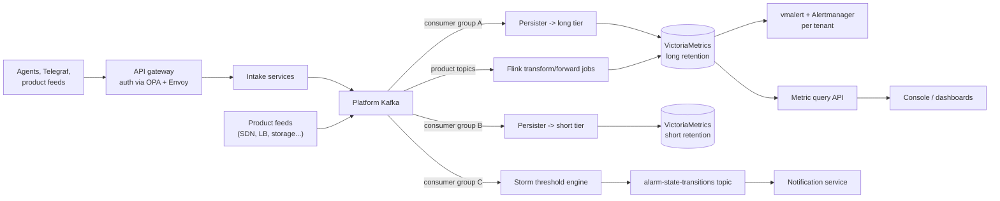
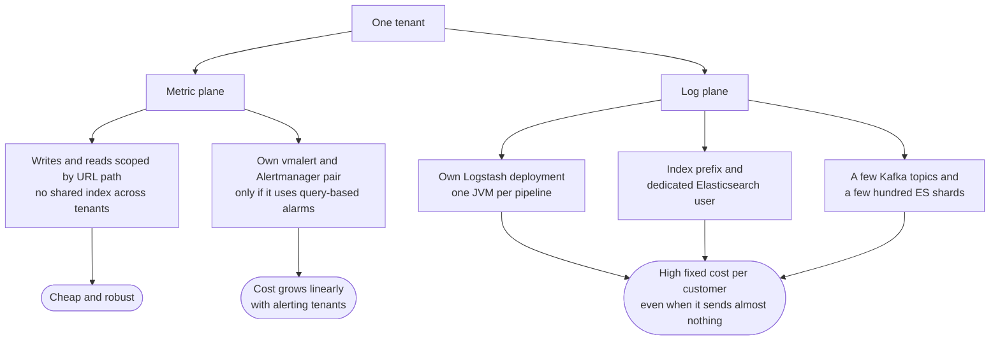
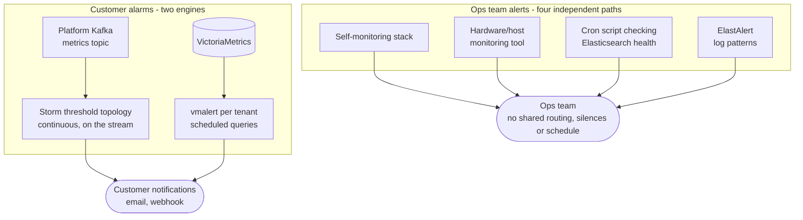
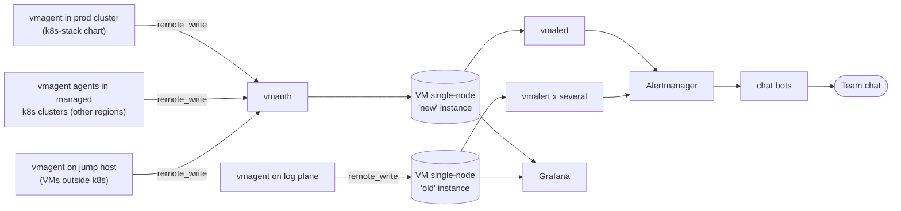
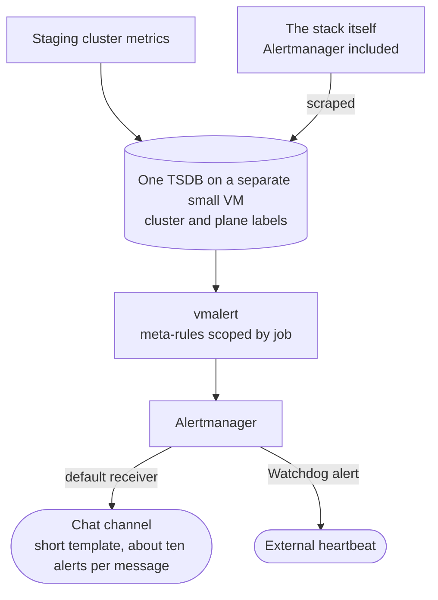

# Designing a Multi-Tenant Monitoring Platform at a Cloud Provider

These are my notes on how the monitoring platform at a public cloud provider is put together: how a metric gets from an agent to a dashboard or an alert, which time-series stack we run, how tenants are kept apart, and which design choices I would defend and which I would not repeat.

> [!TIP]
> **Key takeaways**
> - Two pipelines, metric and log, share one Kubernetes cluster. The metric plane fans out from Kafka into a VictoriaMetrics cluster with two retention tiers.
> - When monitoring breaks, the cloud keeps running but goes **blind**. That raises the bar for detecting our own failures.
> - Tenancy is cheap in storage (scoped by URL) but expensive in alerting (a vmalert and Alertmanager pair per tenant) and in logs (a Logstash deployment per tenant feed).
> - The data path has reasonable redundancy. Single points of failure collect in the alerting path and the shared services.
> - What I would change: one alert engine, one retention tier, isolated disks, and the alerting path treated as tier-0.

## What the platform is for

The platform collects **metrics and logs** for:

- the cloud's own products: compute, load balancers, block and object storage, SDN, backup, managed Kubernetes;
- customers who install an agent.

It stores them, evaluates alert rules, and serves dashboards and a query API.

One property shapes almost every trade-off: when the monitoring platform breaks, the rest of the cloud keeps running. The damage is **blindness**: nobody finds out that something else is broken. That raises the bar for detecting our own failures, and most of the hard lessons in these notes are about exactly that.

## Two planes

The platform is really two pipelines that share a Kubernetes cluster and some datastores:

| | Metric plane | Log plane |
|---|---|---|
| Runs on | Mostly inside a production Kubernetes cluster | Kafka, ZooKeeper, Elasticsearch on VMs and bare metal; Logstash as pods |
| Entry point | API gateway (Kong) with OPA/Envoy auth | Agents (Filebeat) write straight to a log Kafka cluster over mutual TLS |
| Bus | In-cluster "platform" Kafka | Separate "log hub" Kafka, outside the cluster |
| Processing | Flink jobs, Monasca persisters, Storm threshold topology | One Logstash deployment per tenant feed |
| Storage | VictoriaMetrics cluster, two retention tiers | Elasticsearch, plus object storage for archive and replay |
| Tenancy | URL path `accountID:projectID` | Index prefix plus a per-tenant Elasticsearch user |
| Scales by | Kafka partitions and Flink parallelism | Number of pods |

The rest of this document is mostly about the metric plane, with the log plane where it matters.

## The metric pipeline



**Ingest.** Agents and products POST to the gateway on several routes:

- a native intake endpoint,
- an InfluxDB line-protocol `/write` endpoint for Telegraf,
- the customer metric API,
- a metadata forwarder.

The intake services authenticate the request and write to Kafka.

**Wire format.** The platform grew out of OpenStack Monasca, so messages are still the Monasca JSON envelope:

- `metric.name` becomes the series name,
- `metric.dimensions` become labels,
- tenant and region ride in `meta`.

On the storage side, the large majority of writes into VictoriaMetrics come through the **InfluxDB line-protocol** endpoint. Prometheus remote-write is a small minority. That is also why the persisters' environment variables are still called `INFLUX_*` even though they point at VictoriaMetrics. Names outlive the systems they described.

**Fan-out from one topic.** The central `metrics` topic is read by three independent consumer groups:

1. a persister that writes the **long-retention** VictoriaMetrics cluster,
2. a second persister that writes the **short-retention** cluster,
3. the Storm threshold topology that evaluates customer alarms on the stream.

Product-specific feeds (SDN, load balancer, storage, Ceph) go through Flink jobs. They transform the data, join it with broadcast configuration and metadata topics, and sink it into VictoriaMetrics. The usual Flink job shape is Kafka source, broadcast config, map/transform, VM sink. The map/broadcast operator is where throughput runs out.

**Why Kafka in the middle.** Kafka decouples bursty ingest from storage and lets several consumers read the same data independently. The cost is that Kafka retention becomes a data-loss budget.

> [!WARNING]
> On the metric plane, Kafka retention is set in bytes and works out to **about an hour or two** of data on the busiest topics. If a consumer falls behind by more than that, Kafka deletes data the consumer has not read yet. This is the platform's biggest silent-loss mechanism (see the challenges write-up).

## Storage: VictoriaMetrics cluster, two tiers

We run the **VictoriaMetrics cluster** version (vminsert / vmselect / vmstorage) on a small set of dedicated storage nodes. Those nodes carry a label and a matching taint, so only the storage components and the persisters land on them.

| | Long tier | Short tier |
|---|---|---|
| Retention | ~60 days | ~1 day |
| Replication | `-replicationFactor=2` on vminsert | same |
| Data per storage node | hundreds of GiB | tens of GiB |
| Written by | Persister group A + Flink | Persister group B |

Some facts about the shape of the data:

- **High single-digit millions of active series** in the long tier. The short tier's biggest tenant alone carries **more than ten million series**.
- Ingest is on the order of **100k+ samples per second** into each tier.
- **Churn is very low**: new series appear at a fraction of one per second. So the series set is large but stable.
- The query path is fast. vmselect p50 is a few milliseconds and p99 is around a hundred milliseconds.

**Why two tiers.** The sources only infer the reason (a cheap, fast path for recent data), and nobody I could find wrote down the original rationale. What is certain is the cost: every sample is ingested twice through two sets of persister pods. If I were designing it today I would run a single cluster and use downsampling or recording rules for the hot path.

**Two design defects we found later.**

| Defect | What it causes |
|---|---|
| `-replicationFactor=2` set on vminsert but **not on vmselect** | With RF=2, data survives losing one storage node, but vmselect does not know it can get a complete answer from the surviving replica. It returns partial results instead. The `vm_partial_results_total` counter showed this had happened during past storage-node blips. |
| Each storage node gives both tiers their own PersistentVolume, but **both PVs resolve to the same filesystem** | It shows up as identical `vm_free_disk_space_bytes` for both clusters. Kubernetes believes it has roughly twice the disk it really has. |

> [!WARNING]
> Because both tiers share one filesystem, they are not isolated. If either tier fills the disk, both hit `-storage.minFreeDiskSpaceBytes` and go read-only together.

## Multi-tenancy

VictoriaMetrics' built-in tenancy does the heavy lifting on the metric side. Every write and read is scoped by URL:

```text
/insert/0:<projectId>/prometheus/...
/select/0:<projectId>/prometheus/...
```

There is no shared index across tenants, and a query can't reach another tenant's data without changing the URL. That is simple and robust.



**Alerting is where tenancy gets expensive.** Each tenant that uses query-based alarms gets its **own vmalert and Alertmanager pair**, so the cost grows linearly with the number of alerting tenants.

> [!NOTE]
> The per-tenant rules live in ConfigMaps reloaded by a sidecar, not in operator `VMRule` CRs. As a result, `kubectl get vmrules` shows nothing, which confused more than one person on call.

**The log plane does tenancy very differently.** Each tenant feed gets its own Logstash deployment (one JVM per pipeline), plus an index prefix and a dedicated Elasticsearch user. Isolation is strong, but the **fixed cost per customer** is high, and it holds even when the customer sends almost nothing:

- a JVM heap,
- a few Kafka topics with well over a hundred partitions,
- a few hundred Elasticsearch shards.

When we modelled growth, the per-customer fixed cost mattered more than byte volume for most customers. Traffic is extremely skewed: a couple of tenants generate most of the log volume.

## Alerting: more paths than I would like

Customer alarms are evaluated by **two engines in parallel**:

| Engine | How it evaluates | Why it exists |
|---|---|---|
| Storm threshold topology (Monasca heritage) | Continuously, on the Kafka stream | The original alarm engine |
| vmalert per tenant | PromQL/MetricsQL queries on a schedule | Newer, query-based rules |

Both end in customer notifications (email, webhook). Merging them was on the optimisation list. The sources don't say which customer alarms come from which engine, and that alone is an argument for having one engine.

The operations team's own alerts take more paths again. These paths **share no routing, no silences and no on-call schedule**, so one incident can surface as four unrelated streams of messages.



## Kubernetes layout

The production cluster is a **self-managed kubeadm cluster** of a few dozen nodes. It is not the cloud's managed Kubernetes product. Workloads are split into node pools with a label plus a matching `NoSchedule` taint:

| Pool | Carries |
|---|---|
| control plane | API servers, etcd |
| edge | HAProxy/keepalived pair publishing dashboards |
| portal | Customer-facing APIs with Envoy sidecars |
| backend | Platform Kafka, ZooKeeper, Storm, Monasca services |
| tsdb | vminsert / vmselect / vmstorage and persisters |
| flink | Flink metric and log jobs, in-cluster MinIO for checkpoints |
| log | Logstash fleet |
| ops | ArgoCD, External Secrets Operator, backup CronJobs |

- **Namespaces follow function:** gateway, backend, alarm, customer APIs, Flink, log service, self-monitoring, storage, GitOps.
- **Deployment** is GitOps with ArgoCD.
- **Secrets** are synced from Vault by External Secrets Operator.

**What pools give you.** Predictable placement, and a noisy Logstash can't starve vmstorage.

**What they cost.** Small pools where losing one node hurts:

- one ops node carrying every backup job,
- a couple of portal nodes,
- storage-tier nodes that also host the alerting pods.

The HA review later found that pool design alone does not give you HA. You still need anti-affinity and PodDisruptionBudgets, and we had almost none.

## Self-monitoring, outside the cluster

To watch the platform itself, the team runs a **separate stack on a VM outside the production cluster**. If the cluster dies, the thing telling us about it should not die with it.



The stack itself scrapes almost nothing. Everything is pushed in by vmagent over `remote_write` through vmauth. That includes vmagents running in managed Kubernetes clusters in **other regions**, so this one VM is also our cross-site view.

It works, but it has collected several problems over time:

| Problem | Consequence |
|---|---|
| **Several single-node VictoriaMetrics instances**, split by history (one mostly Influx line protocol, one mostly remote-write), plus a few per-product instances | Whether a target shows up on a dashboard depends on *which* vmagent you added it to. A previous audit concluded "Elasticsearch is not monitored" because its series lived only in the other instance. |
| All instances write to **one shared data filesystem with no per-instance quota** | One runaway instance can blind all of them. |
| **One VM, no HA, on an end-of-life OS** | Losing it means losing TSDB, rules, routing, chat bots and Grafana at the same time. |
| Label conventions drifted | Several unrelated managed clusters all report `cluster="k8s-cluster"`, so you have to group by the `prometheus` external label instead. |

When we designed the equivalent stack for staging, we deliberately changed several of these (see below).

## HA and retention, honestly

| Area | State |
|---|---|
| Control plane | 3 API servers and 3 etcd members behind a keepalived VIP. Fine, though the masters are undersized |
| Platform Kafka | RF=3, `min.insync.replicas=2`, no under-replicated partitions. Retention is only an hour or two |
| VictoriaMetrics | RF=2 on insert; vmselect missing RF, which causes partial results; the two tiers share a filesystem |
| Flink | Kubernetes HA services with checkpoints, but HA state lives in an in-cluster MinIO on two nodes, so losing one node loses write quorum |
| Per-tenant alerting | Single replica each, mostly on one storage node, with node-pinned local PVs |
| Log Kafka | A large share of partitions at RF=1 |
| Self-monitoring | One VM |
| Backups | Daily for databases and VictoriaMetrics (vmbackup), one destination, no restore test |

The general pattern:

- The **data path** (Kafka, VictoriaMetrics, persisters, gateway) has reasonable redundancy.
- The **alerting path** and the **shared services** (ops node, MinIO, self-monitoring VM) are where single points of failure collect.

## Staging versus production

Staging differs from production in ways that matter:

| | Production | Staging |
|---|---|---|
| Kubernetes | Self-managed kubeadm | The cloud's **managed Kubernetes service** |
| Galera, MinIO, Flink | On external VMs | Inside the cluster |
| Control plane | Self-managed | Managed: no etcd or scheduler targets to scrape |

The staging cluster also has its own NAT gateway. Recovery drills written on staging cannot be replayed on production without being rewritten.

When we designed staging's self-monitoring, we first proposed running it inside the cluster, then reversed that. It now gets its own small VM, mirroring production's out-of-cluster design, but with the lessons applied:

- **One TSDB with `cluster`/`plane` labels** instead of several instances.
- **Default receiver is the chat channel, not a blackhole**, so mislabelled alerts still show up.
- **Short alert template**, capped at about ten alerts per message.
- **A Watchdog alert** wired to an external heartbeat, plus meta-rules for "no data from cluster", "vmauth rejecting", "Alertmanager failing to send" and "TSDB disk filling" (scoped by `job`).
- **Scrape the stack itself**, Alertmanager included.
- All configuration lives in Git. On the production side, the jump-host vmagent config does not.



As of these notes, the staging design is written and validated offline but not yet applied.

## Trade-offs I would make differently

- **One alert engine, not two.** Two engines evaluating the same data double the operating cost and blur ownership.
- **One retention tier**, with downsampling, instead of dual-writing every sample.
- **Isolate disks per TSDB** and make the capacity Kubernetes sees match the physical disk.
- **Size Kafka retention in time with a byte cap**, and alert on consumer headroom, not on lag.
- **Treat the alerting path as tier-0**: replicas, anti-affinity, PDBs, and a dead-man's switch from day one.
- **Self-monitoring needs its own HA**, or at least a backup and a second region that can take over the dead-man check.
