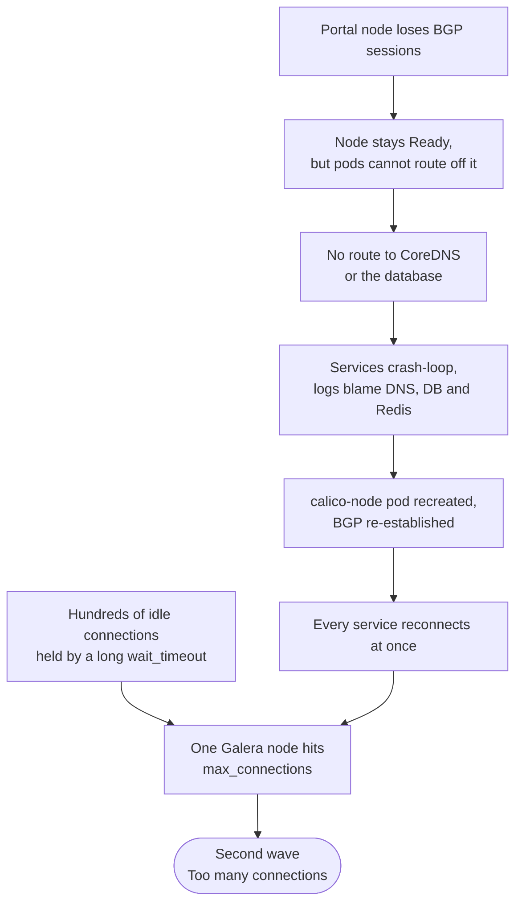
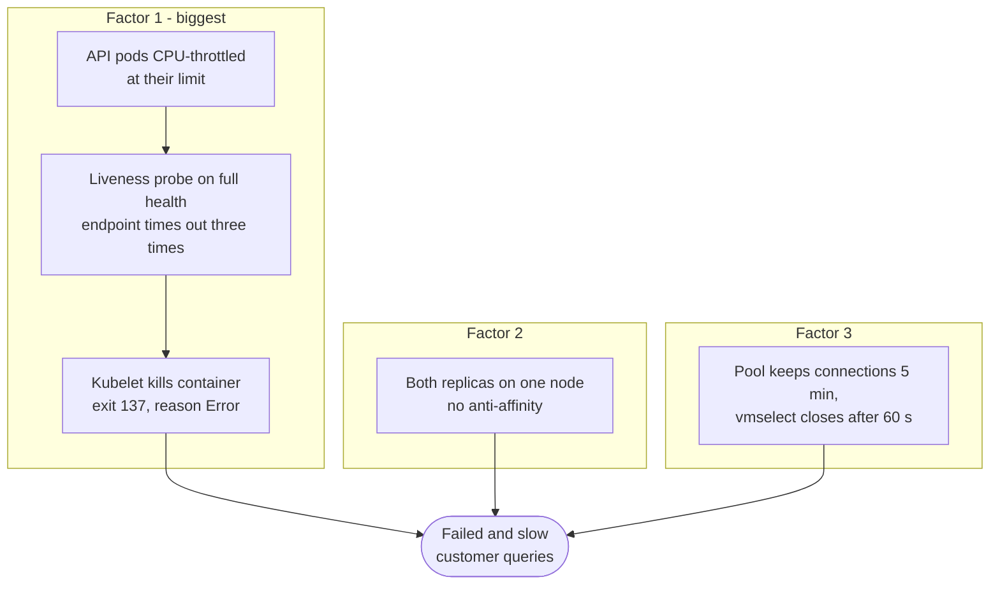
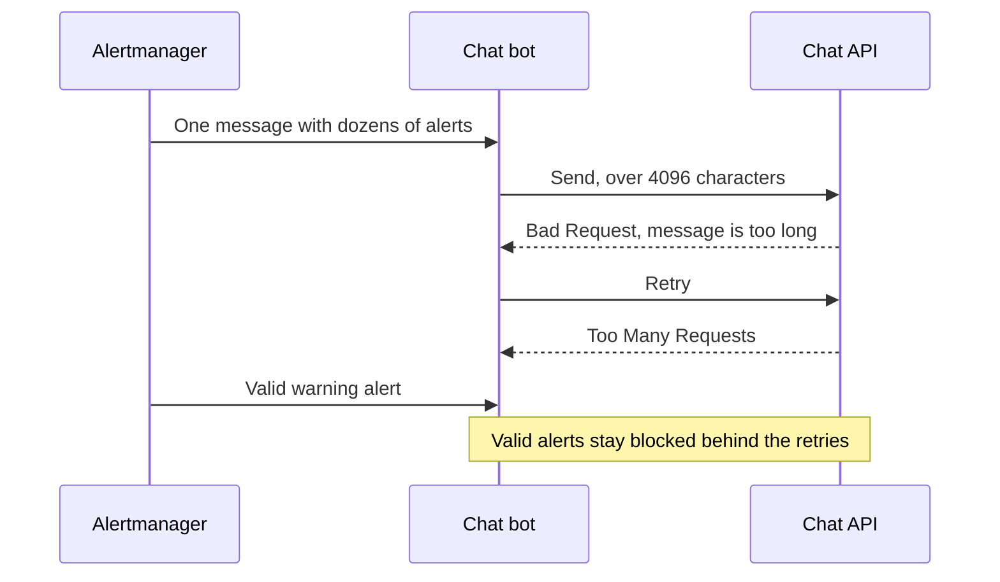
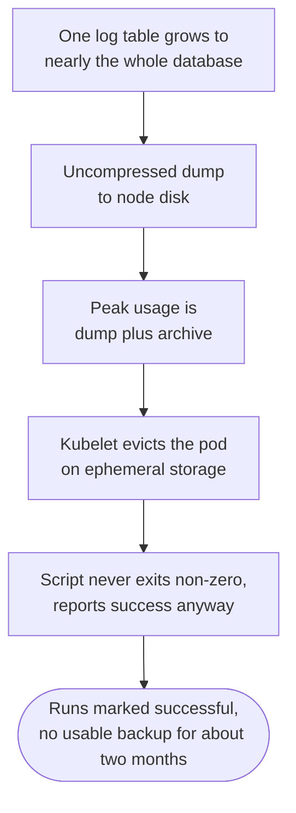
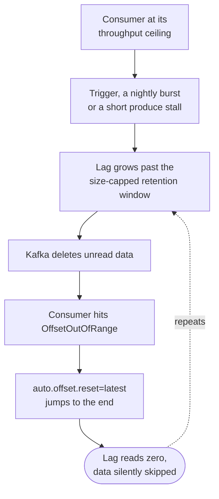

# Monitoring Platform Incidents: Postmortems

These postmortems cover incidents we hit on the monitoring platform, in a fixed format: symptoms, impact, root cause, fix, prevention. Hostnames, addresses and tenant identifiers are replaced with `<placeholders>`. Where a fix was recommended but not yet applied when I wrote this, I say so.

> [!TIP]
> **Key takeaways**
> - Error messages name the dependency a service *noticed* failing, not the thing that broke. Group failures by node first.
> - Several incidents were silent: lag at zero while data was lost, `Up` exporters with no data, backups that "succeeded".
> - `exit 137` with `reason=Error` means a probe kill or an eviction until proven otherwise.
> - Message size and rate limits can quietly stop alert delivery.
> - After any throughput fix upstream, recheck capacity downstream.

| # | Incident | Quarter |
|---|---|---|
| 1 | Customer APIs crash-loop together | 2026 Q3 |
| 2 | "unexpected end of stream" and a metric API killed every half hour | 2026 Q3 |
| 3 | Four critical alerts, all false | 2026 Q3 |
| 4 | Warning alerts stopped reaching chat | 2026 Q3 |
| 5 | Log Kafka broker metrics missing for weeks | 2026 Q3 |
| 6 | Database backups "succeeded" while failing | 2026 Q3 |
| 7 | A log node "loses its kubelet" every day | 2026 Q3 |
| 8 | Silent metric loss through Kafka offset resets | 2026 Q4 |
| 9 | Platform Kafka disks jump overnight | 2026 Q4 |
| 10 | `/series` fails on one huge metric | 2026 Q3, dormant |

## 1. Customer APIs crash-loop together: one node's network, then a connection storm (2026 Q3)

**Symptoms.**

- Many customer-facing API services crash-looped at the same moment.
- Their logs blamed the database and Redis:

  ```text
  java.net.UnknownHostException: <db-host>.<internal-domain>
  All sentinels down ...
  ```

- During recovery a second wave appeared:

  ```text
  ERROR 1040 (HY000): Too many connections
  ```

**Impact.** A customer-facing API outage.

**Root cause.**

1. One portal node lost its BGP sessions. Calico's readiness output showed `BGP peering established = 0`. The node stayed `Ready` and its pods kept "running", but nothing on that node could route off it, including to CoreDNS. So the services reported the dependency they *noticed* failing (DNS and the database), not the thing that had actually broken.
2. Once routing came back, every service reconnected at once. Combined with hundreds of idle connections held open by a very long `wait_timeout`, this drove one Galera node to its `max_connections` limit.



**Fix.**

- Deleted the stuck `calico-node` pod so the DaemonSet recreated it and BGP re-established.
- On the database, raised `max_connections` at runtime, shortened `wait_timeout`, and killed the idle sessions.

**Prevention.**

- Triage now starts by **grouping failures by node**. Here the pattern was obvious within seconds, yet it took about 40 minutes to find, because the investigation started from the error messages.
- Persist the runtime DB setting in configuration. It was still tracked as an open item weeks later.

> [!WARNING]
> A port check doesn't detect connection exhaustion: MySQL accepts the TCP connection and then refuses at auth. Check `Threads_connected` against `max_connections` instead.

```bash
# [read-only] where are the crash-looping pods?
kubectl get pods -A -o custom-columns='NODE:.spec.nodeName,W:.status.containerStatuses[*].state.waiting.reason' \
  --no-headers | grep -i crashloop | awk '{print $1}' | sort | uniq -c | sort -rn
# [read-only] CNI state on a suspect node
kubectl describe pod -n kube-system -l k8s-app=calico-node --field-selector spec.nodeName=<node> \
  | grep -oE "BGP peering established = [0-9]+|BIRD is not ready"
```

## 2. "unexpected end of stream" and a metric API killed every half hour (2026 Q3)

**Symptoms.**

- Customers saw intermittent errors from the metric query API, and the API felt slow.
- Latency alerts fired on the API, and a connection-pool alert fired on the notification service.
- Client logs showed:

  ```text
  okhttp3.OkHttpClient : <-- HTTP FAILED: java.io.IOException: unexpected end of stream on http://<vmselect>:8481/...
  ```

**Impact.** Intermittent failed and slow dashboard queries for customers.

**Root cause.** Three factors, in order of weight:

1. The metric API pods were **CPU-throttled** at their limit for a large share of scheduling periods. Under throttling, the liveness probe on the full health endpoint timed out three times in a row, and the kubelet killed the container: exit code 137, reason `Error`, not `OOMKilled`. That happened roughly every 30 minutes. In the same hour, dozens of other containers across the platform were killed the same way.
2. Both replicas ran on the same node with no anti-affinity.
3. A **keep-alive mismatch**: vmselect closes idle connections after 60 seconds, and the OkHttp pool keeps them for 5 minutes. Any connection reused in that gap fails with the error above. vmselect itself was healthy: millisecond p50, no restarts in years.



**Fix (recommended).**

- Raise the CPU limit or the probe timeout, and point liveness at a lightweight liveness endpoint.
- Add `podAntiAffinity` and scale out once the new portal node is available.
- Set the client keep-alive below the server idle timeout, or raise `-http.idleConnTimeout`. Pick one, not both.

When this was written, the API was still restarting regularly, so the throttling fix had not landed yet.

**Prevention.** Fix the throttling first and the keep-alive second.

> [!WARNING]
> Rule of thumb: `exit 137` with `reason=Error` means a probe kill or an eviction until proven otherwise.

## 3. Four critical alerts, all false: the monitoring path was blind (2026 Q3)

**Symptoms.** Kubelet down, API server down, kube-state-metrics down and Redis missing its master all fired at the same moment.

**Impact.** No impact on customers. On-call chased healthy components. After that, every alert from that path counted as unverified, for weeks.

**Root cause.** vmagent → storage delivery for the self-monitoring tenant had stopped, and rules built on `absent()` fired on the gap. The remote-write error counter was **frozen** at an old value, which meant writes had stopped rather than failing.

**Fix.** The vmagent queue drained without dropping packets, but `count(up)` stayed empty for a long time afterwards. Tracing the write path to the tenant's vminsert remained an open P1.

**Prevention.**

```bash
# [read-only] is the monitoring path alive?
curl -sG "http://<vmselect>:8481/select/<tenant>/prometheus/api/v1/query" --data-urlencode 'query=count(up)'
# [read-only] vmagent delivery health
curl -s "http://<vmagent-pod-ip>:8429/metrics" \
  | grep -E '^vmagent_remotewrite_(errors|packets_dropped)_total|^vm_persistentqueue_bytes_pending'
```

The on-call rule is now: if three or more "X is down" alerts fire while X is visibly running, the monitoring is broken, not X.

## 4. Warning alerts silently stopped reaching chat (2026 Q3)

**Symptoms.** The warning channel received almost nothing, and the critical channel was erratic for a period. The bot logs showed:

```text
Bad Request: message is too long
Too Many Requests
```

**Impact.** Valid warning-level alerts for production never reached a human.

**Root cause.**

- Grouping was broad (`group_by: [job, alertname]`), so one message carried dozens of alerts.
- Two etcd rules carried every managed-cluster tenant label plus long URLs.
- Messages over 4096 characters were rejected, the bot retried them, and the retries hit the chat API's rate limit, which blocked the valid alerts behind them.
- An early report of "0% delivery" was itself wrong: it counted a success string that the log never contained.



**Fix.** Proposed in this order:

1. truncate the template,
2. fix or silence the two noisy rules,
3. rate-limit the channel.

In the separate alert stack, the template is capped per message and tested with a fifty-alert flood that must arrive as a single message.

**Prevention.** Measure delivery per hour (successes against failures), not from "the last N log lines". Scrape the Alertmanager and alert on `alertmanager_notifications_failed_total`.

## 5. Log Kafka broker metrics missing for weeks, alert never fired (2026 Q3)

**Symptoms.** An audit found that most JMX exporters on the log Kafka brokers had produced no data for several weeks. The `UnderReplicatedPartitions` rule sat `inactive`, which looked healthy.

**Impact.** No visibility into broker health or replication on the log plane during that period. No data loss was attributed to it.

**Root cause.**

- A catch-all `- pattern: .*` in the JMX exporter config exported every MBean attribute.
- With hundreds of topics, a scrape took longer than the 120-second scrape timeout. The containers stayed `Up`.
- One broker had been fixed by hand months earlier, so the configs had drifted.
- The "Kafka down" alert watched the **host** exporter, not the brokers.

**Fix.** Explicit patterns with a whitelist, canaried on one broker, then rolled out. All broker exporters reported again afterwards.

**Prevention.**

- Liveness rules for every exporter job (`count(up{job="<job>"} == 0) > 0`).
- Treat `inactive` with no source data as broken, not as fine.
- Diff exporter configs across brokers.

## 6. Database backups "succeeded" while failing for weeks (2026 Q3)

**Symptoms.** Backup pods ended in `Error` or `Evicted` on the ops node. One run marked successful took three seconds. Backups of a second datastore were blocked as well.

**Impact.** No usable relational database backup for about two months. Nothing was lost, because no restore was needed in that window.

**Root cause.**

- One notification log table had grown to nearly the whole database.
- The script dumped everything uncompressed to node disk before compressing it, so peak usage was dump plus archive, and the kubelet evicted the pod on ephemeral storage.
- Worse, the script never exited non-zero and reported success even when the upload failed.



**Fix.** Rewrote the job:

- dump per database with `--single-transaction`,
- compress with `gzip -1` as it streams,
- use a bounded `emptyDir`,
- return real exit codes.

A manual run succeeded and was much smaller compressed. The CronJob was re-enabled later and then ran successfully night after night.

**Prevention.**

- Always-firing `BackupStatus` alerts per CronJob:

  | Age of last good backup | Status |
  |---|---|
  | under 25h | green |
  | 25–48h | amber |
  | beyond 48h | red |

- Also `BackupJobFailed`, `BackupSuspended`, `BackupRunningTooLong`, `BackupNeverSucceeded`.
- A restore test was still outstanding when this was written. That is the real gap.

## 7. A log node "loses its kubelet" every day (2026 Q3)

**Symptoms.** A critical kubelet-down alert for one log node fired daily and cleared about two minutes later. By the time anyone looked, the node was `Ready`.

**Impact.** Noise plus repeated Logstash restarts. No outage of the log pipeline itself.

**Root cause.** Node-wide memory exhaustion. Most Logstash pods had no memory request or limit, so the scheduler kept packing them onto this node. The kernel OOM killer fired, and the kubelet itself was starved:

```text
kubelet invoked oom-killer: ... oom_score_adj=-999
Out of memory: Kill process <pid> (java) ...
```

**Fix.**

- Short term: cordon the node and move some heavy pods off it.
- Real fix: requests and limits in the Logstash provisioning template.

**Prevention.**

```bash
# [read-only] on the node: was the kernel killing things?
dmesg -T | grep -E "invoked oom-killer|Out of memory"
grep -E "MemTotal|MemAvailable" /proc/meminfo
# [read-only] memory requested vs. actually used per node
kubectl describe node <node> | grep -A5 "Allocated resources"
```

## 8. Silent metric loss through Kafka offset resets (2026 Q4)

**Symptoms.**

- On one forwarder, the consumer lag graph had a sawtooth shape that kept dropping back to zero. On the busy SDN feed, lag climbed into the tens of millions after a brief stall.
- Pods also restarted with exit code 137, `reason=Error`.

**Impact.** Metric data was skipped without any alert.

- On the forwarder: more than a dozen resets over two months, each worth roughly a partition of messages.
- On the SDN path, before the fix: a large share of the feed's data was lost every day.

**Root cause.**

- The consumers ran at their throughput ceiling. The forwarder could not keep up with nightly bursts, and the SDN job's Kafka sink was limited by broker produce latency.
- Topic retention was capped by size, so lag beyond the window meant Kafka deleted unread data. The consumer then hit `OffsetOutOfRange`, and `auto.offset.reset=latest` jumped it to the end. Lag went to zero exactly when data was lost.
- On the SDN incident day, the trigger was a short cluster-wide produce stall in Kafka. Its cause was never found: brokers were clean, and CPU, disk and network were normal. We ruled out more than a dozen hypotheses, including a partition increase on a related topic, MinIO disk load, and deployments that happened at the same time.



> [!NOTE]
> The forwarder's restarts were a separate kernel OOM: heap plus off-heap usage went over a 6Gi limit. Because Java was not PID 1, Kubernetes recorded `Error` and not `OOMKilled`.

**Fix.**

- SDN path: doubled the TaskManager CPU, and resets stopped until the next upstream stall.
- Forwarder: raise the memory limit and keep the heap as it is (live heap at peak ruled out shrinking it). More consumer throughput is still needed.

**Prevention.** Alert on per-partition headroom, not lag:

```promql
# headroom (messages) before Kafka deletes unread data, per partition
min by (topic, partition) (
  kafka_consumergroup_current_offset{consumergroup="<group>"}
  - on (topic, partition) group_left kafka_topic_partition_oldest_offset
)
```

A sudden jump in committed offset far above the normal consume rate also marks a reset.

## 9. Platform Kafka disks jump overnight (2026 Q4)

**Symptoms.** Data disks on all Kafka broker nodes rose by about ten percentage points in a day and then flattened. On the fullest brokers, around a fifth of the disk was left free.

**Impact.** None yet. But a planned retention increase would have filled two brokers.

**Root cause.**

- Two busy topics had time-based retention and `retention.bytes=-1`.
- Two correct upstream fixes (more CPU for the SDN forwarder, and mirror-maker batching) raised the real write rate, and disk use stepped up to rate × window × replicas.
- One broker also held all three replicas of a large metadata topic.

**Fix (proposed).**

- Byte caps on those topics.
- A review of the metadata topic's 24-hour retention.
- A throttled partition reassignment.
- Disk expansion before any retention increase.
- An 85% disk alert on the broker volumes.

**Prevention.** After any throughput fix upstream, recheck capacity downstream.

## 10. `/series` fails on one huge metric (2026 Q3, dormant)

**Symptoms.**

```text
the number of matching timeseries exceeds 30000; either narrow down the search or increase -search.maxUniqueTimeseries
```

The failing request was `/api/v1/series` for a load-balancer member metric over a 24-hour range.

**Impact.** One dashboard panel failed. No errors appeared in the following audit window.

**Root cause.** That single metric name had about five times the default limit in series. Load-balancer member metrics were about half of the tenant's series.

**Fix.** We did **not** raise the limit, because that turns a fast failure into a slow, useless success. The direction is to narrow the matcher and reduce the cardinality at the source.

**Prevention.** Review `/api/v1/status/tsdb` top label values regularly.
