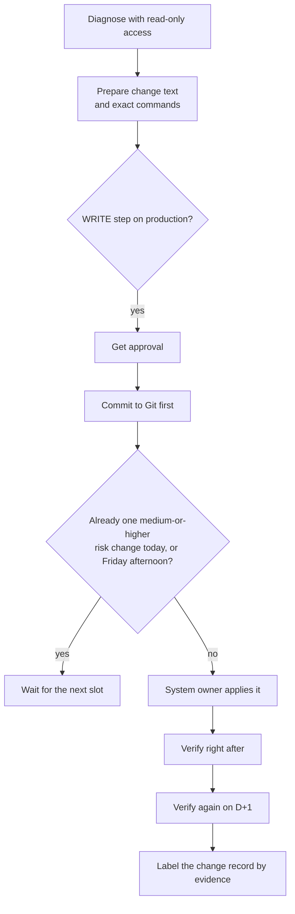
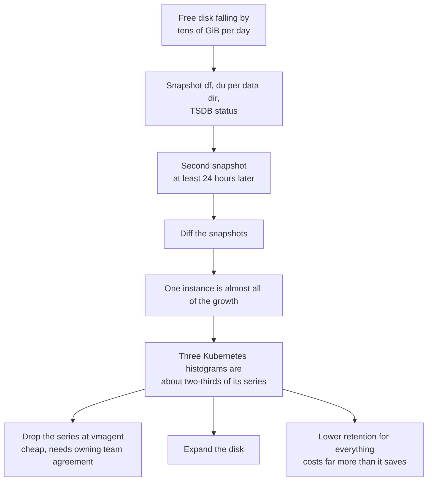
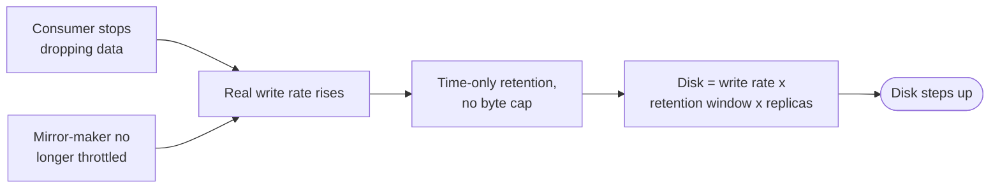
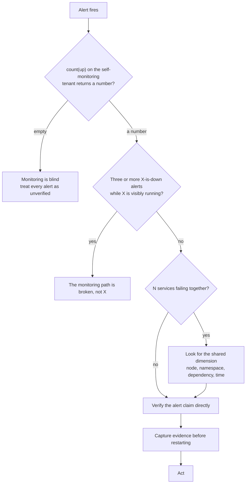

# Operating a Monitoring Platform Without Breaking It

This is how we run the monitoring platform day to day: how we touch production safely, manage capacity and disk growth, keep cardinality and alert rules under control, and watch the monitoring system itself. Most of these practices exist because something went wrong without them.

> [!TIP]
> **Key takeaways**
> - Production is read-only by default. Most access paths don't enforce that, so we make the safe path the easy path.
> - At fixed retention, disk reaches a steady state. Find which instance is growing before choosing a lever.
> - Cut cardinality at the source; don't raise limits to make errors go away.
> - Alert rules fail silently. Check selectors, scope self-metrics by `job`, and default to a catch-all channel.
> - Trust no alert until `count(up)` shows the monitoring path is alive, and keep a dead-man's switch that pages from outside the stack.

## Production is read-only by default

The working rule is blunt. **Diagnosis is read-only. Changes are proposed, approved, and applied by the system owner.**

- Every command in our docs is tagged `[read-only]` or `[WRITE]`.
- A `[WRITE]` step on production needs approval before anyone runs it.
- When I am investigating, I prepare the change text and the exact commands, and someone else applies them.

What makes this harder than it sounds is that **most access paths do not enforce read-only**. Only discipline does:

| Access path | Enforced read-only? |
|---|---|
| Default `kubectl` on a control-plane node | No, it is cluster-admin |
| `kubectl` impersonating a read-only service account | Yes |
| `curl` to a ClusterIP or pod IP | No. Whatever the service allows, you can do |
| SSH to datastore hosts | No |
| Datastore admin accounts | No; dedicated read-only accounts did not exist yet |
| Internal HTTP APIs (TSDB and similar) | Not reliably. Admin operations sit next to query endpoints, so the HTTP method is your only guard |
| Web UIs (Grafana, Kafka UI, ArgoCD, Flink) | No, they all have action buttons |

So we make the safe path the easy path:

```bash
# [read-only] every kubectl call goes through a read-only service account
K(){ command kubectl --as=system:serviceaccount:<ns>:<readonly-sa> "$@"; }
# make the dangerous default fail loudly in this shell
kubectl(){ echo "STOP: use K (read-only session)" >&2; return 1; }
K auth can-i delete pods -n <namespace>   # must print "no"
```

Other rules in the same spirit:

- **GET only.** No `curl -X POST/PUT/DELETE`, and no `-d` either. No UI action buttons (Sync, Restart, Silence, Reset offset).
- **Don't attach to a live Kafka consumer group** to "just look". Joining triggers a rebalance.
- **Reads can hurt too.** Avoid scanning every Elasticsearch index or running `COUNT(*)` on a large table during an incident. For TSDB cardinality, use `/api/v1/status/tsdb`, which reads precomputed index stats, instead of ad-hoc `count by` queries.
- **Don't trust `auth can-i` for proxy subresources.** It said "yes" for `services/proxy`, and the real request was Forbidden.
- **Run scripts over stdin** (`ssh host 'bash -s' < script.sh`) so nothing is left on production hosts.

> [!WARNING]
> `curl -d` silently switches the request to POST. A "read" with a data flag can be a write.

## Change discipline



- **One medium-or-higher-risk production change per day**, and none on Friday afternoon.
- **Verify on D+1**, not just right after. Nightly jobs (backups, compaction, traffic peaks) are where regressions show up.
- **Label change records by evidence**:
  - done with evidence (logs, measurements),
  - done by the operator's word with no proof,
  - drafted only,
  - postponed.

  A runbook that says "not yet applied" does not prove the change wasn't made, and a runbook that exists does not prove it was.
- **Commit to Git before touching the cluster.** Many ArgoCD apps were `OutOfSync`, so a manual sync would have silently reverted any change that wasn't in Git.
- **Cap urgent work.** The weekly plan allows at most five P1 items. Anything older than a month with no owner is escalated rather than quietly promoted to P1.

## Daily and weekly checks

We run a daily check and a weekly checklist. A few things made them worth doing:

- **Measure from the right place.** Commands that hit cluster IPs must run from inside the cluster network. Run from a laptop, they return zeros or timeouts that look like outages.
- **Record numbers in a history file**, so "is this new?" has an answer.
- **When you can't measure, write "unknown" and why.** Never copy yesterday's number. If the self-monitoring query `count(up)` returns nothing, mark every other line as unverified.
- **Automate the boring part.** The daily report is a set of always-firing vmalert rules: one Telegram message each morning with about seventeen items, each in its own severity band. If the message doesn't arrive, or has fewer items than expected, the pipeline is broken.

## Capacity and disk growth

### At fixed retention, disk reaches a steady state

An early audit said the TSDB had "about six months of runway at current growth". That was wrong.

- With a fixed retention window, VictoriaMetrics reaches a **steady state**: old partitions drop off as fast as new ones arrive.
- The question that matters is where the steady state ends up, given today's ingest rate, and whether a plausible ingest increase still fits.
- Ours sat at roughly a quarter of the disk, so even doubling ingest fitted.
- The real storage risk was the shared filesystem and overcommitted PVs, not running out of space.

### Find which instance is growing before choosing a lever

On the self-monitoring VM, several VictoriaMetrics instances share one disk. When free space started falling by tens of GiB per day, we wrote a small read-only collector. It records:

- `df`,
- a niced `du` per data directory,
- the TSDB status endpoint,

then diffs two snapshots taken at least 24 hours apart. That showed one instance was almost all of the growth, and inside it, three Kubernetes histograms made up roughly two-thirds of the series:

```text
etcd_request_duration_seconds_bucket
apiserver_request_sli_duration_seconds_bucket
apiserver_request_duration_seconds_bucket
```

Those histograms came from tenant control planes in another team's managed clusters. That left two levers: **drop those series at vmagent** (cheap, but needs the owning team's agreement), or **expand the disk**. Lowering retention for everything would have cost far more than it saved.



```yaml
# vmagent relabel sketch: drop high-cardinality histograms at the edge
- action: drop
  source_labels: [__name__]
  regex: (etcd_request_duration_seconds_bucket|apiserver_request_(sli_)?duration_seconds_bucket)
```

### Kafka with time-only retention grows in steps

Platform Kafka disks jumped about ten percentage points in a day and then flattened. Two busy topics had `retention.ms` set and `retention.bytes=-1`.



Two good changes raised the real write rate, so disk stepped up. Our rules now:

- Every topic gets a **byte cap as well as a time cap**.
- Check that the planned retention increases **fit on disk first**. One planned increase would have filled two brokers.
- Watch for replica imbalance. One broker held all three replicas of a large metadata topic, and another held none.

### Local volumes lie about capacity

> [!WARNING]
> `local-volume-provisioner` carved each data disk into several directories and advertised each one as a PV the size of the **whole disk**. Every PVC on a node shares the same bytes. Read `df` on the node, not the PVC size.

## Cardinality control

- **Know your top label values.** `/api/v1/status/tsdb` showed that load-balancer member metrics alone were about half of the largest tenant's series, with ~150k series *per metric name*.
- **Don't raise `-search.maxUniqueTimeseries` to make an error go away.** A `/series` call that matches 150k series is useless to a dashboard anyway. Raising the limit turns a fast failure into a slow success. Narrow the matcher or cut the cardinality.
- **Filter before you aggregate.** `limitk(100, avg(avg_over_time(m[1m])) by (device))` evaluates every series first and then throws away all but 100 groups. Put a label matcher on the selector instead.
- **Watch the drops nobody alerts on.** `vm_rows_ignored_total{reason="small_timestamp"}` had counted billions of samples rejected for stale timestamps. That is silent data loss from some producer.

## Scaling components

- **Reclaim before you add.** The cluster was memory-bound, not CPU-bound, and requests did not match reality.
  - Some sidecars requested a full core and used almost nothing.
  - Hundreds of log-tier containers had no requests at all, so the scheduler saw "empty" nodes that were really at 95%+ RAM.
  - Fixing requests freed tens of cores without buying hardware.
- **In Kubernetes, 98% of a limit means OOM-kill, not slow degradation.** The metric plane runs in pods with limits. The log plane runs partly on bare metal, so the same percentage is a different risk.
- **Flink scales by parallelism and TaskManager resources**, and new nodes don't help on their own. Two freshly added Flink nodes stayed idle until jobs were resubmitted onto them.
- **Pools are not HA.** Use `podAntiAffinity` for replicated services, add PodDisruptionBudgets, and check where replicas actually landed. We found two-replica services with both pods on one node.

## Upgrades and drift

We keep an inventory of OS, kernel, runtime and component versions, refreshed with read-only commands, and flag anything past end of life. Upgrades happen as planned changes, never during an incident.

The drift we found was often more urgent than the version numbers themselves:

- Images tagged `latest` or with a **staging tag running in production**.
- A **registry migration** left a few hundred pods pointing at a dead registry. `imagePullPolicy: IfNotPresent` hid this until a pod got scheduled on a node without the cached image.
- **Config drift** on one Kafka broker's JMX exporter went unnoticed for about ten months.
- Important configuration (a jump-host vmagent scrape file, alert-rule directories) lived **outside version control** or in a personal home directory.
## Alert rule hygiene

| Trap | Better |
|---|---|
| `absent(up{job="x"} == 1)` only fires when *every* target is down | `count(up{job="x"} == 0) > 0`, or a ratio |
| `vm_free_disk_space_bytes` without `job=` summed several instances into a reassuring ~10 TB | Always scope self-metrics by `job` |
| A rule pointing at a misspelled metric or job never fires and never errors | Check that every selector returns series before you enable the rule |
| A new rule fires dozens of alerts at once | Preview how many would fire *now* before enabling it |
| A parse error on reload makes vmalert keep running the **old** rules, logging only | Run `vmalert -dryRun` on the host, then reload |
| Default receiver `blackhole` | Default to a catch-all channel |
| `group_by: [job, alertname]` packs dozens of alerts into one message | Group narrowly for critical alerts; cap alerts per message in the template |
| Rules with `health=err` (e.g. HTTP 422 on a series limit) look silent, not broken | Count `health=="err"` in the daily check |
| Hard-coded thresholds like "healthy nodes < N" | Compare against a recent peak instead |

Two patterns I now use by default:

- **Status alerts with mutually exclusive bands.** For backups and certificate expiry, a rule is *always* firing, one alert per object, and the severity depends on the band:

  | Band (example) | Severity |
  |---|---|
  | ≥30 days | info |
  | 14–30 days | warning |
  | <14 days | critical |

  That gives a daily digest for free, and crossing a band re-notifies within minutes.
- **A dead-man's switch** that is always firing and delivered on a schedule. If it stops arriving, the pipeline is dead. Pair it with an external heartbeat, or nobody will notice the silence.

Chronic noise needs accounting too. Some probe failures had fired thousands of times over months. Noise teaches on-call to ignore alerts, so fix the rule; don't silence it forever.

## Runbook principles

1. **Verify the alert's claim directly** before acting:
   - "API down": `kubectl get --raw /healthz`;
   - "DB down": a real login (the exporter port is not the database);
   - "kubelet down": lease objects versus node list (orphaned leases look like dead nodes).
2. **Three or more "X is down" alerts at once while X is visibly running means the monitoring path is broken**, not X.
3. **When N services fail together, look for the shared dimension first**: node, namespace, dependency, time.
4. **Capture evidence before restarting.** Container logs get garbage-collected and events expire within about an hour.
5. **Don't parse `kubectl -o wide` by column.** A restart count with a timestamp splits into extra tokens. Use `-o json | jq`.
6. **Track headroom, not lag percentage**, for Kafka consumers on size-capped topics (see the incidents write-up).



## Watching the monitoring system itself

| Signal | Healthy | Broken |
|---|---|---|
| `count(up)` on the self-monitoring tenant | a number | empty, meaning we are blind |
| `vmagent_remotewrite_errors_total` | flat or slowly rising | rising fast; *frozen* also means writes stopped |
| `vm_persistentqueue_bytes_pending` | ~0 | growing or stuck at the cap |
| `vmagent_remotewrite_packets_dropped_total` | 0 | >0 means permanent loss |
| Ingest rate (`rate(vm_rows_inserted_total[1m])`) | steady | 0 means storage is down |
| `alertmanager_notifications_failed_total` | 0 | rising |
| vmalert rules with `health="err"` | 0 | any |
| Per-cluster data freshness | < a few minutes | stale cluster |
| `vm_free_disk_space_bytes{job="<instance>"}` | above threshold | trending down |
| `vm_partial_results_total`, `vm_rows_ignored_total` | flat | rising |

```bash
# [read-only] the one query that decides whether to trust any other alert
curl -sG "http://<vmselect>:8481/select/<tenant>/prometheus/api/v1/query" \
  --data-urlencode 'query=count(up)' \
  | jq -r 'if (.data.result|length)==0 then "ABSENT - monitoring is blind" else "ok" end'
```

> [!NOTE]
> The two things I now check first on any monitoring stack: is the Alertmanager itself scraped by something, and is there a dead-man's switch that pages from *outside* the stack? Without both, if the alert path dies, nothing tells you.
