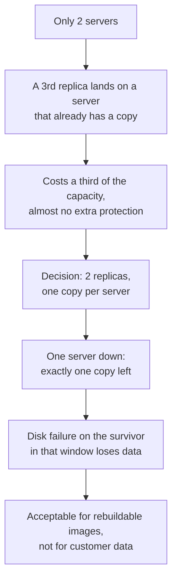
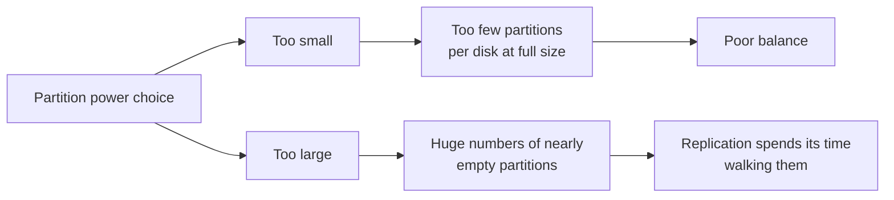
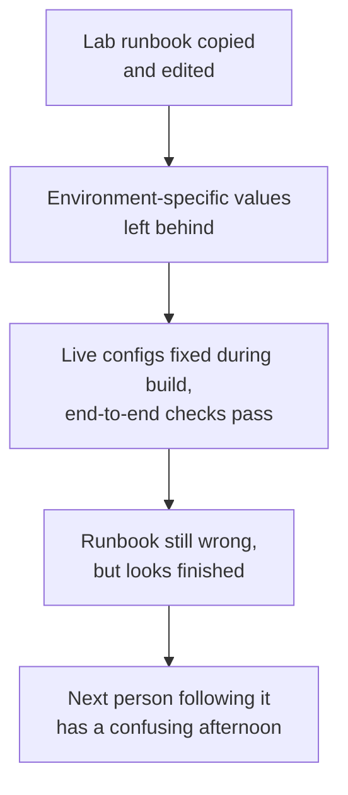
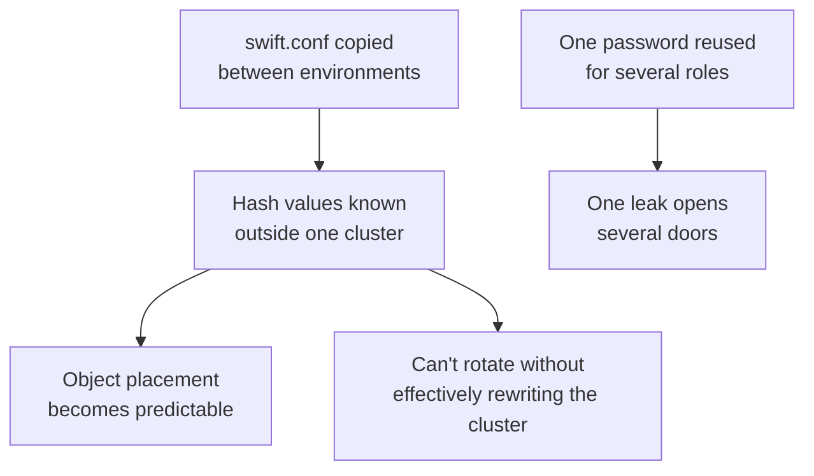
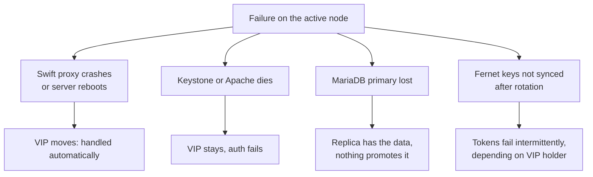

# Swift: Hard Problems and Lessons

The problems that cost me the most time or thought while building and running our Swift clusters. Most are not dramatic. They are the quiet kind that show up a month later if you don't catch them at build time.

> [!TIP]
> **Key takeaways**
> - Match the replica count to the independent failure domains you actually have, and write down what you gave up.
> - Partition power and the `[swift-hash]` values are effectively permanent. Decide them on purpose, before the first object.
> - Runbooks copied between environments carry stale values. Use placeholders and verify the live cluster.
> - A VIP is only as good as its health check. List the failure modes it really detects.
> - Put operator access (`ResellerAdmin`) in the build checklist, and treat that identity as highly privileged.

## At a glance

| # | Challenge | Lesson in one line |
|---|---|---|
| 1 | Durability on two servers | Replicas = independent failure domains, not a default |
| 2 | Partition power | Write the growth assumption next to the ring parameters |
| 3 | Config drift | Placeholders in runbooks, verify the live cluster |
| 4 | Build-time secrets | Generate hash values fresh, once, per cluster |
| 5 | Partial HA | Check which failure modes the health check actually sees |
| 6 | Operator access | `ResellerAdmin` belongs in the build checklist |
| 7 | Environment traps | Proxy variables, ownership, charset, mount by label |

## 1. Durability on a two-server budget

**Context.** An internal platform needed an image store, and we got two physical servers for it.

**Problem.** Swift's normal answer is 3 replicas across separate failure domains. Two servers can't give that. A third replica would land on a server that already holds a copy, so it costs a third of the capacity and adds almost no protection against the failure we worry about most, which is losing a whole server.

**What we tried / considered.**

| Option | Verdict |
|---|---|
| 3 replicas anyway | Rejected: the capacity cost buys little real protection |
| Erasure coding | Rejected: with two hosts EC has nowhere to put its fragments, and it adds CPU cost and complexity |
| 2 replicas with each server as its own failure domain | Chosen |

**What worked.** 2 replicas, all devices in a single region/zone, relying on Swift's "as unique as possible" placement to put the two copies on different servers. Every partition then has one copy per server.

**Lesson.** The replica count should match the number of *independent* failure domains you actually have, not a default. Be explicit about what you've given up: with one server down there is exactly one copy, and a disk failure on the surviving server during that window loses data. That is acceptable for rebuildable images. I wouldn't accept it for customer data.

## 2. Picking a partition power you can live with

**Context.** Partition power is set when the ring is created. It decides how finely data spreads, and changing it later is a separate, careful procedure.

**Problem.** In the lab I used a small value (8) without much thought. When I sized the dev and internal clusters I had to think about where they might grow.

**What worked.** A power of 10 on clusters that start with somewhere between a handful and a dozen-plus disks, with 2 replicas. That puts well over 100 partitions on each disk today. The cost is that the headroom runs out at a few dozen disks.

**Lesson.** Write down the growth assumption next to the ring parameters. If the cluster grows past that assumption, the fix is a partition-power increase, and you want to know that *before* someone adds the 40th disk. Upstream supports increasing partition power, but it involves the relinker running across every disk, so plan for it rather than discover it.

## 3. Config drift from copy-pasted runbooks

**Context.** I built the internal and dev clusters by copying my lab notes and editing them.

**Problem.** Copy-paste doesn't edit itself. Reviewing my own notes later, I found:
- a proxy `authtoken` section that still pointed at the *lab* Keystone address;
- storage `bind_ip` examples left over from a different cluster;
- an `admin.rc` whose `OS_AUTH_URL` didn't match the Keystone it was meant for;
- service-catalog endpoints registered with a region name that differed from the one used at Keystone bootstrap, because the Keystone VM was a clone of an earlier one;
- on one lab build, proxy and storage nodes installed from *different* Swift tags.

The clusters themselves passed end-to-end verification (account created, container listed, object uploaded), so the live configs ended up right. But the runbook was wrong, and the next person to follow it would have had a confusing afternoon.

**What worked.**
- Treating the sample configs of the exact installed tag as the base, and keeping only a small per-cluster diff.
- After building, verifying with `openstack endpoint list`, `swift stat`, and `swift-recon --md5`, not trusting the notes.
- Putting placeholders in runbooks (`<keystone-vip>`, `<node-ip>`), so a missing substitution is obvious.

**Lesson.** A runbook full of real IPs from another environment is worse than one with placeholders, because it looks finished. Template it, or at least make every environment-specific value stand out.

## 4. Treat build-time secrets as permanent

**Context.** A few values matter here:
- Swift: the prefix and suffix in the `[swift-hash]` section of `swift.conf`. They must be identical on every node and must never change.
- Keystone and HA: the service password used by the proxy, the database password, the bootstrap admin password, and the VRRP auth string for keepalived.

**Problem.** Fast lab builds encourage shortcuts: copying a working `swift.conf` from one environment to the next, or reusing one convenient password for several roles. That is harmless in a throwaway lab and a real problem anywhere else — and runbooks written from lab builds tend to carry those habits forward.

**Why that matters.**

- The hash path values decide where every object lives. Anyone who knows them can predict object placement, which is the attack the values exist to prevent. And because they can't be changed without effectively rewriting the cluster, a leak can't be fixed by rotation.
- A shared password means one leak opens several doors.

**What worked / what I do now.**
- Generate fresh hash path values per cluster (`openssl rand -hex 32` or similar), *once*, before the first ring is built, and store them in the secrets store, not the runbook.
- Separate random passwords for DB, service user, admin and VRRP.
- Write runbooks with `<placeholder>` values only.

> [!WARNING]
> For a staging or dev cluster that will be rebuilt anyway, copied hash values are an annoyance. For anything that will hold real data, generate them fresh before the first object is written, because you can't fix them afterwards.

## 5. "HA" that only covers part of the stack

**Context.** Small all-in-one designs put Keystone, MariaDB, a proxy and storage on each of two nodes, with a keepalived VIP floating between them. It is a tempting shape for an internal cluster.

**Problem.** When you walk through the failure modes of that shape, the HA story usually has holes:

- If the keepalived health check watches only the **Swift proxy** process, a dead Keystone or Apache on the active node leaves the VIP in place while auth fails.
- With asynchronous MariaDB primary/replica and Keystone on both nodes pointing at the primary, losing the primary leaves the replica with the data but nothing to promote it.
- Both Keystone nodes need the **same** fernet and credential keys. Forget to sync them after rotation and tokens from one node fail on the other, often only intermittently, depending on which node holds the VIP.

**What worked.** Being explicit about what is covered:
- "One server reboots or a proxy crashes" is handled automatically.
- Losing the primary is a documented manual failover: promote the replica, repoint Keystone, move the VIP.

**Lesson.** List the failure modes and check which ones your HA mechanism actually detects. A VIP is only as good as its health check — make it hit the proxy's `/healthcheck` and Keystone's version endpoint, not just test that a process exists.

## 6. Operator access to customer accounts

**Context.** Support work often means looking *inside* a customer's Swift account: quota, container count, versioning settings, whether an object exists.

**Problem.** After a plain Keystone bootstrap there is no `ResellerAdmin` role. An admin token can create its own account, but can't operate on other projects' accounts. During the internal build, early verification failed until the role existed and was granted.

**What worked.** Creating `ResellerAdmin` as part of the build, granting it to the operator identity, and using the pattern `swift auth`, then `OS_STORAGE_URL=.../AUTH_<project_id>` for support work.

> [!NOTE]
> Put the operator-access step in the build checklist, and treat that operator identity as highly privileged. It can read and write every account in the cluster.

## 7. Little environment traps

A few smaller things that each cost some time:

| Trap | What goes wrong | Do this |
|---|---|---|
| **Egress HTTP proxy variables** | On hosts with `http_proxy`/`https_proxy` set for package downloads, Swift services started from that shell may try to reach Keystone through the egress proxy | Unset them before `swift-init`, or better, don't set them globally |
| **Ownership after mount** | `chown` on `/srv/node` before mounting changes the empty directories, not the filesystems | Do it after `mount -a` |
| **MariaDB charset** | The Keystone install notes I followed switch MariaDB's default from `utf8mb4` to `utf8` before `db_sync`. Older guides do this to avoid index-length problems. | Know that this is a deliberate choice, not an accident |
| **Mount by label, not UUID or `/dev/sdX`** | UUIDs are correct but unreadable in an incident. `/dev/sdX` names move around. | Use a label that encodes the physical slot: both stable and readable |
