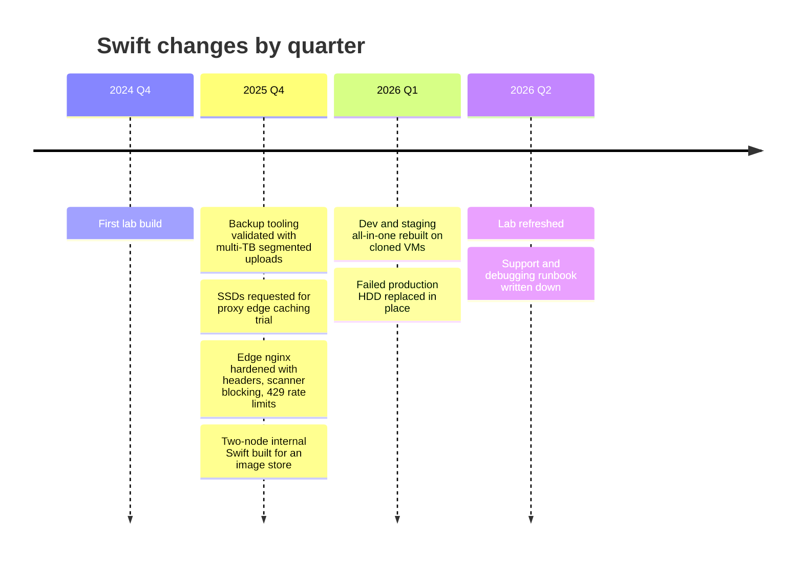

# Swift: Changes Over Time

A timeline of the notable Swift-related changes I was involved in, at quarter granularity. It's short because my Swift work has been occasional, between larger Ceph and platform work.

> [!TIP]
> **Key takeaways**
> - The 2024 Q4 lab build produced the runbook that every later build was copied from, including its mistakes.
> - 2025 Q4 was the busiest quarter: backup uploads validated, the edge hardened, and the two-node internal cluster built.
> - 2026 brought a dev/staging rebuild, an in-place production disk swap with no ring change, and a written support runbook.
> - Recurring gotchas: proxy environment variables, cloned Keystone identity, and missing operator roles.

## Timeline at a glance

| When | Change | Cluster |
|---|---|---|
| 2024 Q4 | First lab build: Keystone + proxy + 2 storage VMs | Lab |
| 2025 Q4 | Backup tooling validated against the Swift API with multi-TB segmented uploads | Production object storage |
| 2025 Q4 | SSDs requested for proxy nodes to trial edge caching | Production object storage |
| 2025 Q4 | Edge nginx hardened: security headers, scanner blocking, rate limits returning 429 | Object storage front end |
| 2025 Q4 | Two-node internal Swift built for an image store | Internal all-in-one |
| 2026 Q1 | Dev/staging all-in-one rebuilt on cloned VMs with new rings | Dev / staging |
| 2026 Q1 | Failed HDD replaced in place on a production storage node | Production object storage |
| 2026 Q2 | Lab refreshed; support/debugging runbook written down | Lab, all |

## 2024 Q4: First lab build

- **What.**
  - One Keystone VM (MariaDB, Apache/mod_wsgi, fernet tokens), one proxy VM, two storage VMs with three small virtual disks each.
  - Swift installed from an upstream git tag.
  - Ring: partition power 8, 2 replicas, single zone.
- **Why.** To learn the install end to end, including Keystone, before touching anything real.
- **Impact.** It produced the runbook that every later build was copied from.
- **Gotchas.**
  - The proxy and storage nodes ended up on different Swift tags.
  - Old sample ports (61xx) were used, while later builds moved to 62xx.

How those two gotchas travelled:

## 2025 Q4: Backup tooling on the Swift API

- **What.** The platform's backup workers were configured with a Swift client profile:
  - Keystone v3 auth;
  - a per-project storage URL pattern `.../v1/AUTH_<project_id>`;
  - segment size of a few GB, and a 5 GiB single-object ceiling.

  As part of setting up a new worker we tested uploading a multi-terabyte file.
- **Why.** Backups produce files far larger than Swift's 5 GiB object limit, so they must go up as segmented large objects.
- **Impact.** It served as the acceptance test for segmented uploads at that size through the production endpoint. A test like this belongs in any acceptance plan for a large-object consumer.
- **Gotchas.** The workers needed explicit `no_proxy` entries for the auth and storage endpoints because they sit behind an egress HTTP proxy. This is the same class of problem as the `http_proxy` trap on Swift hosts.

## 2025 Q4: Edge caching trial and edge hardening

- **What.**
  - We requested SSDs for proxy nodes to test edge caching.
  - We also hardened the nginx front end with HSTS, `nosniff` and frame-deny headers, blocking of common scanner paths and script extensions, per-zone connection limits and request rate limits (429 on reject), and per-method metrics logging.
- **Why.** The hardening came out of a security review. The caching trial was to see whether hot objects could be served without hitting the storage tier.
- **Impact.** The hardening is in place.

> [!NOTE]
> My notes don't record the outcome of the caching trial.

## 2025 Q4: Two-node internal Swift

- **What.**
  - Two 1U servers, each running Keystone, MariaDB (primary/replica), a proxy and account/container/object servers.
  - Each server has a handful of HDDs as single-disk RAID-0 volumes, labelled by physical slot.
  - Ring: partition power 10, 2 replicas. keepalived VIP in front.
  - Node exporter, Zabbix agent and auditbeat for monitoring.
- **Why.** An internal platform needed a native Swift image store with Keystone auth on a two-server budget.
- **Impact.** It works end to end: account auto-create, containers and uploads verified.
- **Gotchas.**
  - `ResellerAdmin` had to be created and granted before the admin identity could manage accounts.
  - Proxy environment variables had to be unset before starting services.
  - The keepalived check only watches the proxy process.
  - Swift-level StatsD metrics are still on the to-do list.

## 2026 Q1: Dev/staging all-in-one rebuilt

- **What.**
  - We cloned the Keystone VM from an earlier one, reset its database, and re-bootstrapped it.
  - Three VMs run proxy and storage, with 2 disks each, mounted by XFS label.
  - The old rings and builders were moved to a backup directory and new rings created (partition power 10, 2 replicas, ports 62xx).
  - A dev user and project were created with operator rights.
- **Why.** Developers needed a Swift endpoint that looks like production but can be broken freely.
- **Gotchas.** Cloning a Keystone VM carries its identity with it:
  - we had to delete the old SQLite stub, recreate the MariaDB database, and fix hostname and `/etc/hosts`;
  - even then, the region name on the service-catalog entries didn't line up with the bootstrap region at first.

> [!WARNING]
> Check `openstack endpoint list` after any clone.

## 2026 Q1: In-place disk replacement in production

- **What.** One HDD on a dense storage node threw unrecoverable read errors. It was unmounted, replaced, recreated as a single-disk RAID-0 volume, formatted with the same label and remounted, all without a ring change.
- **Why.** It's the least disruptive way to replace a like-for-like disk.
- **Impact.** No ring rebalance was needed. The replicator refilled the disk. See [incidents](incidents.md).

## 2026 Q2: Lab refresh and support runbook

- **What.** We rebuilt the lab Keystone against a newer release, and wrote down the support workflow:
  - `swift-recon`;
  - transaction-ID log tracing;
  - operator-token access to customer accounts;
  - `swift-get-nodes`;
  - a status-code-to-cause cheat sheet.
- **Why.** Support questions on the object storage service kept coming back to the same few causes, which were quotas, auth, ACL/policy and large-object versioning. Writing them down saves time for whoever is on call.
