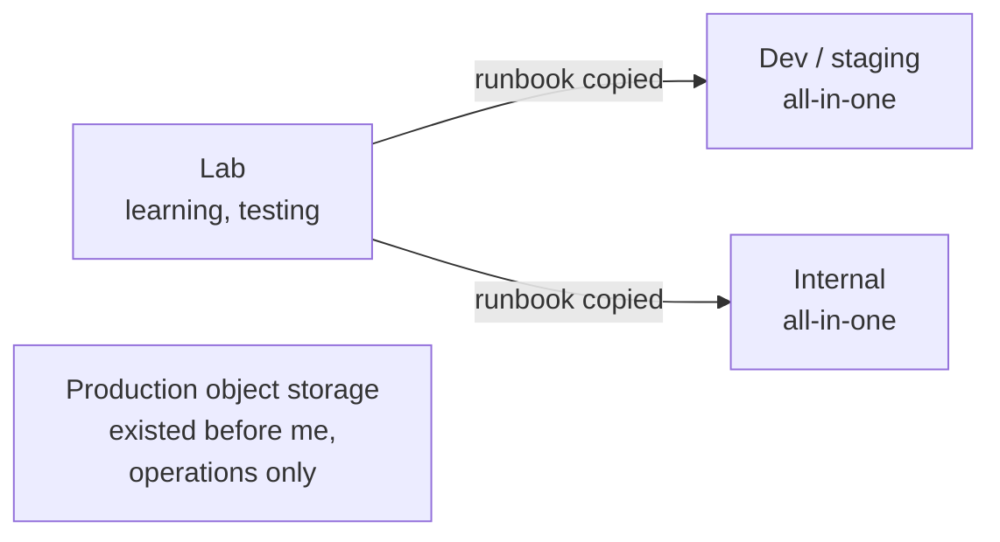
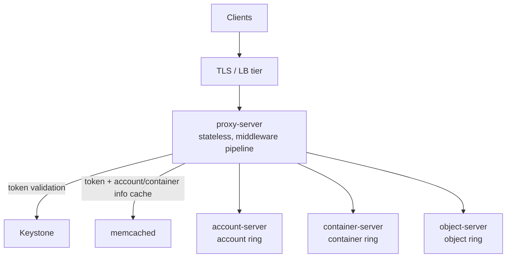
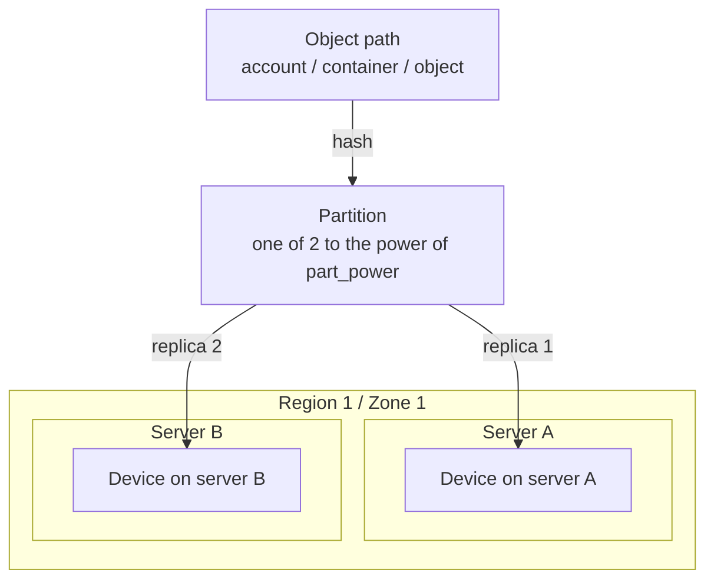
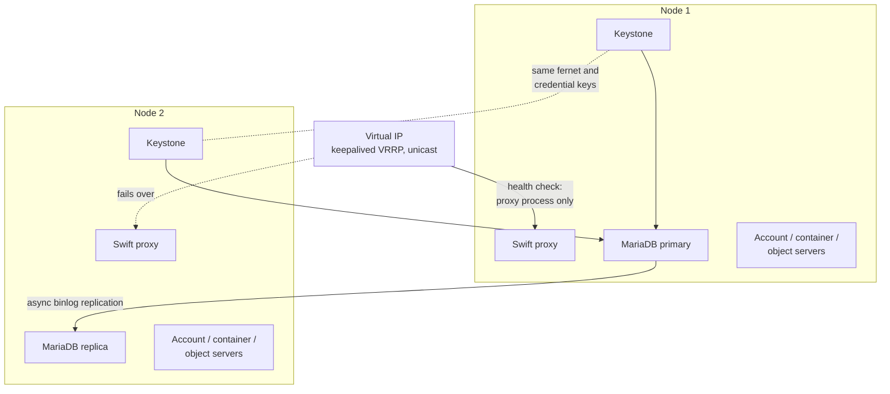

# Swift Design Notes

How the OpenStack Swift clusters I built and looked after are put together, and why they ended up that way. These range from throwaway lab VMs to a small two-node internal cluster and an older, much larger production object store that I mostly touched on the operations side.

> [!TIP]
> **Key takeaways**
> - Small clusters run "all-in-one": every node runs Keystone, proxy and storage services. That is cheap and simple, but tiers can't scale or fail independently.
> - 2 replicas, not 3, because there are only two real failure domains. That is fine for rebuildable images, but not for customer data.
> - Partition power 10 is a deliberate bet that the cluster stays small. There is room for only a few dozen disks.
> - Disks are raw XFS, one RAID-0 per disk, mounted by a label that encodes the physical slot.
> - The two-node "HA" covers a reboot, not every failure. The VIP follows the proxy, and database failover is manual.

## The clusters in scope

I worked with several Swift deployments, and they look quite different from each other. Where a design choice only applies to one of them, I say which.

| Cluster | Purpose | Shape |
|---|---|---|
| Lab | Learning, testing upgrades and config | 1 Keystone VM, 1 proxy VM, 2 storage VMs with a few small virtual disks each |
| Dev / staging "all-in-one" | Development and integration testing for internal teams | 1 Keystone VM, 3 small VMs running proxy plus storage services, 2 data disks each |
| Internal "all-in-one" | Image store for an internal platform | 2 physical 1U servers, each running Keystone, MariaDB, proxy and storage services, with a handful of HDDs per server |
| Production object storage | Customer-facing object storage on the cloud platform | Separate proxy and storage tiers, dense 2U storage servers with many large HDDs each |



> [!NOTE]
> The production cluster was there before I joined. I didn't design it. My work there was day-to-day operations such as disk replacement, proxy middleware changes and support debugging. Everything I describe about building clusters from scratch comes from the lab, dev and internal clusters.

## Tiers

Swift has four logical roles. How they are placed on hosts is the main design decision for a small cluster.



| Tier | What it is | Where it runs |
|---|---|---|
| **Proxy** | Stateless, holds the WSGI middleware pipeline, scales out behind a load balancer | Dedicated nodes in production. Shares hosts with storage on the small clusters. |
| **Account / container** | SQLite databases replicated by Swift | Shares disks with objects on every cluster I built |
| **Object** | The bulk of the data, on plain XFS disks, one mount point per disk under `/srv/node/<device>` | Storage nodes |
| **Background daemons** | Replicators, auditors, updaters, reaper, expirer and sharder. They do the actual work of keeping data consistent, which makes them the part you monitor most. | Storage nodes |

Upstream guidance is to put account and container databases on SSDs once container listings get large. Our small clusters never got near that point, so I didn't split them.

### Why "all-in-one" for the small clusters

For the internal image store we got two servers. That is not enough to split proxy and storage tiers and still have redundancy in both. So each server runs everything: Keystone, a MariaDB instance, a proxy, and account/container/object servers.

| | Trade-off |
|---|---|
| **Pro** | Losing one node leaves a full working stack on the other. There are few moving parts and the hardware cost is low. |
| **Con** | Proxy CPU and storage I/O compete on the same host. One node failure takes away half the proxies *and* half the storage at the same time. There is also no room to grow one tier without the other. |

For an internal image store with modest traffic, that was an acceptable deal.

## Ring design

All clusters use separate account, container and object rings with a single replication storage policy as the default. We named it with a tier-style name; that name is all you see in `swift stat` output.

```ini
# swift.conf (shape only)
[swift-hash]
swift_hash_path_suffix = <random, per cluster, never changes>
swift_hash_path_prefix = <random, per cluster, never changes>

[storage-policy:0]
name = <policy-name>
default = yes
policy_type = replication
```

How a ring places data, in short: each object maps to a partition, and the ring assigns each partition's replicas to devices, spreading them as uniquely as possible.



### Partition power, replicas, min_part_hours

| Cluster | Partition power | Replicas | min_part_hours | Devices |
|---|---|---|---|---|
| Lab | 8 | 2 | 1 | a handful of tiny virtual disks |
| Dev / staging | 10 | 2 | 1 | a handful of virtual disks |
| Internal all-in-one | 10 | 2 | 1 | around a dozen-plus HDDs |

```bash
swift-ring-builder object.builder create <part_power> <replicas> <min_part_hours>
```

Why these values:

- **Partition power.**
  - The general upstream rule is to aim for at least about 100 partitions per disk at the *largest* size you expect the cluster to reach.
  - A power of 10 gives 1024 partitions. With 2 replicas over around a dozen-plus disks, that is still comfortably above 100 per disk, so it fits the internal cluster as built.
  - The catch is that it leaves room for only a few dozen disks before partitions get too coarse. That was a deliberate bet that this cluster stays small.
  - Swift can raise partition power after the fact (`prepare_increase_partition_power` plus the relinker), but that is a procedure I would rather not need.
  - I picked 8 for the lab because nothing there matters.
- **2 replicas instead of the usual 3.** This is the biggest trade-off.
  - With only two storage hosts, a third replica can't land on a third failure domain anyway. Swift would just put two copies on the same server.
  - So we kept 2 replicas and accepted that losing one node leaves exactly one copy until it comes back.
  - That is fine for an internal image store whose source images can be rebuilt. I would not do it for customer data.
- **min_part_hours = 1.** This is low because these are small clusters where I am the only operator, and I want quick iterations when adding devices. On a large cluster you want this higher, so that two rebalances in a row can't move more than one replica of the same partition while replication is still catching up.

### Regions and zones

Every device in our small clusters is `r1z1`, so there is one region and one zone:

```bash
swift-ring-builder object.builder add r1z1-<storage-ip>:6200/<device-label> <weight>
```

With only two or three hosts, separate zones per host would add nothing. Swift's placement already tries to be "as unique as possible" across region, zone, server and device, in that order. With all devices in one zone it spreads replicas across servers, and that is the failure domain we actually have. If these clusters grow to racks or rooms, zones are the knob to use.

### Weights

Weights are set roughly to disk capacity, for example a weight in the hundreds for disks in the high-hundreds-of-GB range, so that a bigger disk gets proportionally more partitions. In the lab I used a flat weight of 100 because all disks were identical. The rule I follow is to use one unit consistently across a cluster, so that adding a different-sized disk later is a simple calculation.

### Ports

| | Object | Container | Account |
|---|---|---|---|
| Lab (old sample ports) | 6100 | 6101 | 6102 |
| Later builds (current upstream defaults) | 6200 | 6201 | 6202 |

> [!WARNING]
> Whatever ports you choose, the ring entries and each server's `bind_port` must match. Getting that wrong is an easy mistake when you copy notes between environments.

## Disk layout

Every data disk is exposed to the OS as its own block device, partitioned GPT, formatted XFS, and mounted by **label** under `/srv/node/<label>`:

```bash
parted -s /dev/<dev> mklabel gpt mkpart primary xfs 0% 100%
mkfs.xfs -f -L <label> /dev/<dev>1
```

```text
# /etc/fstab
LABEL=<label>  /srv/node/<label>  xfs  noatime,nodiratime,logbufs=8  0 2
```

Design points:

- **No RAID redundancy under Swift.** The servers have hardware RAID controllers. We still create one single-disk RAID-0 logical drive per physical disk, because the controller won't pass disks through otherwise. Swift does the redundancy, and a RAID set underneath would only waste capacity and hide failures.
- **Label = physical slot.**
  - On the physical clusters the XFS label, mount point and ring device name all encode the controller/enclosure/bay of the physical disk, for example `<ctrl>.<encl>.<slot>`.
  - When the kernel reports an error on `/dev/sdX`, I can go from block device to mount point to physical slot without a lookup table.
  - This also survives `/dev/sdX` renumbering across reboots, which is the main reason to mount by label and not by device name.
  - In the lab I mounted by filesystem UUID at first and switched to labels later because UUIDs are unreadable in an incident.
- **Mount options.** `noatime,nodiratime` avoids pointless metadata writes. `logbufs=8` is an old XFS tuning recommendation carried over from upstream guides.
- **OS on separate disks.** The OS lives on its own disk. On the dev hardware request this meant a pair of small SSDs for OS and separate SSDs for data.

## Authentication: Keystone

All clusters authenticate through Keystone (Identity v3, fernet tokens, MariaDB backend). The proxy pipeline is close to the upstream sample:

```ini
[pipeline:main]
pipeline = catch_errors gatekeeper healthcheck proxy-logging cache listing_formats
           container_sync bulk tempurl ratelimit authtoken keystoneauth copy
           container-quotas account-quotas slo dlo versioned_writes symlink
           proxy-logging proxy-server

[app:proxy-server]
allow_account_management = true
account_autocreate = true

[filter:authtoken]
paste.filter_factory = keystonemiddleware.auth_token:filter_factory
www_authenticate_uri = http://<keystone-vip>:5000
auth_url = http://<keystone-vip>:5000
auth_type = password          # older notes used the deprecated auth_plugin
project_domain_id = default
user_domain_id = default
project_name = service
username = swift
password = <secret>
delay_auth_decision = True

[filter:keystoneauth]
use = egg:swift#keystoneauth
```

Why this shape:

- **Endpoint per project.** The object-store endpoint is `.../v1/AUTH_%(project_id)s`, so every Keystone project maps to one Swift account. `account_autocreate` means the account appears on first use, with no separate provisioning step.
- **`delay_auth_decision = True`** lets `tempurl` and container ACLs work for requests without a Keystone token.
- **ResellerAdmin.** Operators get a `ResellerAdmin` role. That lets an admin token act on *other* projects' accounts, which is what you need for support work like reading a customer's quota or listing their containers. We create this role explicitly because it doesn't exist after a plain Keystone bootstrap.
- **Middleware chosen for the API surface users expect.** We include `slo`/`dlo` for large objects, `versioned_writes`, `tempurl`, `bulk`, quotas and `symlink`. One consumer, a backup tool, uploads files of several TB as segments of a few GB each. Swift's single-object limit is 5 GiB, so segmented large objects are mandatory, not optional.

### Keystone high availability on two nodes

On the two-node internal cluster:

- MariaDB runs as asynchronous primary/replica (binlog replication). Keystone on both nodes points at the primary.
- Both Keystone nodes must share the same fernet and credential keys, or a token issued on one node fails validation on the other.
- keepalived (VRRP, unicast peers, since the network didn't want multicast) floats a virtual IP between the two nodes. The health check is a simple process check on the Swift proxy.



> [!WARNING]
> This is a pragmatic setup, not real HA. The VIP follows the proxy process, not Keystone or the database. Promoting the replica if the primary dies is a manual step. It covers the "one server rebooted" case well, but not every failure mode.

## Load balancing and TLS

| | Small clusters | Production |
|---|---|---|
| Front end | keepalived VIP in front of the proxies | An nginx tier terminates TLS in front of the object storage API |
| Transport | Plain HTTP on an internal network | TLS |
| Extras | — | Standard security headers (HSTS, `nosniff`, frame denial), blocking of obvious scanner paths, per-zone connection and request rate limits |

- **Small clusters.** The Keystone service catalog is first registered against a node address and then repointed at the VIP. That "update the endpoint later" step is easy to forget.
- **Production.** Rate-limited requests get **429**. The config ties that choice to the code our Swift-side middleware uses for rate limiting, so clients have one "slow down" signal to handle, not two. If you copy this pattern, check what your own proxy pipeline returns: upstream Swift's `ratelimit` middleware has historically used its own non-standard status code.

## Where Swift sits next to other storage

The cloud platform also runs Ceph for block storage and for S3/Swift-compatible object storage through RGW. Swift in this environment is:

- the **native** OpenStack object store for workloads that already speak the Swift API with Keystone auth (internal image storage, backup tooling with a Swift client config);
- a simpler choice than Ceph for small, self-contained deployments: no MONs, no OSD/PG tuning, just Python services on XFS disks;
- something that lives on the **same front-end patterns** (nginx TLS + rate limiting, Keystone-style auth) as the Ceph-backed object storage. To clients the API looks the same either way.

The honest trade-off: running two object storage technologies means two sets of runbooks, two sets of failure modes, and more for the on-call engineer to remember. For the small internal clusters, Swift's operational simplicity was worth it.
