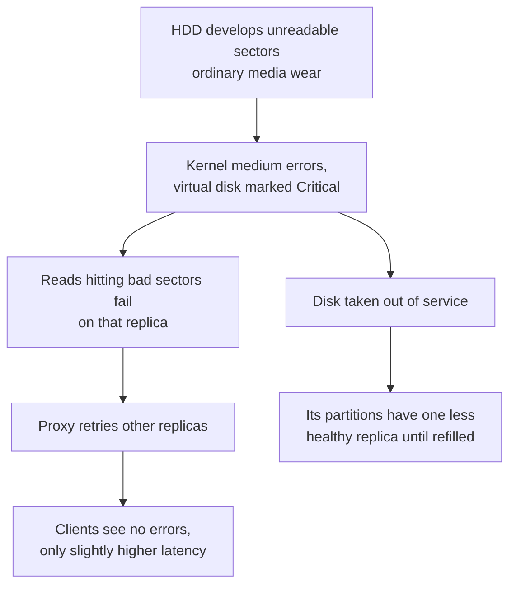
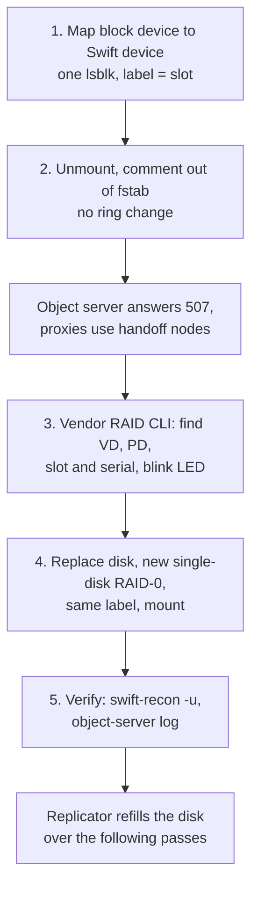
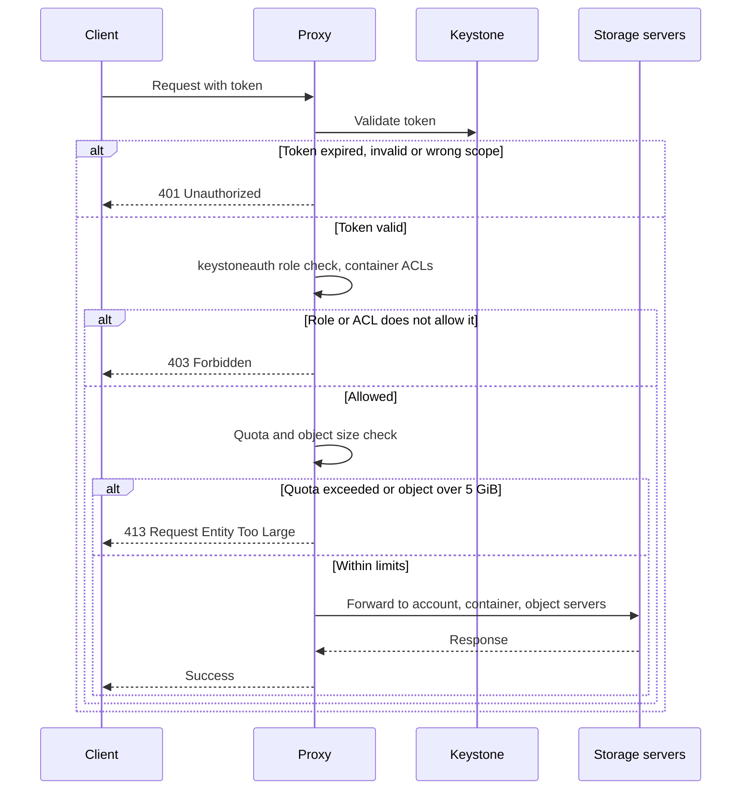
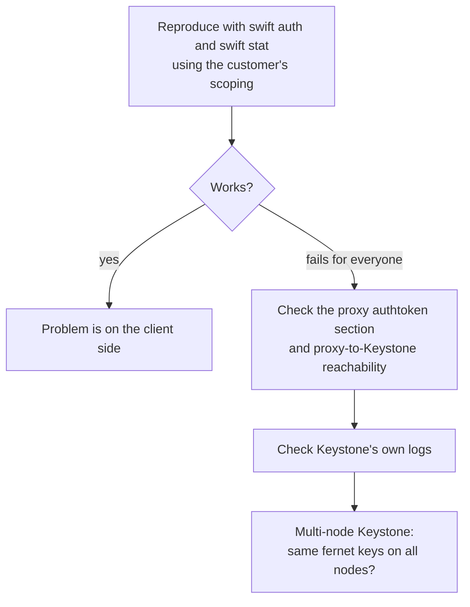

# Swift Incidents

Problems we actually hit on Swift, written up postmortem-style. There's one real hardware incident and a set of recurring support issues that show up often enough to deserve a combined write-up. Log lines are trimmed, and device names, addresses and identifiers are replaced with placeholders.

> [!TIP]
> **Key takeaways**
> - A failing HDD showed up as a "Critical" RAID virtual disk while the physical disk still said "OK". Alert on both, and on kernel medium errors.
> - A like-for-like disk was replaced in place, with no ring change. Mounting by a slot-encoding label made finding it one `lsblk`.
> - The recurring support issues map cleanly to status codes: 413 for quota or 5 GiB, 401 for authentication, 403 for authorization.
> - Versioning combined with bulk or segmented uploads is a recurring source of partial failures. Follow the transaction ID.

## Incident 1: Unrecoverable read errors on a production storage HDD (2026 Q1)

### Symptoms

The kernel log on one dense storage node in the production object storage cluster started showing medium errors on a single disk:

```text
[<ts>] <raid-driver>: FATAL - Uncorrectable medium error logged for VD <n> (on PD <slot>)
[<ts>] sd <h:c:t:l>: [sdX] FAILED Result: hostbyte=DID_OK driverbyte=DRIVER_SENSE
[<ts>] sd <h:c:t:l>: [sdX] Sense Key : Medium Error [current]
[<ts>] sd <h:c:t:l>: [sdX] Add. Sense: Unrecovered read error
[<ts>] blk_update_request: critical medium error, dev sdX, sector <N> op 0x0:(READ)
```

The RAID controller's own view agreed, with one twist:

| Layer | State reported |
|---|---|
| Single-disk RAID-0 virtual disk | **Critical**, **bad blocks: yes** |
| Physical disk underneath | *Online / OK / failure predicted: no* |

### Failure chain and impact



Qualitatively small. This is one disk out of many, in a cluster where every object has replicas on other servers:
- Reads that hit bad sectors on this disk failed on that replica. Swift's proxy retries other replicas, so clients shouldn't see errors, only slightly higher latency on the affected requests.
- While the disk was out, its partitions had one less healthy replica until the replicator refilled the replacement.

### Root cause

A physical HDD developing unreadable sectors. This is ordinary media wear on a large-capacity spinning disk, not a Swift problem.

### Fix



1. **Map the block device to the Swift device.** Because we mount by a label that encodes the physical slot, one command gives both the Swift device name and the physical location:
   ```bash
   lsblk | grep sdX
   # sdX1 ... /srv/node/<ctrl>.<encl>.<slot>
   ```
2. **Take it out of service** without touching the ring:
   ```bash
   umount /srv/node/<label>
   # comment out its line in /etc/fstab so a reboot doesn't remount a bad disk
   ```
   With `mount_check = true`, the object server now answers 507 for that device and the proxies use handoff nodes for new writes.
3. **Identify the physical drive** with the vendor RAID CLI:
   - find the virtual disk that maps to `/dev/sdX`, then its member physical disk, then its slot and serial for the data-centre ticket;
   - delete the failed virtual disk and **blink the slot LED** so the on-site engineer pulls the right drive.
4. **Replace and rebuild the device:**
   ```bash
   # vendor RAID CLI: create a single-disk RAID-0 VD on the new physical disk
   # then partition, mkfs.xfs with the SAME label, restore fstab, mount
   ./mkdevice /dev/sdY <label>      # our helper script wrapping the steps above
   ```
5. **Verify:**
   ```bash
   swift-recon -u                                         # no unexpected unmounted drives
   tail -f /var/log/swift/object-server.log | grep <label>  # normal traffic, no errors
   ```
   The replicator then repopulated the disk over the following passes.

### Prevention / what we'd improve

> [!WARNING]
> **Alert on kernel medium errors and RAID virtual-disk state,** not only on SMART "failure predicted". In this case the physical disk said "OK" while the virtual disk said "Critical". Watching only the physical disk would have missed it.

- **Watch quarantines per device.** A rising quarantine count from `swift-recon -q` or the auditor logs is often the first Swift-level sign of a dying disk.
- **Keep the label = slot convention.** It turned a potentially fiddly mapping exercise into one `lsblk`.
- **In-place replacement vs. ring removal.**

  | Replacement timing | Approach |
  |---|---|
  | Like-for-like, within days | No ring change needed |
  | Will take weeks | Set the device's weight to 0 and rebalance, so the cluster isn't running with reduced redundancy for that long |

## Recurring support issues

| Issue | Status | Usually means | Scope |
|---|---|---|---|
| A | 413 | Quota hit, or a single object over 5 GiB without segmentation | One customer or project |
| B | 401 | Expired/invalid token, wrong credentials or scope, rarely proxy-to-Keystone validation | One client, or *all* clients if Keystone-side |
| C | 403 | ACLs, platform IAM policy, or role mapping | Specific containers or operations |
| D | partial failures | Versioning settings clash with bulk or segmented uploads | Bulk / large uploads |

Where in the request each of the first three gets rejected:



> [!NOTE]
> The platform's IAM policies on top of Swift can also produce 403. They sit outside this simplified picture.

### Recurring issue A: 413 Request Entity Too Large

- **Symptoms.** Uploads fail with HTTP 413.
- **Impact.** A single customer or project can't write. Nothing else is affected.
- **Root cause.** Almost always one of two things:
  - The account or container hit its **quota** (the `account-quotas` / `container-quotas` middleware).
  - A **single object larger than 5 GiB** sent without segmentation.
- **Fix.**
  ```bash
  # with an operator token and OS_STORAGE_URL pointing at AUTH_<project_id>
  swift stat                 # look at quota headers vs bytes used
  swift stat <container>
  ```
  Either the quota is raised through the normal process, or the client is told to use segmented uploads (`swift upload --segment-size <bytes> ...` or the SDK's large-object support).
- **Prevention.** Make quota usage visible to customers before they hit it, and document the 5 GiB limit and segmentation clearly.

### Recurring issue B: 401 Unauthorized

- **Symptoms.** Every request from a client fails with 401, even with credentials that "worked yesterday".
- **Root cause**, in order of frequency:
  1. An expired or invalid token cached by the client.
  2. Wrong credentials or project scope.
  3. Rarely, the proxy can't validate tokens against Keystone. That shows up across *all* clients at once.
- **Fix.** Reproduce with `swift auth` and `swift stat` using the customer's scoping. If that works, the problem is on the client side. If it fails for everyone, check the proxy's `authtoken` section and whether the proxy can reach Keystone. Then check Keystone's own logs, and on multi-node Keystone, whether all nodes have the same fernet keys.
- **Prevention.** Monitor a synthetic `swift auth` + `swift stat` from outside the cluster, so a Keystone-side problem shows up before customers report it.



### Recurring issue C: 403 Forbidden

- **Symptoms.** Authenticated requests are refused on specific containers or operations.
- **Root cause.** Authorization, not authentication:
  - container read/write ACLs;
  - the cloud platform's IAM policies on top of Swift;
  - the user's role not being one of `keystoneauth`'s operator roles for that project.
- **Fix.** `swift stat <container>` shows the Read/Write ACL. Then check the user's role assignments and the platform-level policy.
- **Prevention.** Most 403s are working-as-designed, so the main fix is clearer documentation for customers on how ACLs and roles interact.

### Recurring issue D: Bulk upload/download failures with versioning

- **Symptoms.** Bulk operations or large uploads fail partway through, or produce unexpected object versions.
- **Root cause.** Usually tied to **object versioning** on the container. The versions container or its settings don't match what the client expects, and interacting with segmented objects makes it worse.
- **Fix.**
  ```bash
  swift stat <container>         # versioning headers / versions location
  swift list <versions-container>
  grep <tx-id> /var/log/swift/proxy.log
  ```
  Follow the transaction ID from the proxy log to the backend servers it touched, to see which sub-request actually failed.
- **Prevention.** For containers used by bulk or large-object clients, settle the versioning mode up front and test it with the client before production use.

## General diagnostic sequence

This is what I run first, whatever the complaint:

```bash
swift-recon --all                             # cluster-wide health snapshot
swift-recon -u                                # any unmounted drives?
grep -i error /var/log/swift/proxy.log | tail # find a failing transaction ID
grep <tx-id> /var/log/swift/*.log             # follow it through each node
swift-get-nodes /etc/swift/object.ring.gz AUTH_<project_id> <container> <object>
```

System logs (`/var/log/syslog`, `/var/log/kern.log`) are the next stop when the Swift logs point at a specific device or node. Kernel I/O errors almost always show up there before Swift notices.
