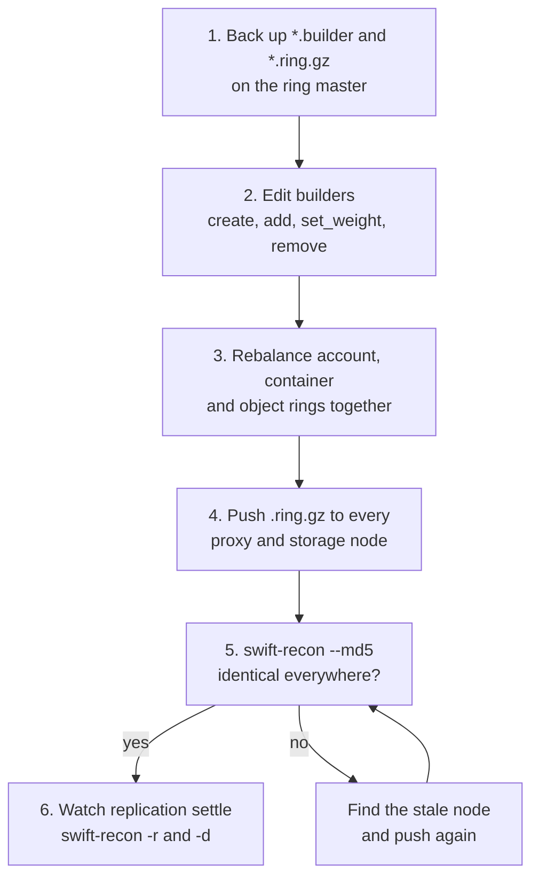
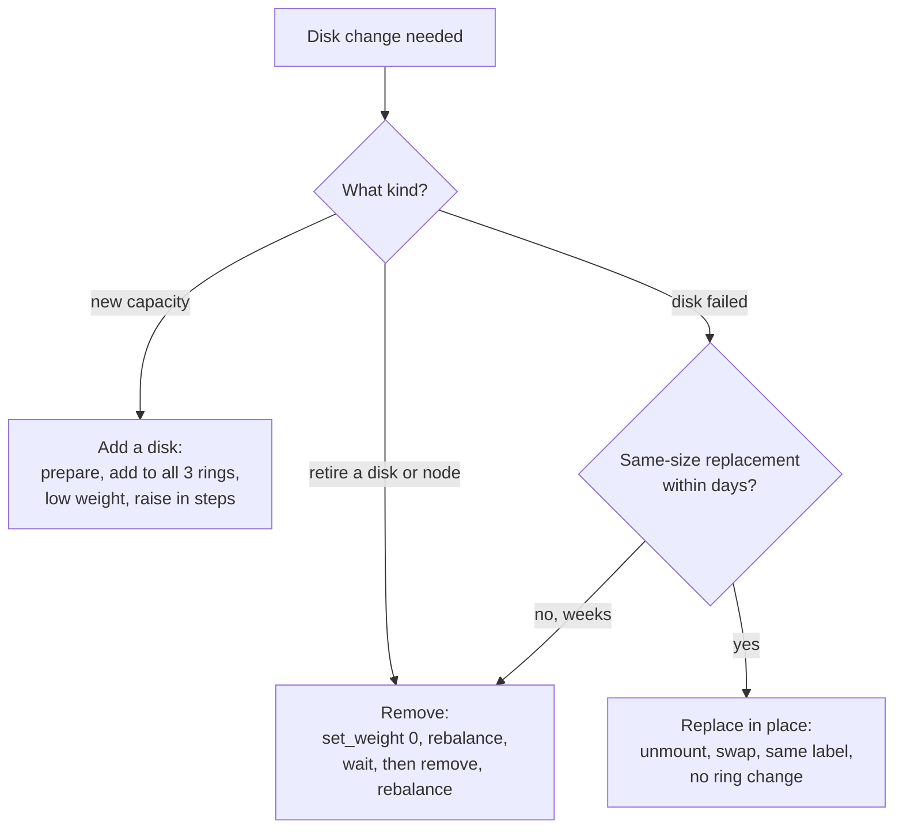
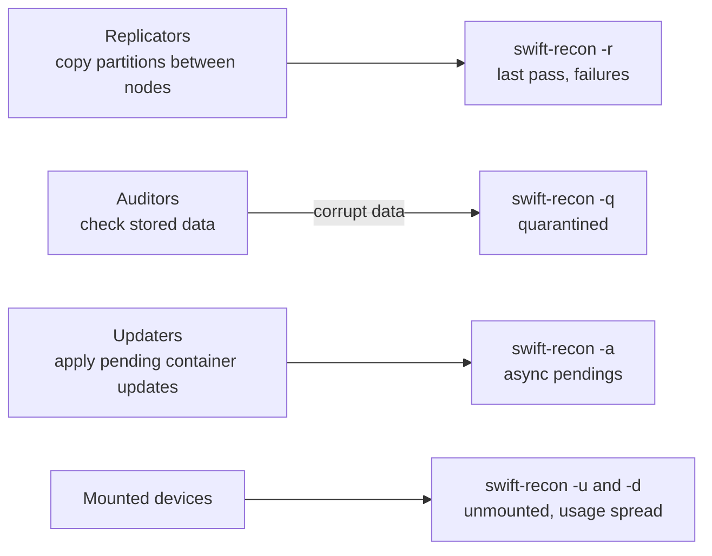
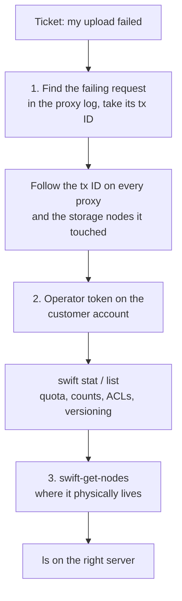

# Operating Swift

The procedures and commands I actually use to build, change and debug our Swift clusters, plus the checks I run before and after each change. Where I add general upstream best practice that our notes don't show us doing, I say so.

> [!TIP]
> **Key takeaways**
> - Install from one pinned upstream tag on every node, and start from that tag's sample configs.
> - Rings are built on one "ring master". Back up the `.builder` files, push only `.ring.gz`, and verify with `swift-recon --md5`.
> - Drain disks with weight 0 before removing them. Replace a like-for-like failed disk in place, with no ring change.
> - `swift-recon` is the main health tool. Swift-level dashboards (StatsD) are still a gap.
> - For support tickets: transaction ID in the proxy log, then an operator token, then `swift-get-nodes`.

## Installing (how we do it)

We install Swift **from a pinned upstream git tag** with pip and setuptools, not from distro packages, so every environment gets the exact release we tested:

```bash
apt install -y build-essential libssl-dev libffi-dev libsqlite3-dev zlib1g-dev \
  liberasurecode-dev liberasurecode1 attr xfsprogs memcached rsync rsyslog \
  python3-pip python3-swiftclient python3-keystoneclient

cd /opt
git clone -b <swift-tag> https://github.com/openstack/swift.git
cd swift
pip3 install -r requirements.txt
pip3 install keystonemiddleware
python3 setup.py install

mkdir -p /etc/swift /var/log/swift
cp /opt/swift/etc/* /etc/swift/      # start from the sample configs of the same tag
```

Notes from doing this several times:

- **Python version.** On the first lab build the distro Python was the wrong version for what I wanted, so I built a separate interpreter with `make altinstall`. On later builds the distro Python 3.10 was fine, and that is much less to maintain.
- **Same-tag sample configs.** Starting from `etc/*` of the **same tag** matters. Sample configs change between releases, including default ports and new options.
- **Egress proxy variables.** If the host has an HTTP proxy configured for egress, `unset http_proxy https_proxy` before `swift-init all start`. Otherwise internal calls (proxy to Keystone, for example) may try to go through the egress proxy.

> [!WARNING]
> Create the `swift` user and `chown -R swift:swift /srv/node` *after* mounting the disks. Otherwise you only change the ownership of the empty mount-point directories.

### Logging

Every daemon logs through syslog. rsyslog splits the log per program, so each daemon gets its own file:

```text
# /etc/rsyslog.d/10-swift.conf (storage node, abbreviated)
if $programname == 'account-server'     then /var/log/swift/account-server.log
if $programname == 'container-server'   then /var/log/swift/container-server.log
if $programname == 'object-server'      then /var/log/swift/object-server.log
if $programname == 'object-replicator'  then /var/log/swift/object-replicator.log
if $programname == 'object-auditor'     then /var/log/swift/object-auditor.log
if $programname == 'object-updater'     then /var/log/swift/object-updater.log
if $programname == 'container-sharder'  then /var/log/swift/container-sharder.log
# ... one line per daemon ...
local0.* stop
```

- On proxies we add a custom template that keeps severity and facility in each line, so you can grep proxy logs by level.
- The `local0.* stop` at the end keeps Swift noise out of the main syslog.

## Ring management

The rings are built on one host, the "ring master", and the `.builder` files stay there. Only the `.ring.gz` files are copied to every proxy and storage node.



### Creating rings

```bash
cd /etc/swift
# keep the previous rings before touching anything
mkdir -p /opt/ring-backup/$(date +%F)
cp *.builder *.ring.gz /opt/ring-backup/$(date +%F)/ 2>/dev/null

for r in account container object; do
  swift-ring-builder $r.builder create <part_power> <replicas> <min_part_hours>
done

swift-ring-builder account.builder   add r1z1-<node-ip>:6202/<label> <weight>
swift-ring-builder container.builder add r1z1-<node-ip>:6201/<label> <weight>
swift-ring-builder object.builder    add r1z1-<node-ip>:6200/<label> <weight>
# ...repeat for every device on every node...

for r in account container object; do swift-ring-builder $r.builder rebalance; done
```

Then distribute:

```bash
for h in <proxy-and-storage-hosts>; do
  scp /etc/swift/*.ring.gz $h:/etc/swift/
done
```

Every node must run the **same** ring files. A node with a stale ring sends data to the wrong place, and replication then spends hours moving it back. After pushing, I compare checksums across nodes (see `swift-recon --md5` below).

### The `.builder` file is the real asset

> [!WARNING]
> The ring files can be rebuilt from the builder, but the builder can't be fully recovered from the ring files. Losing it means guessing at device IDs and history. We back it up before every change. As general practice, keep it in version control or at least in two places.

### Rebalancing in practice

```bash
swift-ring-builder object.builder                 # show devices, weights, balance
swift-ring-builder object.builder rebalance
swift-ring-builder object.builder dispersion -v   # check replica spread (general tip)
```

- Rebalance account, container and object rings in the same change window, so they stay consistent.
- `min_part_hours` blocks moving the same partition twice within that window. On our small clusters it is 1. On a bigger cluster I would raise it and wait for replication to settle between rebalances.
- If `rebalance` reports that balance didn't improve enough, it's usually because a weight change is too big or the zone layout can't accommodate it. Fix weights rather than forcing it.

## Adding and removing capacity

Which procedure to use:



### Adding a disk to an existing node

1. **Prepare the disk.** Create the logical drive on the RAID controller as single-disk RAID-0, then partition, format and label it:
   ```bash
   parted -s /dev/<dev> mklabel gpt mkpart primary xfs 0% 100%
   mkfs.xfs -f -L <label> /dev/<dev>1
   echo 'LABEL=<label> /srv/node/<label> xfs noatime,nodiratime,logbufs=8 0 2' >> /etc/fstab
   mkdir -p /srv/node/<label> && mount /srv/node/<label>
   chown swift:swift /srv/node/<label>
   ```
   On the production cluster all of this is wrapped in a helper script that takes a block device and a label, so there is less to get wrong at 2 a.m.
2. **Add to the rings.** Add the device to all three rings. For more than a trivial amount of capacity, the general practice is to start at a low weight and raise it in steps, so replication traffic doesn't swamp the cluster.
3. **Roll out.** Rebalance, push the rings, watch replication.

### Removing a disk or node

General procedure (upstream practice, and the one I follow):

```bash
swift-ring-builder object.builder set_weight <search> 0   # drain first
swift-ring-builder object.builder rebalance
# push rings; wait for replication to move data off
swift-ring-builder object.builder remove <search>
swift-ring-builder object.builder rebalance
```

| Approach | What happens |
|---|---|
| Weight 0 first, then remove | Replication moves partitions off gradually |
| Remove right away | Its partitions get rebuilt from the remaining replicas, which hurts more when you only have 2 replicas |

### Replacing a failed disk without touching the ring

For a single failed disk that will be replaced with one of the same size, we **don't** change the ring at all:

1. Unmount the failed device and comment it out of `fstab`. With `mount_check = true` (the default), the object server then returns 507 for that device and the proxy uses handoff nodes.
2. Replace the physical disk and recreate the single-disk RAID-0 volume.
3. Format it with the **same label** and mount it at the same path.
4. The replicator refills it from the other replicas.

This avoids two rebalances, one to take the disk out and one to put it back. It's fine as long as the replacement happens within days, not weeks. See the incidents page for a real run of this procedure.

## Health: replication, auditors, updaters

The background daemons do the consistency work, and each one surfaces as a `swift-recon` signal:



`swift-recon` (run from a proxy or the ring master) is the main health tool:

```bash
swift-recon --all            # everything below in one go
swift-recon -r               # replication: last completion time, failures
swift-recon -u               # unmounted drives
swift-recon -d               # disk usage per device (fullness spread)
swift-recon -a               # async pendings (container updates not yet applied)
swift-recon -q               # quarantined objects/containers/accounts
swift-recon -l               # load average
swift-recon --md5            # ring and swift.conf checksums identical everywhere?
```

What I watch in the output:

| Signal | Why it matters |
|---|---|
| Unmounted drives (`-u`) | First thing after any disk work. Should be zero, or exactly the disks you know about. |
| Replication time / last pass (`-r`) | A pass that keeps getting longer or stops completing means a node is down, a disk is slow, or rsync is blocked. |
| Async pendings (`-a`) | A growing count means container servers can't keep up or are unreachable, so listings lag behind reality. |
| Quarantined (`-q`) | The auditor found corrupt data. A sudden jump on one disk is an early sign that the disk is dying. |
| Disk usage spread (`-d`) | A disk much fuller than its peers suggests a weight error or a missed rebalance. |
| Ring md5 (`--md5`) | Any mismatch means someone forgot to push a ring. |

`swift-dispersion-report` (configured through `dispersion.conf`) is the end-to-end check that sample objects actually have all their replicas. It's in the sample configs we copy. As general guidance it's worth running regularly on any cluster you care about.

## Debugging a user request

Our support workflow for "my upload failed" style tickets:



```bash
# 1. find the failing request in the proxy log and take its transaction ID
grep -i error /var/log/swift/proxy.log | tail
grep <tx-id> /var/log/swift/proxy.log          # on every proxy
grep <tx-id> /var/log/swift/*.log              # on the storage nodes it touched

# 2. act on the customer's account with an operator (ResellerAdmin) token
source ~/admin.rc
swift auth                                      # prints token and storage URL
export OS_AUTH_TOKEN=<token>
export OS_STORAGE_URL=<proxy-endpoint>/v1/AUTH_<project_id>
swift stat                                      # quota, container/object counts, bytes
swift list
swift stat <container>                          # ACLs, versioning, policy
swift stat <container> <object>

# 3. find where something physically lives
swift-get-nodes /etc/swift/account.ring.gz   AUTH_<project_id>
swift-get-nodes /etc/swift/container.ring.gz AUTH_<project_id> <container>
swift-get-nodes /etc/swift/object.ring.gz    AUTH_<project_id> <container> <object>
```

`swift-get-nodes` prints the primary and handoff nodes and the exact on-disk path, which turns "is this object really there?" into an `ls` on the right server.

Quick map of status codes to first suspects:

| Status | First thing to check |
|---|---|
| 401 | Token expired or invalid, wrong credentials, Keystone reachability from the proxy |
| 403 | Container ACLs, the platform's IAM/portal policies, the role mapping in `keystoneauth` |
| 413 | Account or container quota exceeded, or a single object over 5 GiB that should be segmented |
| 429 | Edge rate limiting |
| 507 (in backend logs) | Unmounted or full device |

## Monitoring

What we have on the storage nodes today, and what's still missing:

| | What | Status |
|---|---|---|
| Host metrics | Node exporter, scraped by a central Prometheus, shown on the shared system-utilisation Grafana dashboards | In place |
| Host checks and security | A Zabbix agent for classic host checks, and auditbeat for security auditing | In place |
| Swift-specific | Per-daemon log files (above) | In place |
| Swift metrics | Swift's own **StatsD** metrics (`log_statsd_host` in each server config) flowing through Telegraf into Prometheus and Grafana | Planned, not finished |

> [!NOTE]
> Until StatsD is done, Swift-level signals (replication, async pendings, quarantines, 5xx rate) come from `swift-recon` and the logs, not from dashboards. That's a real gap.

## Upgrades

We have no formal upgrade history in the notes. The approach I use and would recommend:

- **One tag everywhere.** Pin one Swift tag per cluster and use it on **every** node. On one lab build the proxy and storage nodes ended up on different tags. That's supported within limits, but it confuses debugging.
- **Rolling order.** Upgrade storage nodes first and proxies last, one node at a time, with `swift-recon` clean between nodes. Swift's internal APIs are designed for this rolling order.
- **Config diff.** Re-diff your configs against the new tag's `etc/*.conf-sample` and read the release notes for changed defaults before restarting.
- **Keystone separately.** Keystone is upgraded separately and is a bigger deal: `keystone-manage db_sync`, with the database backed up first.

## Checklists

**Before any ring change**
- [ ] Back up `*.builder` and `*.ring.gz`
- [ ] `swift-recon -r -u` clean, with no replication backlog
- [ ] Change applied to account, container *and* object builders as needed
- [ ] Weights in the cluster's usual unit

**After any ring change**
- [ ] Rings pushed to every proxy and storage node
- [ ] `swift-recon --md5` shows no mismatch
- [ ] Replication completes within the usual time over the next passes
- [ ] Disk usage spread (`-d`) converging

**After disk work**
- [ ] `swift-recon -u` shows no unexpected unmounted drives
- [ ] `fstab` entry present and by label
- [ ] Ownership `swift:swift` on the mount point
- [ ] Object server log for that device shows normal traffic, no errors

**New cluster**
- [ ] Fresh random `[swift-hash]` prefix/suffix values, generated once and kept secret
- [ ] Identical `swift.conf` on every node
- [ ] Service-catalog endpoints pointing at the VIP or load balancer, not a single node
- [ ] Operator role (`ResellerAdmin`) created and assigned
- [ ] Logging, node exporter and recon working before handing over
